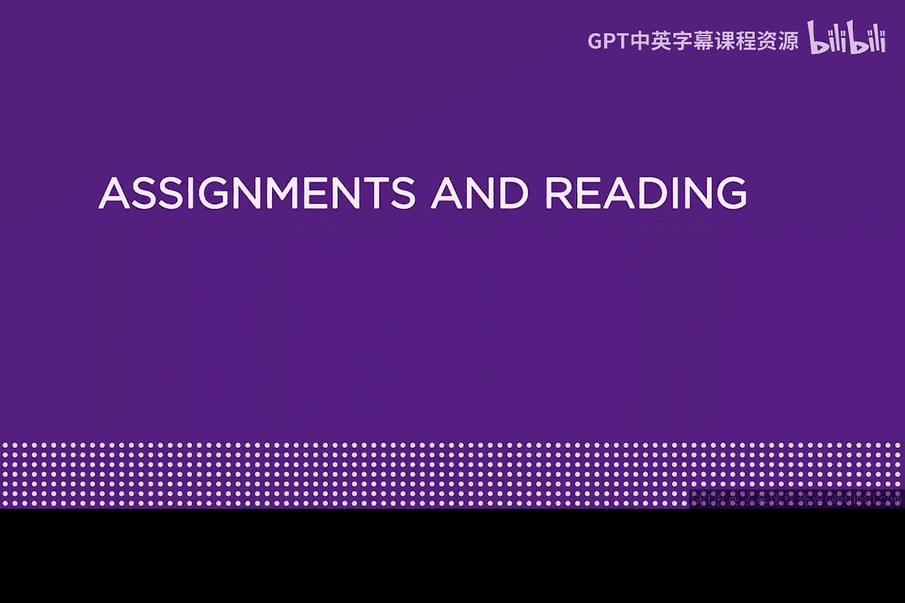
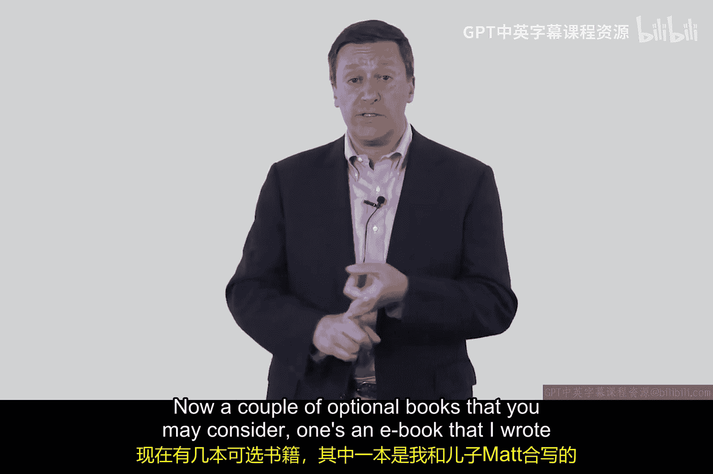
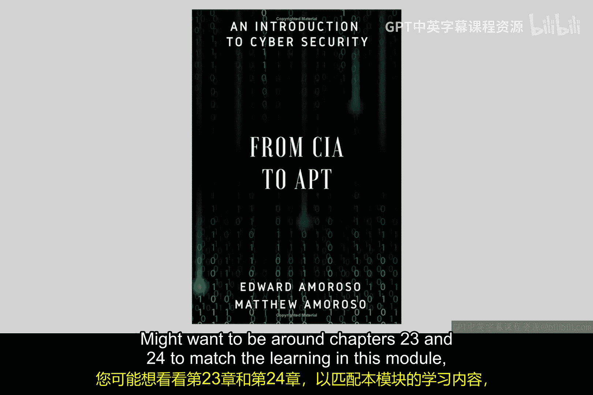
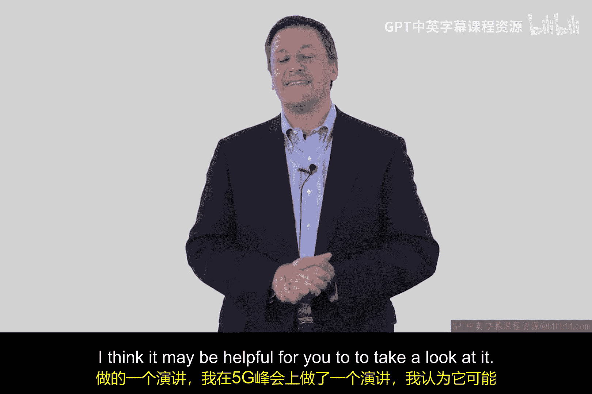

# 纽约大学《网络安全｜Introduction to Cyber Security》中英字幕（deepseek p125 36_作业与阅读.zh_en -BV1TFLZzYE26_p125-

Everyone Ed Ammarosa here。 And I want to welcome you to this module。

 Our goal in this module is to take you through some very important but subtle problems that exist right now in infrastructure and enterprise。

 One is challenge of an enterprise perimeter and the second is techniques use for advanced persistent threat。

 the kinds of things that nation states are doing now。

 Now there's some resources I'd like to complement the module learning with。😊。

And a couple of them are things that seems so terribly narcissistic。

 but there've got some things that I've done， but I think they match the material nicely。

 so I'd like you to take a look at。 one is a paper that I wrote a few years ago called from Enterprise Permeter to Mo enabled Cloud。

 It takes you through kind of the problems of a perimeter and it'll complement some of the Learns in the module。

 and then there's a nice paper called a study of Adv persistent threat by some capable authors that I think you should look at as well。

 give you a nice balance View on AP。 Now a couple of optional books that you may consider one's an ebook that I wrote with my son Matt。

 It's called from CIA to AP an Inuction to cybersecurity。

 I want to be around chapters 23 and 24 to match the learning in this module。

 Now one video you may look at it。 And again， it's something I did at Princeton University I give a talk at a 5G sumummit。

 and I think it may be helpful for you to take a look at it。 I lay out。

The detailed underpinnings of what happened to the perimeter。

 so it's iEE TV 5G sumummit take a look at I think you'll enjoy the video so get started on the module right away and I hope you learn quite a bit thanks。

