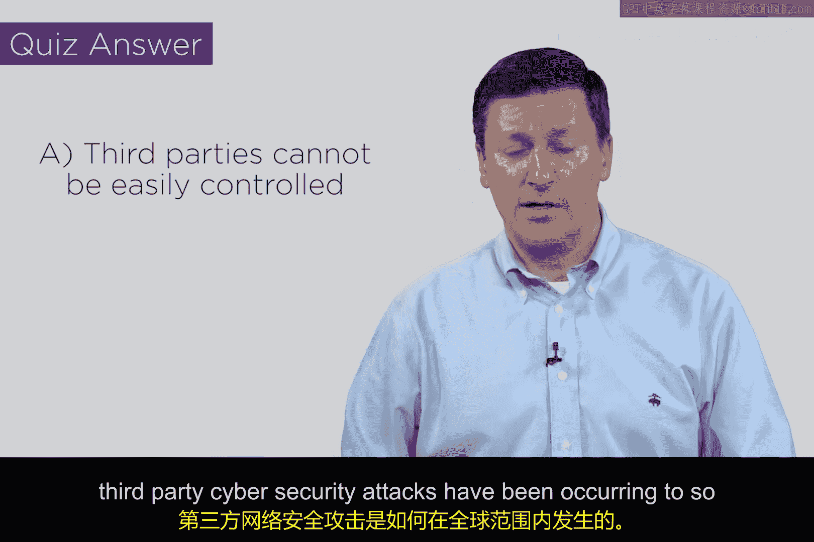
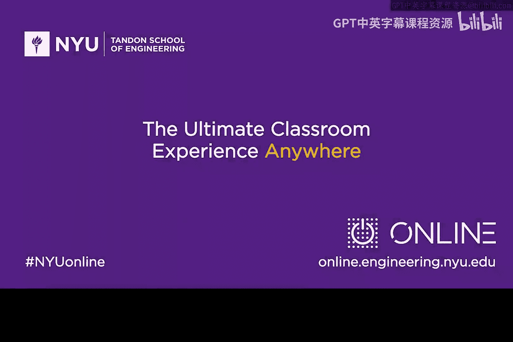

# 纽约大学《网络安全｜Introduction to Cyber Security》中英字幕（deepseek p128 39_第三方安全.zh_en -BV1TFLZzYE26_p128-

Hi， folks at Emorosso here。 And I want to talk to you in this video about something called third party security。

 Now What mean by third party。 party is sort of entity， business entity。

 and the first party is you So you're running a business to call yourself the first party and it's all the things that you own and operate。

 The second party is your customer。 whoever's buying， whatever you're doing deals with， you know。

 to sell services， products or whatever。 third parties or organizations that sit in support of your mission to your customer。

 Do you follow， It could be a lawyer， It could be a contact center。 It could be your vendor。

 It could be an auditor， It could be marketing experts。 It could be consultants。

 These are all third party that only exist to help you serve your customer。 Now。

 here's a basic concept that you need to keep in mind as you learn more about cybersecurity。😊，To you。

 the first party， the third party looks like an external organization that you're connected to that's off doing its thing。

 But to the second party to your customer， you， the first party and your third party appear as one。

 When you go to your local phone store and you sign up for， you know。

5G service and you come out with your nice iPhone and you're all set and you got whatever。

 Do you know or care or have one ioda of concern about who their third party tech center is that's supporting some aspect of their infrastructure。

 couldn't care less。 And if they got hacked。 And as a result， your information was lost。

 Do you agree that the customer doesn't care that it was the third party。

 They care that they did to deal with you， I walked into your store。 I bought your phone。

 I bought your。Service， you're my vendor。 If you decide you want to use the third party。 Well。

 that's your problem。 That's something that I think is very poorly captured a lot of times in our industry。

 Sometimes we'll see a first party having a third party hacked and blame the third party call it their hack。

 I think that's nonsense。 Now， how does this happen。

 it happens when a third party requires access to a company。

 let's say if some company orders do company dot com。 and they need access in。

 maybe they're who knows what they're doing。 They're supporting some aspect of ordering。

And they come in。 And what has to happen is the enterprise firewall perimeter has to provide access to some gateway。

 The gateway probably is going to check their IPp address， maybe ask for password， do whatever。

 once they're okay。 It drops them on the land and allows them to sort of forward their access to some production system。

 And really， they're supposed to get to the production system and turn upward to the order server。

 But what's to stop them from turning downward to your finance server。 You could say， well。

 I'd have security， and that's the whole point。If you have some security。

 then do it and what is it you would put there， what are the tools we've spent so much time talking about？

Cryptography， authentication， firewall， intrusion detection， log files， a Sim。

 Youve got to do something。 You figure out what you're going to do。

 And it's not so obvious what you do because you're inside this big blob of a perimeter where you've decided that the things insider trusted the things outside or not and most of your security is on that demilitarized zone。

 that DMZ between out and in。 But if you're letting outsiders in。

 Then you have basically the possibility that you could have a compromised insider disgruntled angry third party。

 Now， they could also be in your company。 Inrs could be anywhere。

 you could have somebody who just doesn't like you as a boss and is going to go hit your finance server。

 But in this case of third parties， it's kind of an intense case because you're allowing groups of individuals you don't manage。

 You don't know where they come from。 You may have no idea with the hiring practice。

You may have no idea what their local area network looks like。 Maybe you do some risk management。

 Maybe you make them fill out some compliance forms， whatever。 But you don't know a lot about them。

 You're letting them come in。 they get onto your network。

 and they can steer pretty much anywhere they want。

 we see some colossal attacks that have occurred as a result of this weakness。

 I hope that's something that you kind of get first， second， third party。

 Third parties look like part of you， the first party to a second party。

 Third parties gain access to the enterprise through specifically open ports to gateways。

 Once they've authenticated， they' have access to the whole place。

 And instead of steering to the order network where they're supposed to go。

 they can steer to some other thing like a finance server。

 That's the basic template through which third party security attacks have tended to occur。

 Ki of the best answer here， I think is the first one。 You know。

 maybe you could argue a little bit around you know。or C， there might be some element there。

 but really a is an important one。 this idea that a third party involves infrastructure people process that you just can't control as a first party。

 you can try， but you're not going to be able to do it very effectively。

 so I hope this has been useful。 I hope it gives you a clear insight into the way third party cybersecurity attacks have been occurring to so many businesses around the world。

 I'll see you in the next video。

