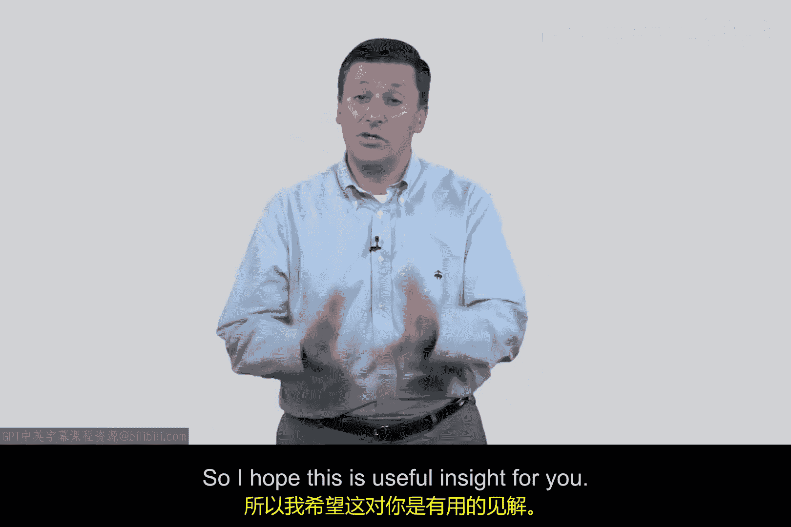

# 纽约大学《网络安全｜Introduction to Cyber Security》中英字幕（deepseek p129 40_目标APT攻击.zh_en -BV1TFLZzYE26_p129-

Hi， everyone Ed Amarosso here。 And in this video， I want to talk to you about a case study of something that happened back in January 2014。

 happened to a really fine company here in the United States target that you probably heard of。

 maybe maybe you shop there。 wonderful company。 But they， along with many many， many， many。

 many other companies were the victim of an advanced persistent threat in A a targeted attack and it involved third parties。

 So what happened was third parties had access to their gateway。

 managed to get through the gateway that had been set up for third parties to gain access to。

 They were able to somehow compromised that access and find thelateal traversal on the network。

 credit card processing systems。 The car swipe systems that you and I and everybody used。

 and here in the United States back in 2014， we were still using older technology that didn't involve chip and pins who used magnetic stripes and was exposing credit card。

😊，Numbers in clear text onto the systems。So this is what happened and it exfiltrated out through gateways that weren't properly filtering。

 again， I don't bring this up in the context of target because I want to be critical of them because full disclosure I think this sort of thing has happened to so many companies that this is just sort of representative rather than in any way showing you know something that I would consider more or less neglect than anybody else。

 it's a very typical kind of problem， but there's a couple things that pop up out of this that I think are important for all of us to think about as cybersecurity expert' kind of transcends the technology。

 but I think it's important for us to think about the first is what is the impact of a cyberattack on a business。

Now， it turns out that target being the fine company that it is was able to recover。 You know。

 I'm sure they did what they need to do internally to fix things up。

 They probably learned quite a bit about it， obviously encrypting all the credit cards。

 And I think we go back and you look historically at their stock price。

 you can see that it more or less rebounded。 So it's probably the case， that a disclosure attack。

In modern time is not going to be， say a death knell for a typical company or a government group。

 that's probably true。But a number of executives did lose their job as a result of this。

 And we can sort of ponder whether that's fair or not。 I mean。

 you can have your own opinion as many people who are watching this video。

 That's probably how many different opinions we would have about that。

 But I think this question of what the consequences are to a typical organization that gives a cyberat is something we need to think about。

 And I want you to think of it。In two different groupings。

 the first would be disclosure of confidential information， credit card， customer data and so on。

And the second would be integrity problems that affect the operations of the business。 Now。

 let's take each in turn。We've seen in the last few years so many companies like Target lose our personal information that it's sort of like numbing。

 Now， there's a term that you use called the security fatigue。

 which means you just one after another after another， these things after a while， you say， well。

 I just have no privacy， I have my credit cards hacked and it is what it is in business goes on。

 right， Like if， if right now， as we're filming this video here in our studio。

 if some bad people somehow had a listening device in the room。

 and they were stealing all my lectures here to you。 I wouldn't like it。

But the video goes on and life goes on and it sort of doesn't matter。 So that's the first category。

 And the second we said is disruptive。 That's where an attack basically causes a business to not be able to function。

 breaks their systems， destroys their network destroys records， blocks access to their systems。

 like here werere now talking them doing a filming of this video。

 supposeuppose hackers were able to turn the lights off， turn the camera off。

 turn everything off in the room。 The video stops。 Life does not go on。

 We can't just sweep that under the carpet。 I think what we're going to see in the coming years。

 is a shift from disclosure attacks to more consequential destructive attacks。

 and you might have seen some of that， like here in the United States。

 the Sony Pictures Corporation had some problems where they were attacked。

 and it had real integritybased consequence to what they were doing。

 So let's keep that all sort of in mind as。We think through these attacks that you hear about every single day that there are disclosure issues that we've all been somewhat numb to as a result of security fatigue。

 but what's coming would be more destructive issues， think ransomware for example。

 certainly much more consequential and creates a paralysis that has to be dealt with。

 you can't just allow things to proceed if you're the victim of a destructive or operational attack that makes it difficult for you to conduct your business I hope this useful insight for you。

 I'll see you in the next video。

