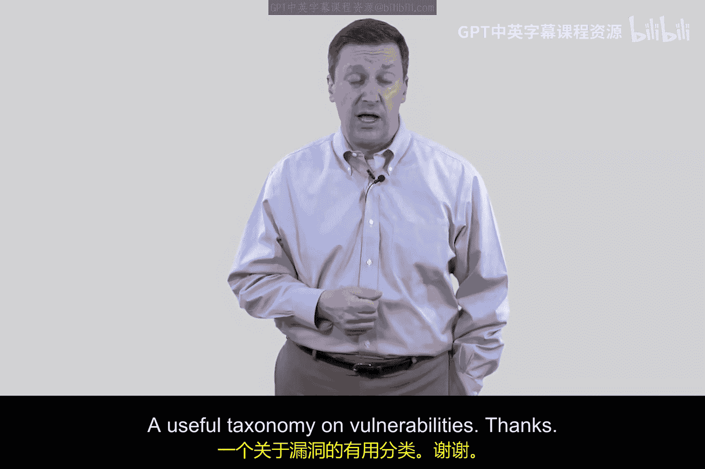

# 纽约大学《网络安全｜Introduction to Cyber Security》中英字幕（deepseek p13 13_漏洞类型.zh_en -BV1TFLZzYE26_p13-

Now， the definition of a vulnerability is a system attribute or feature that can be exploited to cause something bad to happen。

 not exactly the most technical definition。 We get the idea。

 think if is a bug in a system or something。 And I go， oh my gosh。

 I can exploit that to cause something bad。Then we call that a vulnerability。

 It turns out there' are going to be four types of vulnerababilityities。

 So let's go through them and it's a taxonomy again that we want to keep in mind as we go through the cybersecurity。

 You're noticing in our lectures here that's a lot of lists sometimes cybersecurity reminds me of biology of these taxonies and lists and types and you can get a little crazy with it。

 I try and minimize it。 I don't want you to have to be sitting around memorizing things。

 but I do think it helps in our vocabulary for you to be able to sort things out。

 So the first type of vulnerability is just flat out of bug。 it's usually a bug in software。

 system design， a software design， and that's where you just made a mistake in some code like for example。

 if you write code that takes in address names in a box name。

 address and whatever and you kind of forget to do some bounds checking in the softwareh I assume you're smart enough to know that but for you。

People didn't know that。 And then somebody figures out oh， this software doesn't even check to see。

 So where it says address I just hold down the a key and let it just keep running and suddenly the whole system crashes and I'm sitting there laughing that's a vulnerability that takes advantage of a flaw in your code and you blew it and I did that and and the question is。

 is that malicious or is that tampering。 you have to decide。

 But so that's the first type of vulnerability and that's kind of a funny example。

 But the reality is there dangerous ones you don't want that kind of an example like in the safety system for nuclear power plant that would not be a great thing if somebody can tamper with those things So that's number one Second is a missing security control So that's where set up a network set up a router。

 connect everybody up， hook up wifi。 Everything's great。

 we go how are we doing and somebody says seems like we're getting hacked and you go getting hack getting hacked and you went I forgot to put。

Firewall in and everybody goes duh and you run out you get yourself firewall。

 whether you buy it or download it whatever you put it in place missing security components。

's not really like a coding flaw。 It's a little different。

 but you can see in both cases it's your mistake right。

 I mean that's the essence of vulnerability It's somebody doing something that is then exploited Go that。

So for bug， missing security flaws the second， the third is you and me human action。

 It's our learning community doing something dumb。 An email comes across and it says， hey。

 you have a facts waiting for you at cool cool facts do net。 and you go。Cool， cool f。net。And it says。

 yeah， just click here and get your facts you go， h what wasn't expecting a facts？Well。

 let's click and see what happens and you click and downloads Ma or whatever。

Its human being a human being doing something down。 Now that's a really egregious example。

 But I'll tell you what。 Think about your day to day activity。

 I'm pretty sure I could send you something like that。 You know what that's called called a fish。

I could probably get you to click on something， right？

If I sent our learning community something from me。And it said， hey。

 what'd you think of the lecture today with a link？You probably click on that。

 right and and there's ways around that。 But again， the vulnerability type third one is human beings。

 A fourth kind of interesting one is organizational action。

 meaning you didn't fund the security team properly。 You didn't put people in place。

 youre negligent in setting up policy。 You just we a bad organizational manager and you set things up in a chaotic way。

 Now， all four of them can be exploited， right， I mean， fundamentally。

 it's that first one that from a functional perspective is the one that gets exploited in all the other cases。

 there's ones and zeros。 there's computing going on。

 I got a human being does something stupid and there's a fish that causes malware to be downloaded。

 The malware is still taking advantage of a vulnerability in the operating system in your local runtime environment。

 But those four different components。 that gives you a pretty good idea of how we're going to be categor。

VulnerabilMost of our emphasis is going to be on the first at first software vulnerability。

 the bugs and so on with some emphasis on the second one as well。

 So I hope that's a good way for you to kind of keep straight in your mind。

 a useful taxonomy on vulnerabilities， thanks。

