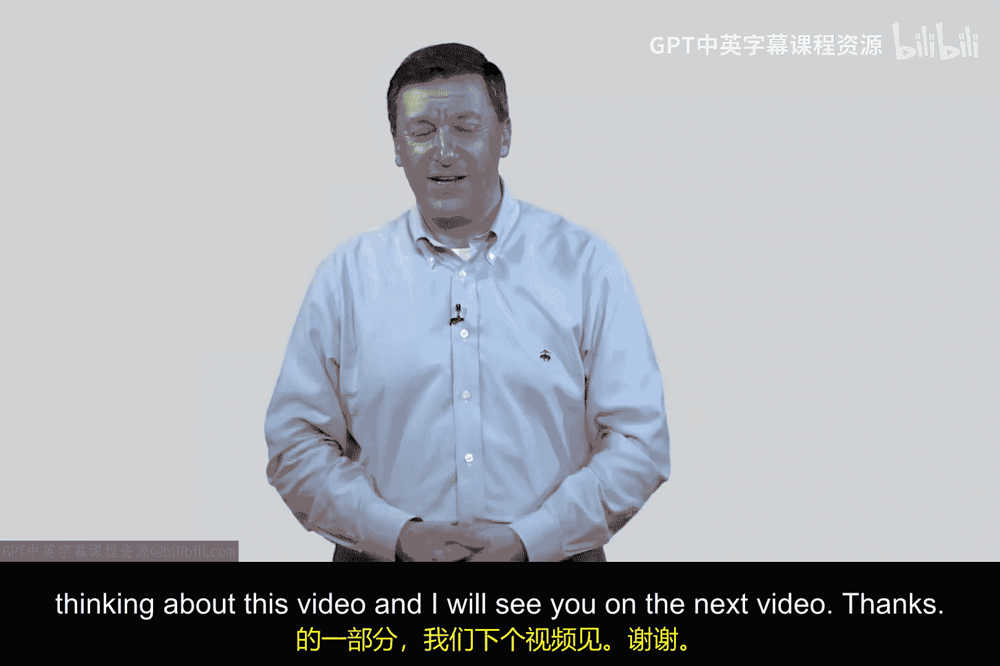

# 纽约大学《网络安全｜Introduction to Cyber Security》中英字幕（deepseek p130 41_大型政府机构攻击.zh_en -BV1TFLZzYE26_p130-

Hi everyone Ed Amarosso here， and in this video I want to talk to you about a really consequential attack that occurred in June of 2015 here in the United States and occurred to a government agency called the Office of Personnel and Management OPM。

So a group that keeps track of records， personal records of a lot of US citizens and in particular keeps track of clearance information。

 clearance being the kinds of designation that's assigned to an individual based on a background check and provides determination as to whether an individual should have access to classified information so high officials and people working in national intelligence or defense applications or anybody doing sort of really sensitive critical work for government would have a clearance would have information involved in the obtaining of that clearance filling out forms and you know a little bit of your background and what you've done all that would be documented and kept in records by OPM Well in 2015 we found out that potentially nation state who knows came in and snarfed up all those records and carried them away。

Raises some interesting questions。 The most important of which is this question of whether a nation state attacking an agency is an act of war。

 Is it， I guess it's a question we're all going to have to grapple with。

If a country does this sort of thing， I's say they did it by flying a plane in， bombing the building。

 running in， ransacking all the rooms， coming out with arms full of papers， you know， running out。

 getting on their helicopter and flying out， we would certainly call that an act of war。

 But when we do it with electrons and do it with networks and do the kinds of attacks that if you've been with me for other videos。

 We've been learning how you do it now you protect it， I that warfare， or is that something else。

 hard to say。 Certainly the consequential discussion here that I think has to happen across all of our nations。

 I think there's a concept called norm or norms that really needs more emphasis across the international community where we come to some agreement on what types of things nations should be doing to each other。

 We all know that nations spy that's not a big surprise。 they just do。

 But we've all sort of accepted that。As part of the nature of military and intelligence work。

 But what happens when it sort of transcends that， What happens when they're doing that sort of work to a business。

 Are they doing it for economic purpose， they meaning some nation state。

 this attack in June 2015 really got a lot of people thinking。

 and for those of you studying cybersecur and trying to grapple with these issues。

 I use this as a good case study， in this question of whether when you're doing I system security for a company。

 are you doing civil defense， are you protecting your country， wherever you're working。

 wherever you live， if you are doing cybersecur for your company in whatever country you're living in。

 are you providing civil defense for that country， Yes or no， I don't think there's a yes or no。

 but you should have opinion about that， And when a nation state should successfully breach whatever defenses you've put in place。

 I that an act of war， Yes or no。There's no real answer to that。

 but it's something that I'd like you to ponder， I want you to think about these things as a professional cybersecurity expert。

 you should have an opinion about this and you'll find that if you get 10 experts together。

You'll get some different opinions。 I'll tell you my opinion is that yes。

 you are doing civil defense and yes， it is an act of war。 That's my personal opinion。

 You might get someone standing here next to me who has equal or greater credentials than me who might say no that's not civil defense and know that's not an act of war。

 these are the kinds of things that we're going to have to deal with if you're say under the age of 30 watching this。

 then my suspicion is your generation will figure this out。

 I'm over the age of 50 so my generation perhaps has had it shot at doing this and I think we've failed in coming up with good answers to these questions。

 but they're going to have to be solved and as an international community we're going to need better norms accepted sort of agreed upon procedures by which we all operate and I think we're just going to have to get to the point where more and more people agree that if you know somebody comes in and a nation state comes in。

teals all your stuff， whether they do that with computers or do that with helicopters and guns to me seems like no distinction there。

 so I'll let you ponder that as part of your additional sort of thinking about this video and I will see you on the next video thanks。

