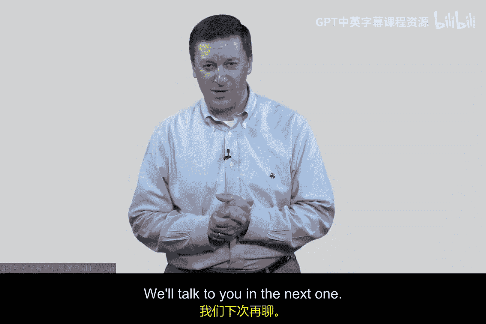

# 纽约大学《网络安全｜Introduction to Cyber Security》中英字幕（deepseek p131 42_第3层DDoS防护.zh_en -BV1TFLZzYE26_p131-

Hi everybody at Ammarosso here。 and in this video I want to revisit some issues related to distributed denial of service Ddos attacking the corresponding defenses that we do for Ds and what the implications are for a global infrastructure。

 We need to spend some time digging into that a little bit let's revisit and make sure we're all on the same page in some sense about how Ddos attack is typically accomplished。

 We all know that a botnet would be a whole series of computers that have been infected。

 they've got malware embedded on them。 There's a command and control that tells each of these bots to drive some sort of traffic at a target it's going to go across ISP and Internet infrastructure。

 It's going to be aimed at that target and if theres security in place。

 and the way that would work is the security or Ddos detection would see the traffic volumes would use protocols such as the border gateway protocol BGP to re。

ect traffic away from the target to special capability we usually refer to as Ddos scrubbing。

 special firewalls。 The scrubbing uses different special algorithms to try and sort through what's good traffic and what's errant Ddos traffic originated from a bonet it will then forward the good traffic to the target trying very hard to keep it up。

 And this is the cadence that we have across the globe。

 Every country of our globe has service providers and special security providers that do exactly what we're showing you there on the screen with Ddos detection Ddos scrubbing and filtering。

 Now， what are some issues that come up as a result of this。

 The first issue is that you would want to know whether a given service providers can do lots of these at the same time。

😊，So if a service provider can handle one big attack， but can't handle two。

Then wouldn't that expose kind of a significant critical infrastructure of vulnerability， right？ Now。

 I doubt there's a service provider anywhere that can't handle two。 And then you say， well。

 if you can handle 2 can handle 3。 if you handle 3 can handle 4。 And the question is。

 at what point do you reach your limit where I can handle N attacks。

 but n plus one would break the camels back。 I want you to think about that。

 because every system has its limit。Now， not only do defenders have their limit。 So does the offense。

 Now， we've done the math on how big Diddos can get。 You know。

 we said that if you have 10000 bots and they're all spewing a magg that you can fill up a big pipe going into a data center and on and on and on。

 But at some point， you reach something that we refer to in telecommunications as peering capacity。

 here's what that means， and I'll tell it to you in the context of traffic with cars and freeways。

 If you say。Hey， I can create an attack this big， you know。

 by having all these cars drive on the freeway and aim to some off ramp and clog up that off ramp。

 And you'd go， oh， wow， that is a big problem。 I need to be able to stop that。 Well， then you say。

 well， you stop that。 But now I'm going to do another one。 And another one， another， at some point。

 you don't have enough freeway to carry all that attack traffic。 The backbone networks get filled up。

 Now， that's not good news， right， But all I'm saying is that the math is a little weird with that sort of queuing problem。

 because the freeways or in this case， the tier1 telecommunication backbone networks are going to have a physical limit。

 I mean， you might think of it as a terabyte of per second of information a terab bit per second。😊。

Or it could be bigger。 But at some point， youll limit and policy issues that need to be thought through internationally。

 What do you do， What if you did have a case where all these things going on。

 should an ISP be able to drop the traffic， just to sort of keep critical infrastructure up。

 These are mechanisms that are not in place today， And these are cybersecurity controls that are still to be determined。

 If you're a young person and you're thinking， what are the kinds of problems I'm likely to be working on if I go into a career in cybersecurity。

 This is one of them。 The idea that if a tax gets so big。

 that the infrastructure protection needs to be set up so that it can keep the things up that must be up emergency services。

 emergency communication， Hospital and medical， food， water， power， communications。

 These are important things， the sort of。Ancillary communications that we might have like with entertainment or just people yaking on their mobile phones or downloading things or doing social。

 whatever， maybe we would make a determination that that sort of thing would fall off the table and we would just keep up or keep available the networks that are necessary to keep critical infrastructure rolling。

 we'll spend a little more time on this if you stick with us for subsequent videos。 but for now。

 I want you to kind of ponder that issue that Dids is in fact， a volumetric attack。

 the defense tends to be volumetric。 And if you've been wondering what if the volume gets bigger than the defense can handle you're thinking about it the right way。

 still nonsolve problem， something that the next generation will have to come up with more creative solutions to and give you something to think about。

 I hope you enjoyed the discussion， probably didn't make it feel real comfortable but I hope you'd enjoyed it nevertheless。

 we'll talk to you in the next one。

