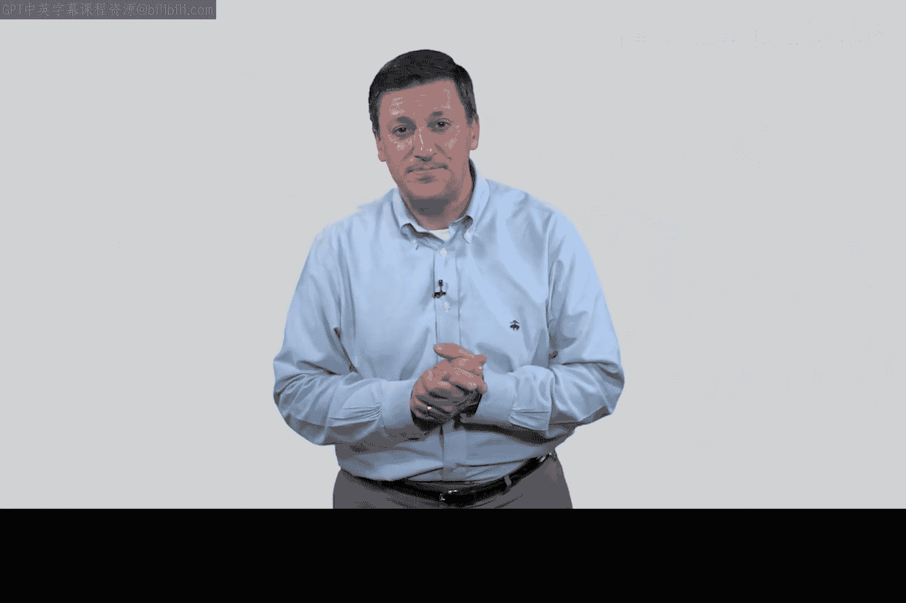

# 纽约大学《网络安全｜Introduction to Cyber Security》中英字幕（deepseek p132 43_第7层应用级DDoS风险.zh_en -BV1TFLZzYE26_p132-

Hi， folks at Amorosso here and in this short video I just want to talk to you a little bit about a couple of the nuances in distributed denial of service attacks。

 You know we've been kind of pondering as a community。

 this problem of volumetric attacks at targets and how do we stop the attacks using scrubbing and or a gateway protocol redirects and filtering and so on。

 but what the attackers have filter figured out is that theyre creative ways to create clogs or floods or traffic jams on networks that might not be detectable at that layer 3 or packet volume layer。

 So layer 3 Ddos attacks folks on packet volume ISP can detect them we use scrubbing solution and it works pretty well we've pondered what if that gets bigger and bigger well hopefully the defense gets bigger and bigger but what a lot of attackers have gone to is something called a layer 7 Ddos attacks which is really。

Clever because it tends to be low and slow， tends to be more at the application level。

 and it's a little harder for ISps to detect。 So we have to reverse two letters and usually we need an I an intrusion prevention system at the gateway to detect it。

 So here's an example。 Suppose you had a website with an application that allow people to download information。

 Let's say you have a library of all sorts of different things that you've created。

 when they might be sizable， might be image libraries or something that are big Mon things with video and multimedia and all kinds of stuff。

 and you're a very kindhearted soul and you give it all away for free。

So if somebody comes to your site and they want to request a bunch of the downloads。

 you've coded it up where you say， hey， you want to download stuff， go right ahead。

 And it may be that most of the time people are very reasonable about that。 You know。

 they download what's reasonable and they don't download anymore。 But what if a botnet。

 Notice that your server was sitting in a network or hosting center in a business where I'd like to cause problems for that business。

 And I see that your little server allows a lot of traffic to go out。

 So what I do is Id a bunch of bots then requesting big monster downloads。

 And what would happen is all that traffic on egress to your gateway out to the Internet would create a gigantic traffic jam in the enterprise the ISP wouldn't see any of it because these are just little normal requests。

 Hey， download all this stuff。 Nothing else。 And then boom， a big barrage of stuff。😊，Not packet。

 packet， packet， attack attack， session all the kinds of things you see in layer 3。

 so you'd have an attack on egress from an amplifying source that's hidden to the Ddos scrubbing that we've all become so comfortable with as our primary solution for denial and service and they a little crazy。

 So this is a really， really interesting problem that I think begs a lot of creativity in the next five to 10 years。

 a lot of the young people watching。 I hope you'll spend some time thinking about different types of protection solutions。

 different types of international norms and other kinds of mechanisms。

 both functional procedural and also policybased that will reduce the risk not just of layer 3 Ddos attacks but also layer 7 application attacks。

 So I think that's all we have to say about this。 we'll see in the next video。

