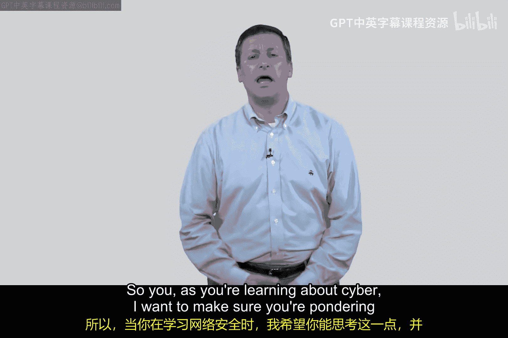

# 纽约大学《网络安全｜Introduction to Cyber Security》中英字幕（deepseek p133 44_大型金融网站DDoS攻击.zh_en -BV1TFLZzYE26_p133-

Hi folks at Amarosso here， and I want to tell you a little bit about a case study and distributed denial of service activity with a very specific incident that I remember vividly was the summer of 2012 and what happened was a malicious actor decided that they were going to target a bunch of financial institutions here in the United States。

 they wanted to make a point make a case， I'm not really interested in what it was or what the point was but the idea was that they were going to spend Tuesday。

 Wednesday， Thursday of the work week kind of attacking a series of banks and doing it for a very limited period of time using a big botnet that was known as Brobot and it had characteristic that it was attacking or using as bots。

 servers that had fixed IP addresses known IP addresses because they were establishing a connection a full threehandshake step TCP connection to a known source IP to generate the volume。

The bo at work。So what was the effect well it turned out？

That this was a little bit more difficult than anybody had ever really expected。 Now。

 it was kind of called out， like they would say， here's what time we were starting and here's when we're going to finish。

 So all of the banks and their service providers and the security providers。

 the whole community sort of knew it was coming。And what would happen is in the early stages of the attack。

 it would take a little bit of time to characterize what sort of traffic was being thrown and to which banks。

 So it was a little bit of activity in the beginning to figure out what was happening。

 but then over time。The defenders would figure out what's happening。

 be able to get the right packets filtered in the scrubbing systems and essentially forward good traffic。

 and， for the most part， keep banks up。 But there was that early period each day where it was a little tricky。

 Now， why is this important， I think it's important because it suggest that under optimal conditions an attack by a capable adversary at some critical infrastructure。

 Certainly banking is that was more or less successful， but not perfect。

 And it highlighted in my mind that all of us in the community Ne to redouble our efforts to do a better job in and around distributed denial service。

 I'll tell you， we don't tend to do a lot of attack testing in this area。 Now。

 you could laugh at that and say， why would you test something when we have a lot of Diddos attacks。

 But look， here's a case where we knew what time it was going to happen， We the community， And still。

 there was some struggle in。of tuning the systems and getting to the point where as the attack occurred。

 you very quickly adjusted and you were able to keep sessions working on websites。

 That was not the case。 So I think there's a lot of learning here。 I think again。

 distributed denial the service， it turns out is going to be something that will be more consequential as intruders get a better sense that they can combine big volume metrics。

 lots of different attacks with layer  attacks， understanding that even under the best conditions。

 the defenders do have some struggle。 it's not a snap to just very quickly characterize the Ddos very quickly get the right packets pushed off the scrubbers very quickly set up whatever tunneling or redirect to the sites needs to be done and very quickly be able to sort of shape the traffic patterns to keep things normal and do it for as long as the attack is occurring plus be able to turn up on concurrent diverse。

Tacks that might be happening the same time so that you're juggling 10 balls at the same time globally。

 These are the kinds of things I worry about every day。

 the kinds of attacks that I think can be really consequential to global infrastructure。

 So you you know as you're learning about cyber。 I want to make sure you're pondering this and thinking about the case in summer 2012 when these major banks were hit with what some people refer to as the biggest cyber attacks in history。

 So I hope this has been a useful insight for you。 we'll see in the next video。

