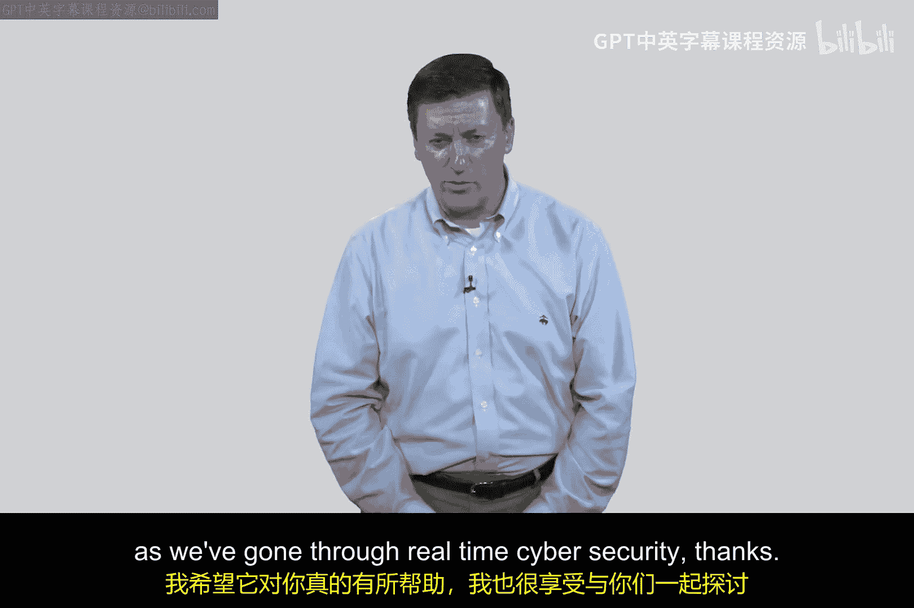

# 纽约大学《网络安全｜Introduction to Cyber Security》中英字幕（deepseek p134 45_网络安全行业概述.zh_en -BV1TFLZzYE26_p134-

Hi， everyone Ed Ammarosso here。 And what I'd like to do in this video is I want to kind of wrap up this course。

 this topic of realtime cybersecurity。 If you've been with us。

 you know we started by looking at firewalls and packet filtering and how you arrange them into do I and all kinds of realtime things looked at Sims。

 we looked at socks。 we had a lot of fun with that very interesting stuff。

 But if you're wondering what's the full range of controls that need to be done to kind of protect a typical enterprise。

 Well， you know， it's a tough question， this is a really complex and very full topic。

 know we probably would need100 videos to really dig into all of these things properly。

 But one of the things I worked on personally that you can download， we're gonna pop up the URL。

 It's tagd cyberber co you can download a free Pf。 it's three volumes that we've download and created you'll see the information。

 but one of the graphics in my reports is。G that I'm showing here on the screen。

 it shows basically six columns of categories of different types of controls and under each one。

 I sort of label out the control category that I think needs to be attended to from a cybersecurity perspective if you're protecting infrastructure and you can see intrusion detection prevention you can see firewall。

 you can see a lot of the things that are probably very familiar to you and maybe a couple in there that you're less familiar with like unified threat management is a category。

 we didn't have a lot of time for you know as we went through our discussion of real-time cybersecurity。

 it's basically combining a lot of different security controls into one appliance or device that a small company would use but you may want to take a little time if you feel like you really want to do more research and dig in and get a better general sense of all the different controls that are here。

 you may want to take a look at this graphic。 you might want to think about downloading the P it might just give you something that。

Of reference as you plan a lifetime of learning in this area。 you know you can sort of number them。

 there's 50 different areas that I've identified。 and I think in each of them you can spend some time making sure that you get yourself comfortable。

 it's kind of a self-learning sort of thing that you can do outside the confines of your're learning in this course。

 but if you're really， really motivated and you say I want to become an expert then grabbing this diagram and going through the different components that are in here might be very useful to you。

 So I hope you've enjoyed this discussion of real-time cybersecurity I hope it's really helped you and I've enjoyed my time with you here as we've gone through real-time cybersecurity thanks。

