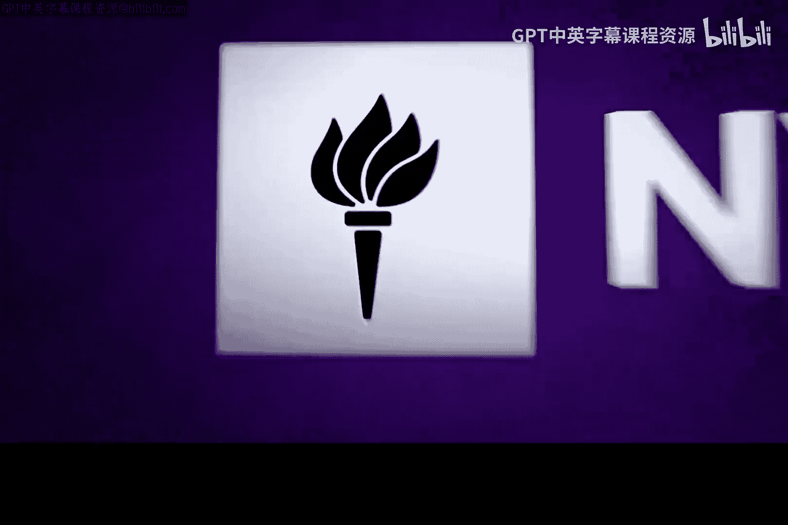
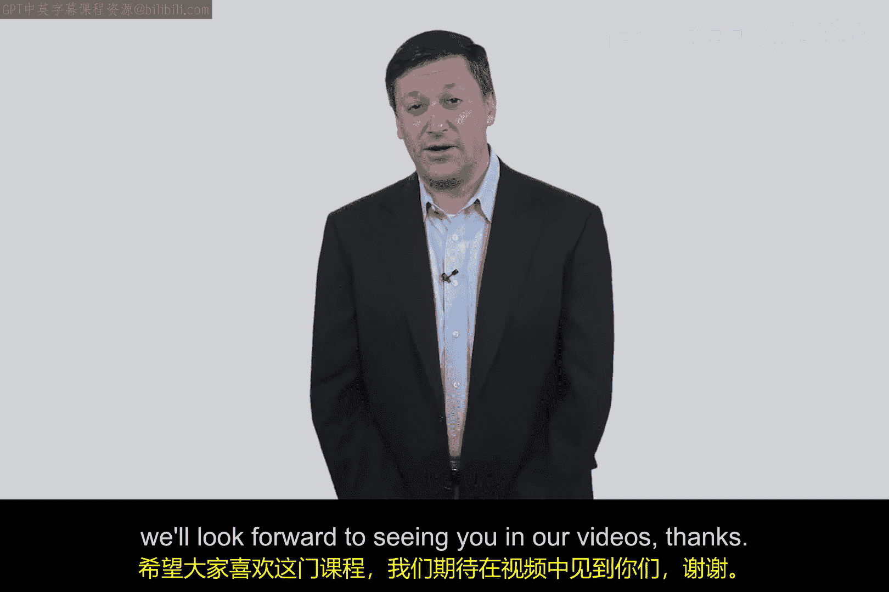
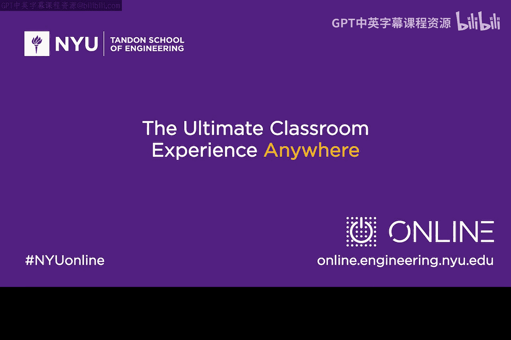

# 纽约大学《网络安全｜Introduction to Cyber Security》中英字幕（deepseek p137 0_网络安全课程介绍：你将学到什么.zh_en -BV1TFLZzYE26_p137-

Hi， everyone Ed Ammarosso here， and I want to welcome you to a course on advanced topics in cybersecurity。

 Now， there's really three goals that we want to accomplish in this course first。

 I want to introduce you to these advanced topics。 and they're scattered around like this is a vibrant field。

 and there's always new issues popping up things ranging from security awareness in business to governance。

 risk and compliance platforms and approaches also primarily in business and government to advance topics in cloud security。

 which I think is particularly relevant you as most individuals， small business。

 big business government move to cloud services。 So we'll spend some time on that in this course and learn a little bit。

 So that'll be our first goal。 Second is as always trying to lay out a practical foundation for these things。

 This is not about theory， this is about helping you apply these things to real technology situations。

 And then third， I want to develop sort of a lifelong interest there。

 I hope I inspire some of you to go in。One of these areas or fields I'd be so happy if at least one of you out there sees something that sparks an interest and creates a new career opportunity and a new passion for you so I hope you enjoy the course and we'll look forward to seeing in our videos。

 thanks。

