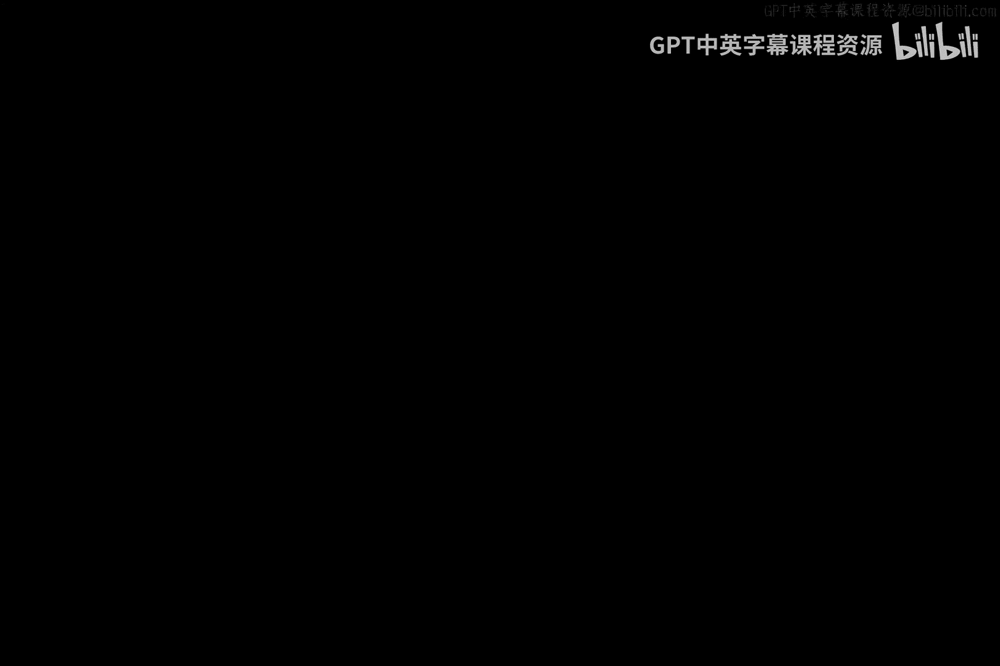
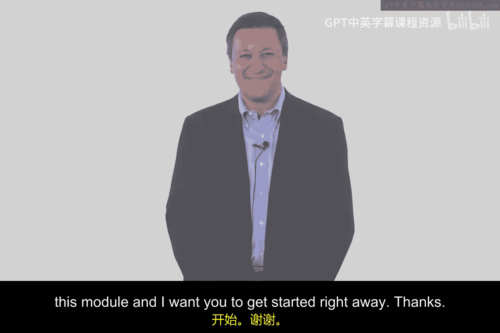

# 纽约大学《网络安全｜Introduction to Cyber Security》中英字幕（deepseek p138 1_作业与阅读.zh_en -BV1TFLZzYE26_p138-

Hi， everyone Ed Emmarosu here， and I want to welcome you to this module。

 Now the goal of this module is kind of an eclectic mix of things that I want to try and accomplish。

 I want to help you understand some good subtle problems that we have in the internet related social engineering and fishingish and I want to use that to lead into the kinds of things we do in compliance governance and risk assessment to reduce the likelihood that will have problems at a procedural or at a sort of a setup level we call governance risk and compliance GRC that's the terminology that's used frequently and I'm sure a lot of you know about compliance。

 Now there's some resources that we think will help complement your learning in this module。

 some papers and books of optional books and a couple of videos that I'd like you to look at as well that'll help let me tell you about them。

 So first off the first paper kind of a dirty trick here。

 I want you to read a compliance framework It's from the National Institute of standards and technology NISist here in the United States。

And it's read titleFra for I critical infrastructure， cybersecurity volumee one NIST February 14。

That's what it's called。 It's not fun reading， but I think you should do the best you can to try and get through it。

 You want to have some experience having read a compliance framework。

 and you can see what you enjoy your conclusions about whether this is a useful thing for Cy。

 I think it is。 Now， a couple of optional books you may want to consider one is an ebook you can get on Amazon that I wrote with my son Matt。

 It's called from CIA to AP an introduction to cybersecurity。

 If you're following along chapters 25 and 26 would be Good to Compment Your learning here in this module。

And I think all of you need to have a good solid TCPIP textbook。

 It's an investment that I think is worth considering doing。

 Richard Stevens has written a wonderful one。 Now， two videos that I think you may want to look at。

 One is kind of a video on PCI compliance PCI's payment card industry。

 an interesting video you see the title and I think you'll enjoyed。

 And then my friend French Caldwell metric streamream gives a keynote address we talks to the past present and future of GRC。

 very， very good video and we'll help you learning。 So listen。

 I hope you learn a lot in this module and why don't you get started right away， thanks。😊。

