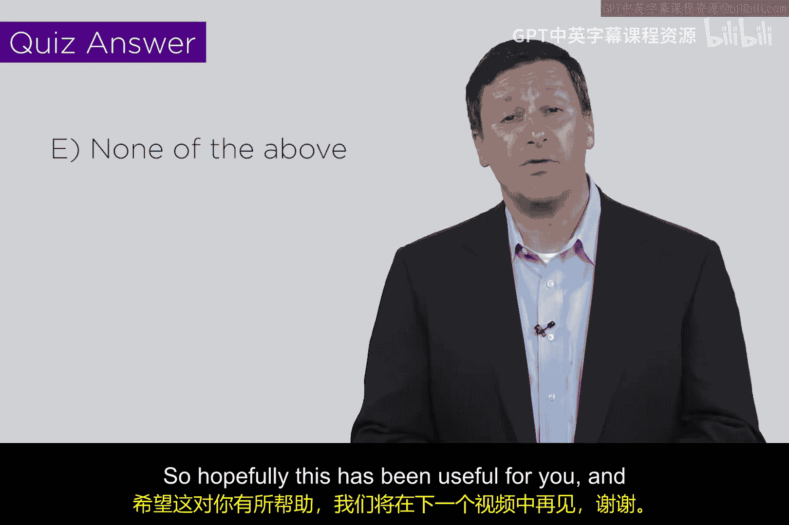
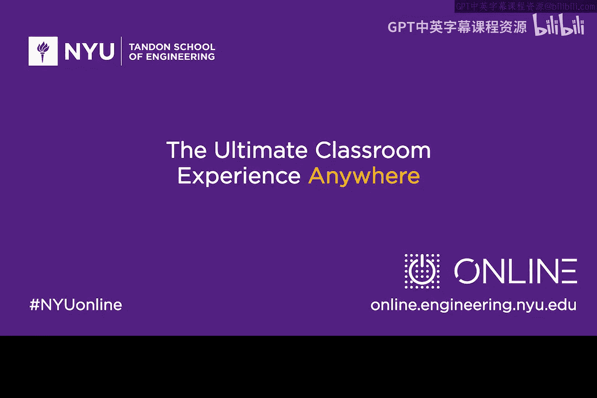

# 纽约大学《网络安全｜Introduction to Cyber Security》中英字幕（deepseek p139 2_社会工程学.zh_en -BV1TFLZzYE26_p139-

Hi， everyone at Emmarosso here。 In this video， I want to talk to you about a particularly tough。

 particularly insidious type of attack known as social engineering。 Now。

 this is a relatively recent phenomenon and business， you didn't have this too much。

 maybe 100 years ago， even 50 years ago。 but more recently。

 we've seen hackers and fraudsters and criminals。 and even young children just fooling around。

 taking advantage of the trust that businesses place in their customers when they're trying to help them。

 So， for example， bought of businesses will set up very friendly help desk with smiling， happy。

 friendly people who are there wearing their headsets， you know。

 ready to to provide assistance to customers， maybe you forgot something your account number or you want to look something up or you need help ordering or you want to check a balance。

 any number of things that you might be calling a help desk for。

 And these help desk folks are trained to be helpful。 That's the whole idea。 they are dis。😊。

ers of help， hence the name。 So when you call and for example， you make believe you are Alice。

 but you're really not and you call in as Alice and you try and get information。

 you're taking advantage of that trust in a sense you're kind of lying and there's a whole discipline around how this works。

 that hackers have figured out， for example， if you're calling bank X Yz。 before you call them。

 you look on your website， you get some information about them。

 you learn the names of the departments so that as you're calling in either as a customer or even as an employee。

 you do so in a way that has some informed element to it。

 you know the right lingo you know the right sort of things to be asking for Similarlyly if you're calling as a customer you you might find some things about that customer and we refer to a lot of that a sort of a targeted attack or a sp attack where I'm calling in as you but I。

Learn about you I go on your website， I go on your social network pages。

 I look you up a little bit and then if I'm calling in as you I'm calling from an informed perspective I might have your home address for example。

 might have some phone numbers might have email so that first attack social engineering iss particularly tough one there's a related ones sort of a physical attack where you might be looking not so much for paper I'm sorry for people calling but you're looking for paper you're looking for discarded trash or documents or reports that might have information that would be particularly useful to then use in a subsequent attack and there's a classic reference that we have in in this area called dumpster diving that's where you go and you dive in the garbage you know some business and you're looking for whatever you can find and again there's old discipline around how you do this like for example。

 one thing some youngsters like to do if they're dumpster。

Diving a business is bring some cardboard boxes， scatter them around outside the dumpster and then jump in looking for business material。

 if the police， if corporate security， if some people come up and they say hey what are you doing you pop your head up out of the trash dumpster and you say oh I'm just looking for some boxes I'm moving and you have some boxes scattered there it's a good way and they might kick you out and say hey get out of there you're not allowed in there but it looks like a plausible argument。

 you could also make it look like your're foraging for food。

 if you have some food in your pocket a sandwich that you ball up into some tinfoil or something and then you dive in and the police come and somebody come and say what are you doing you stand up and you take a bite of your sandwich and it appears that you're actually looking for food So there are all these plausible arguments that could be used to support maybe not getting caught dumpster diving similarly social engineering and so on。

 The reason these are so difficult The reason these are just completely unacceptable。

I because the solution to these has been to not trust people that you're dealing with to change the business model to be helpful to folks now granted dumpster diving should not encourage should be shredding your documents and there are some sort of physical interaction type attack that I think are reasonable to be stopping with prove security but when you have to train a help desk not to be helpful and to distrust people calling in and to assume the glasses half empty as opposed to the glasses half full。

 you call in and instead of saying the goal of this calls I really want to help you。

 if you change that to the goal of this calls to make sure you don't hack me。

 changes business changes the way we interact not just in business but as a society so social engineering and dumpster diving in particular are very difficult types of attacks to deal。

Because they prey on the basic trust that businesses have with their customers now。

A little quiz here and the answer is none of the above。

 none of them really make any sense or true with respect to social engineering。 As we said。

 social engineering takes advantage of the trust that businesses have with their users and the solution unfortunately。

 in many cases has been to degrade that trust to some degree。

 so hopefully this has been useful for you and we will see you in our next video thanks。

