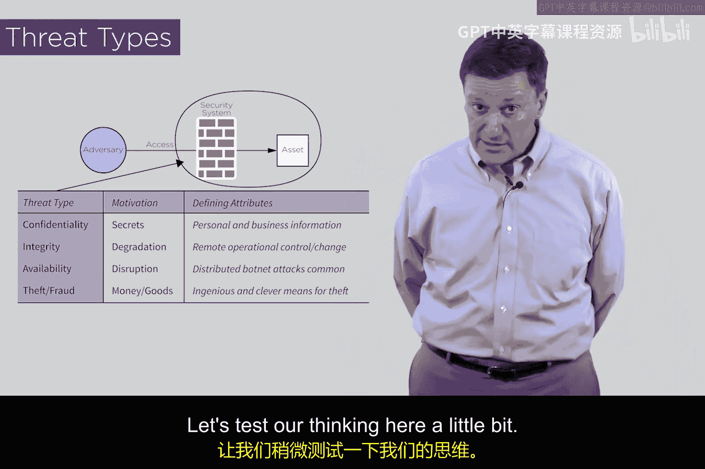

# 纽约大学《网络安全｜Introduction to Cyber Security》中英字幕（deepseek p14 14_威胁类型.zh_en -BV1TFLZzYE26_p14-

Hey， good good news for you， another taxonomy coming up。list that you have to keep track of。

 but pretty soon we'll be running out of list so hang with me now listen it turns out。

That there are really three primary types of threats that we deal with on the Internet and computing。

 In a minute， I'll tell you， there may be a fourth， but let's start with the first three。

 and threat really is something bad that can happen to an asset。

 an asset is the thing you care about your computing， your network， your software。

 your infrastructure， your data， your customer lists， your source code。

 things you care about something bad can happen to that as a result of some sort of malicious attack。

 We call that a threat。 Notice the English word threat is something that I would use with you as as some way of causing you to think that some future action might happen thatll be like I'm going to threaten you。

 This is a little different。 Think of threat more as a technical term that just describes a set of possible conditions that can cause something bad to an asset。

 So let's take the first three。 First one is called confidentiality。

That's where secrets are given up there's leaks of information if you live here in the United States then you know we've had issues in our government with a lot of things leaking and with election related leaking and it can be very damaging when information that was intended to be secret is leak。

 think about a conversation you may have had with a friend。

 you may have said some things that you don't want everyone to know about but if I had a secret listener and I was able to capture what you said and then I push it on the internet。

 you're not going to like that， the property of preventing that is called privacy。

So when we have privacy properties， then we worry less about confidentiality or disclosure problems。

 that makes sense。 So confidentiality is the first threat type。 Second is called integrity。

 and that has to do with malicious modification， malicious altering of something。

 that's where I go in。 instead of reading and stealing your data。 I change your system。 I alter it。

 I break it， I infect it。 I do something that affects the validity or the integrity of a system。

 A million examples of that。 But obviously malware and viruses are the most common。

 malware in a system is an example of an integrity threat。 So that's our second one。

Third one's called availability。 And you might think of it also as denial of service。

 That's where a hacker， a malicious actor， somebody takes steps to block legitimate access to some resource might be a network。

 I could say your network hooked up to an Internet service provider pipe to a router。

 and the Internet service provider takes out to the Internet。 Your network， ISP Internet got that。

 And then somebody out on the Internet decides， hey。

 I want to make it difficult for you to connect to the Internet。 So what am I going to do。

 I'm going make this link real busy。 I'm going just keep sending stuff to you over and over and over and over over over again。

 create a gigantic traffic jam on your ISP ingress or egress pipe And suddenly。

 normal users can't get in is too busy。 C a traffic jam。 We call that a denial of service attack。

So the first three， when we organize them by their first letters， confidentiality， integrity。

 availability， it spells CIA。And I guess， you know， in the US。

 there was like a little joke there that it would be like the CIA。

 but we call that the CIA model of cybersecurity， three types of threats。 then here's the problem。

I think there's a fourth threat type。 And I wrote a textbook on this 25 years ago。

 and I put this in there。 But the fourth one， let me tell you， I think it's theft or fraud。

 And here's the idea。 If I steal money， if I steal a service without paying。 Like， let'd say。

 get on a train。 And I'm riding on an empty， it's empty train and I might be， if I'm in the US。

 I'm taking a train from New York to Philadelphia。 I get on early in the morning。

 I sit down whole train's empty。 The conductor comes up and says， hello， sir。

 do you have a ticket and I say。I don't have a ticket because what do you mean you'll have a ticket。

 I said， I don't have a ticket。 I don't have any money， but I'm going to get a job in Philadelphia。

 If I get a job， I'll take the train all the time。 can you let me go。 What is the conductor do。

 Should the conductor throw you off， leave you on。 You are committing fraud， your stealing service。

 Now， I hope you let him stay on， seems like a nicer world。 if the conductor， let you stay on。

 but set that aside。 You can see how it's not really a disclosure problem。

 It's not the integrity and certainly not denial a service。 nobody he's on the train。

 So when people steal services without paying， I think it's a forth type。

 So sometimes I say fraud is a fourth， And I say CIAF model。

 but the CIA model is well established in computer security。 Either one works。

 but you certainly should recognize that CIA are well developed kind of concepts。

 And let's test our thinking here a little bit。

