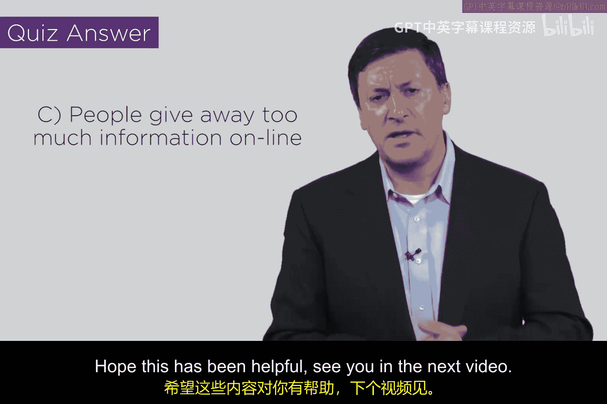

# 纽约大学《网络安全｜Introduction to Cyber Security》中英字幕（deepseek p140 3_钓鱼攻击.zh_en -BV1TFLZzYE26_p140-

Hi， everyone at Emmarosso here。 And I want to talk to you about a pretty advanced attack called Fishing。

 Now I say advanced because it works so well。 and there's so many different variations on how you can do it。

 I would guess that many of you would say that it's probably a very simple type of attack to carry out。

 Here's what it plays on。 we all know that email on the Internet is an open protocol。 For example。

 any of you and any of me or any of the folks here in our studio can more or less exchange email for the most part。

 right， I give you an email address。 you give me your email address。

 and we can send things back and forth。 That's what the Internet intended for email to be。

 that was the whole idea that it be open。 Now， that trust or that openness or that ability to support and foster communication is exactly what a fish in some sense takes advantage of。

 Now here's the idea。 Ki of two kinds of email， right。😊。

There's email that are just sort of casual communication and there are emails that are trying to get you to do something right and for example a bank might send you an email asking you to do something。

 to buy something， change something， update something or whatever or an administrator at work。

 an IT administrator might send you an email to ask you to do something to update this。

 to change that， to make sure you do that to click on this， click on that download that。

 you get the idea， system administration in most businesses has been very emailbased for years now。

When an attacker？Recognizes that there is that handshake between， say， a bank and a customer。

 The attacker can make an email look， quote unquote。

 very official can create the logos and the look and the font and the voicing of a particular bank or of an administrator。

 whoever you're trying to spoof。 you create something that's intended to look authentic and you send it from you to wherever。

 Now， the from you unfortunately， also on the Internet turns out to be relatively easy to spoof。

If you've studied spoofing， if you've studied internet attacks。

 if you've spent some time looking into this， you know that the underlying infrastructure。

 the protocols of the internet supporting email and the applicationle content for example。

 the fromline in an email are not tightly bound。 There are standards。

 there's a protocol called Dmar that allows you to tighten them up。

 but it's not a widely used protocols。 So for the most part。

 there's separation between content at the email level and infrastructure protocols that are moving things around between mail servers So turns out to be relatively easy to create an email that looks official that appears to be coming from some place that's reasonable and if you really can't think of a way to do that。

 let's say you're going after bank Xyzbank co Well。

 you know maybe you register XYz underscore bank co or。

you knowbank co or some domain would refer to that as an adjacent domain or a cousin domain to the original one and you send it from that domain。

 which you pay whatever amount for to register and own and then to the user looks authentic。

 asking you to do something looks like it's coming from some place that appears to be valid and it can be even worse because the attacker can deploy a technique called spearing and for a fish。

 we call that spear fish where they're going after you specifically they've done some research on you。

 they're not spamming 100 or a million users， they do research on you。

 maybe you're a corporate executive， maybe you're the chief financial officer for a company。

 they look into you create something authentic， sendend it from a place that appears to be reasonable。

 They've speared， they've done research on you and they get you to do something and what's the something they're going to want you to do。

 download malware。And how they're going to download malware by having you click on an infected link。

 do you see the tight loop， that's why I say it is simple， but it's kind of advanced。

 You really have to do your work and know what you're doing to some degree to make this work now。

The way that we deal with this， unfortunately， is very clumsy。

 There are some technology solutions that will go in and look for some sort of payload that may or may not be。

 in fact， it'll actually test and detonate URLs。 that's promising。

 but it's nowhere near enough wide deployment of that sort of technology that's promising。

 but what do we usually do， We usually try to train users to be careful what they click on have them hover over a link and make sure that as you hover and you read the link does it really look like it's coming from your bank co or is there something weird about the address。

 that training unfortunately is not really that effective。

 the problem is that it just cant can't get everybody to do it。

 We'll talk more about that in other videos， but the bottom line here is that phishing。

Is generally considered the first step in just about any advanced persistent threat or even nation state attack。

 It's kind of ironic， right， that a simple attack affecting a simple protocol with these。

Techniques that a child could learn to do。Are really embedded in some of the more advanced attacks that we've seen。

 So it's kind of a curious mix of simple and hard。 I often say that if you're the greatest burglar in the world and you walk up to a house and the windows open。

 do you really have to go taking an hour to decode and break in lock where you just climb through the open window you would do the simplest thing right So keep that in mind as you continue to learn more about cybersecurity。

 that attacks for the most part。 will take advantage of the easiest thing they can do and fishing turns out to be extremely effective。

 like most people tend to play on that trust are' used to clicking on links and email。

 And if you get something that looks official and it's coming from some place that seems reasonable And maybe there's something in there that knows something about you。

 the likelihood that you are going to click on that fish is spectacularly high。 unfortunately。

 we've got to work on that。😊，As a global community Now I've got a little quizzier。 the answer。

 the best answer there is the middle one see that the spearfishing does involve researching targeted individuals and this idea that people give away too much information online certainly enables and enhances the likelihood that a spearfish is going to work so hopefully this helps your understanding of ph and how spearfishing can target someone and how the basic elements of making something authentic。

 making its source look reasonable， using spear to do something that's useful about you or or that will help you you know think that it's reasonable all of the above。

 go into the equation of making fishing a particularly effective attack on the internet。

 hope this has been helpful， See in the next video。

