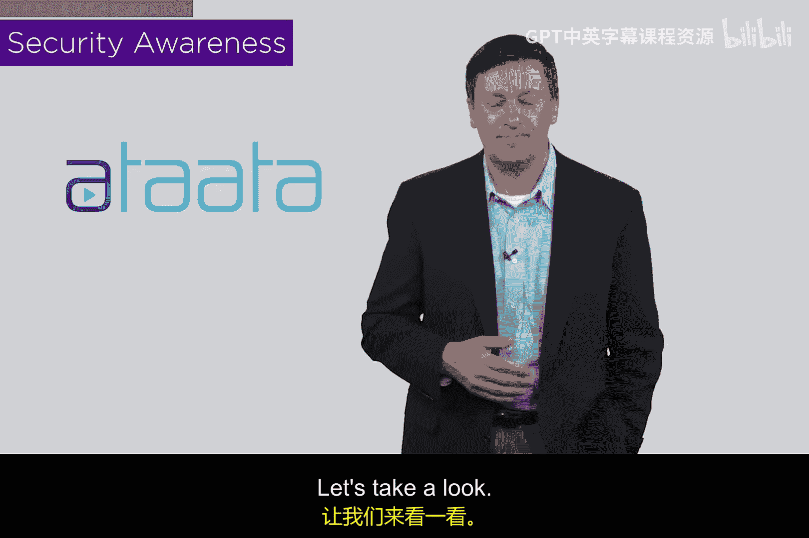

# 纽约大学《网络安全｜Introduction to Cyber Security》中英字幕（deepseek p142 5_使用视频提高安全意识.zh_en -BV1TFLZzYE26_p142-

Hi folks， this is Ed Ammarro and I want to talk to you a little more about security awareness and security awareness video in particular。

 Now， when you're trying to convince a group to do something in our modern time。

 there's a few ways that I think we've all seen work。 number one， social works， viral works。

 humor works and clearly video works。 It's old sort of emails that you might get at work。

 know a stern sort of video saying to all staff do the following， nobody reads that stuff anymore。

 In fact， the younger people in particular， will hit the delete button on anything that looks like it requires a lot of reading and a lot of instruction that needs to be followed。

 But if that's replaced with something interesting， like a fun。

 viral video that get your message across and in this context。

 the message around security awareness like， for example。

 being careful which you click on being careful which you download， being careful， what you save。

 you shouldn't be saving a bunch of real important stuff。

That maybe could be put off into a cloud server or being careful what you share， like what you say。

 what you're doing。 you might be in an airplane and you're blabbing too much about corporate secrets。

 we've all seen that happen。 So these basic security awareness messages for the most part。

 I think in modern context are best accomplished using video。

 Now there's some wonderful companies doing this。 a lot of good examples it might find on the Internet。

 but my good friend good friends from Attata have created content that I think is just wonderful and they were kind enough to share some examples here。

 we're going to see a little video clip here that I think you're going to enjoy。 It's a great。

 great illustration of how video can be used to accomplish wonderful cybersecurity objectives。

 Let's take a look。😊。

