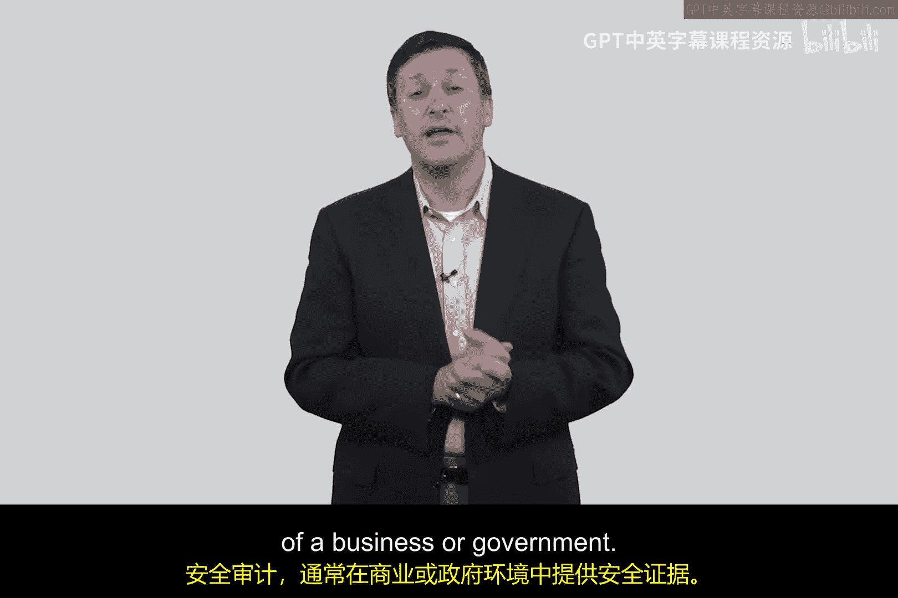

# 纽约大学《网络安全｜Introduction to Cyber Security》中英字幕（deepseek p143 6_安全评估与审计.zh_en -BV1TFLZzYE26_p143-

Hi， everyone， Ed Ammarosso here。 and I want to talk to you in this video about security assessment。

 Let me start a little story。 In the early days of cybersecurity， particularly at our conferences。

 it was pretty obvious that the security equation broke into two pieces。

 The first was building functionality to protect system。

 building encryption systems and authentication system。

 the functional mechanisms that comprise what most of us would consider cybersecurity。

 But there was a second piece of the equation it was referred to as assurance or also as the trust like how do I demonstrate or provide convincing evidence to somebody that what I've actually built is really working。

 Think about it。 security doesn't have a lot of good demos right I've built something that's going to prevent an attack。

 So now proved to me that you did well。I can run a bunch of attacks and show you that they don't work。

 but how do you know that there aren't other attacks that maybe I didn't think of that would work So you can see that it is reasonable to think of security in those two contexts as building something and then providing evidence that。

 in fact， what you've built is secure it turns out there's a couple of different ways that that evidence can be built。

 One is something called security assessment。 It's usually very nonconfrontational thing。

 It's usually a scheduled project， there's usually some discretion about being put in place a nice partnership between the assessors and the team building something gonna come in and together try and determine are there weak spots。

 can I test for certain types of things Can I do an overall architectural assessment or investigation to try to determine if you've done things right security assessments are best done by experts with some experience once in a while。

 you may see some younger。People learning might be some apprenticeship that goes into the business of security assessment。

 A lot of you watching might get a job at some point working for。

 say a consulting firm or a security architecture firm or a penetration testing firm that does assessments that come in and they follow very structured methodology to look at you know things that'll you go through the different phases and trying to understand where there might be some weak point So security assessment is like I said。

 non-confrontational theres a second approach and that's referred to a security audit and that is a little different security audits usually are confrontational it's not those adversary。

 but the auditor is not necessarily sort of working hand in hand with the team that's building the system。

 they're in there to find problems that you know may not be scheduled there may results thatll come out that may not have a lot of discretion may go out to the whole company。

You get a grade so it can be a little different。 The relationship between auditor and sort of auditee are in fact different Now the goal in both cases is to try to provide evidence that a system is in fact secure and like I said it's a little different than you know if I was building a communication system that had to meet。

 say some performance characteristics like I had to build a system that supports a 10 gig requirement。

 I put it in place， we drive 10 gig through and we all high five because we did it if the security requirement there it's something that's not as easily demonstrated then we become reliant on these two approaches。

 security assessment through partnership or security audit which is done by a third party and may not be partnership may not be the word that would be used both are important。

 both are things that you should understand and you should recognize the difference between the two they certainly are both。

Focused on evidence， but they're accomplished in slightly different ways。

 Hope this has been a little useful comparison of security assessment。

 security audit toward providing evidence of security in the context。

 usually of a business or government。 I hope this has been helpful， thanks。😊。

