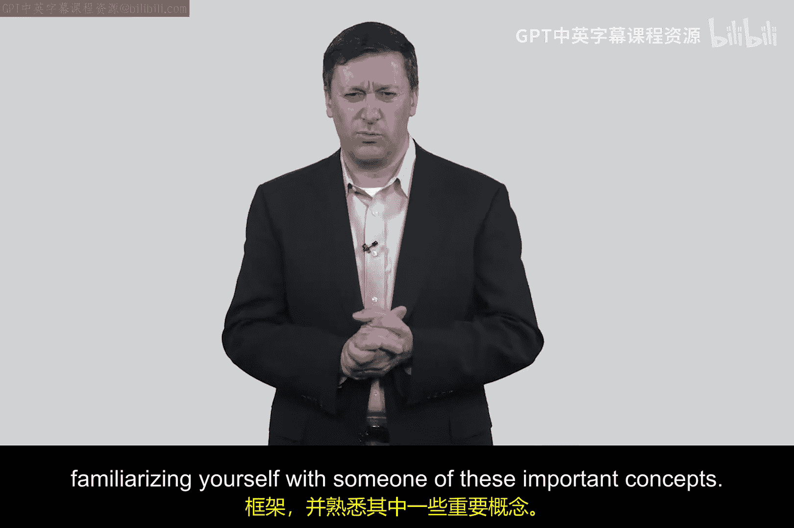

# 纽约大学《网络安全｜Introduction to Cyber Security》中英字幕（deepseek p145 8_NIST框架概述.zh_en -BV1TFLZzYE26_p145-

Hi， folks at MRmarosso here in this video I want to tell you a little bit about a cybersecurity framework here in the United States from an organization called NIST。

 the National Institute of Standards and Technology。

 and we refer to the framework as the NIS cybersecurity frameworkra， a little background。

The idea of demonstrating some property of software or computing systems。Is done in one or two ways。

 One is you can look at the system。 And the second is you can look at the process that produced the system。

 For example， a analogy here is if I wanted to find out if you had some disease， I can A look at you。

 investigate， look at your blood， do you know， a checkup see what I can do。 Take X-rays or B。

 I can ask you about where you've been， what you've done， what your lifestyle is。

 where you've traveled， what you eat， how you do you smoke and sort of do a workup on on how your lifestyle cycle as a human being proceeds in order to make some sort of prediction about whether you may have a problem。

 Comp systems work the same way。 And these frameworks tend to focus on the latter。

 a little bit more about process than kind of digging in and looking at something。

 So the NIS framework follows a long series of models that we tend to refer to as maturity models where we。

measuresure how mature your process is We in immature process is just terrible and you're probably going to be producing security that'll be weak and ineffectual and so on because I can just look at how you build things and it's not good。

 you're not doing the things that need to be done all the way up to a very mature process。

 We're doing a lot of wonderful things doing the kinds of things that are going to be reducing risk and the NIS framework breaks the whole thing down into five categories and refer to them a lot of times as columns and sort of famous N cybersecurity framework diagram。

 The first column is about identifying issues， the second column is about protecting systems。

 The third is about detecting issues that may actually be going on。

 The fourth is about responding when something has happened and the fifth is about recovering or learning。

 and within each one， there's some very specific guidelines and some specific categories that。

Someone using the NISist cybersecurity framework can employ to measure their own process and hopefully improve it。

So you can measure a gap between what NISistT is recommending you do in these five different critical areas。

And what you're actually doing so it's been extremely popular framework。

 it's something worth taking some time and reading。

 you know those of you are sort of following along here with our lectures。

 taking some of the courses and quizzes and so on will know that one of the requirements here is that you actually read large chunks of this cybersecurity framework it's something I want you to be familiar with it's kind of dry reading reading frameworks is sometimes like reading the dictionary。

 but I think it's worth taking the time to just familiarize yourself but some of the more important components like under identify if asset management and business environment and governance and so on these are all areas that anyone trying to deal with risk in a business needs to know about and under the protect column there's again access control and awareness and training and data security and on and on and on under detect there's the issue of how you're dealing with anomalies and dealing with different types of events。

 the respond area。ro your planning and communication。

 these are really important areas and certainly recovery is， again。

 about planning and how you can learn from problems。

 So it's a powerful means for anyone interested in improving cybersecurity to use a clear rational framework。

😊，Based on a maturity model to try and improve the way that you're doing security as an organization。

 So hope this very brief summary to the N cybersecurity framework originated here in the United States is useful to you。

 and maybe inspires you to go off and take a quick look at the actual framework and familiarizing yourself with some of these important concepts。

 I hope this has been useful。 I'll see you in the next one。

