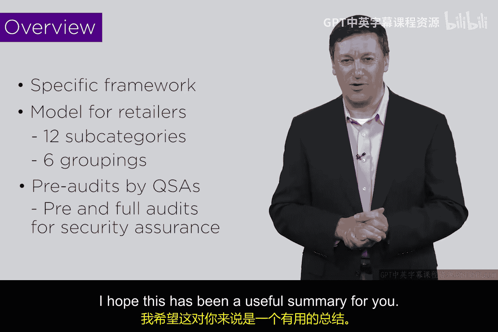

# 纽约大学《网络安全｜Introduction to Cyber Security》中英字幕（deepseek p146 9_PCI DSS框架概述.zh_en -BV1TFLZzYE26_p146-

Hi， folks at Amarosso here， and I want to spend some time in this short video。

Kind of introducing a framework known as PCI， DSS。That stands for payment card industry。

 data security standards。's hard to say that right a lot of sounds in there。

 So PCI is really intended to reduce the risk of cyber attacks to retail businesses that we see so many attacks to credit card readers and servers keeping track of retail information and your private account data and definitely your credit card information I mean my goodness。

 see one after another of these kinds of breaches over the last 10 years。 So the industry。

 the payment card industry， credit card industry basically decides。😊，This is not reasonable。

 We need to improve our industry。 Security is not acceptable。 People。 they stop using credit cards。

 that it's a big blow to that industry。 Obviously， so they had to reduce the likelihood of these attacks by increasing trust。

 So what they did is came up with a framework。 these data security standard requirements that they impose and levy on anyone involved in the payment card industry。

 and they've got a whole discipline has emerged a job。

 a profession called a QsA or qualified security assessor。 It's a job。 It's a profession。

 It's something that an auditor might specialize in。

 where they'll go in and either do a pre-assess or pre-auit with a business to see if they're consistent with these PCI requirements or they'll actually come in and boom at test with their stamp of approval that a particular company has in fact。

 met the PCI requirements。And there are all these complications around you know where you live in the context of the retail industry。

 you might be a retailer actually dealing with credit cards or you might be say a service provider just kind of supporting that industry and they're different gradations of requirements that are imposed depending on what your role is in the credit card industry so there are these different categories。

 there's a diagram that we can put up that shows networks and systems as one category a second is the vulnerability management program。

 a third is monitoring and testing of your networks， a fourth is the protection of cardholderer data。

 fifth access control measures and then the sixth is your information security policy and these are all broken up into 12 different subcategories。

 these are all requirements that you go one at a time through。

 just like any framework looking for gaps， you're looking for a place where your requirements。

Don't match the requirements the PCI demands and if the gap exists， the gap has to be closed。

 a QSA has to come in， validate that you've closed it。

 there has to be documentation and on and on and on this is called security assessment and security audit the assessment is the preauit。

 the real audit activity is done by the QSA with the attestation it really is a complicated issue now the foundational problem is that amidst all of this we still have retail hacks。

So I think anybody， even a QSA with years of experience would tell you that while this reduces risk。

 it doesn't remove it。 It's important。 security assessment and security audit， reduced risk。

 They don't remove risk。 So it's still there。 It just makes things a little better。

 makes it makes our retail system， something that we can trust。

 a big improvement has been this move from magnetic stripes on the back of cards to chip and pin。

 chip and signature here in the United States were a little slower to the sort of thing and it was October of 2016。

 that there was a requirement that businesses really moved to a chip kind of model。

 whereas in Europe and other parts of the world that had been done much sooner。

 that certainly reduced risk。 that was something that I think was a real contribution in the retail industry to greater trust and greater assurance。

 but the reality exists that it's still a problem。Attack and the fact that there's money involved here makes this very consequential。

 so kind of the learning here is that this is a very specific framework has a very specific model with 12 subcategories and six groupings。

 QsAs will come in and do pre-auits and then full audits to produce an attestation that businesses need to continue taking credit cards。

 the whole process I would claim has in fact， reduced risk considerably。

 but it hasn't removed it that's something that we need to keep in mind。

 I hope this has been a useful summary for you。 I'll see on the next one。

