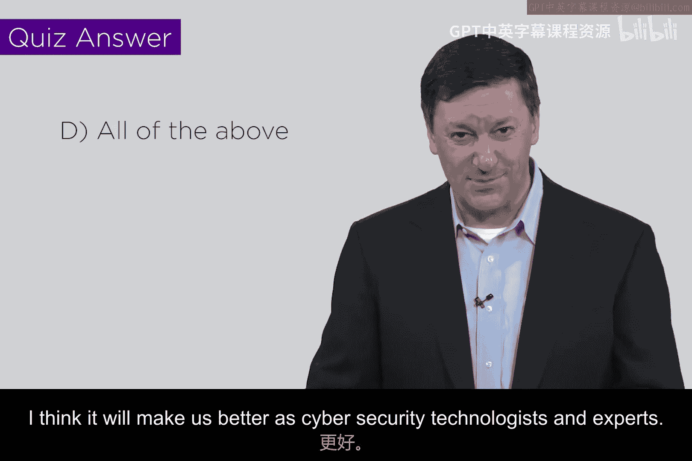

# 纽约大学《网络安全｜Introduction to Cyber Security》中英字幕（deepseek p147 10_合规性与安全性的挑战.zh_en -BV1TFLZzYE26_p147-

Hi everyone， this is Ed Emmarroso and I want to talk to you about a topic known as security compliance in this video Now if you want to stop cyber attacks in your business。

There's four things that you need to do First is you're gonna to need a baseline compliance program。

 we'll talk a little bit more about that in a minute on top of that compliance program。

 you need a technology program。 You need to have firewalls and intrusion detection systems and cryptography and so on。

 and you can sort of think of these as building a higher and higher fence like a compliance fence might be a foot high or whatever metric you use to measure and then two feet would be compliance plus technology on top of technology。

 there's a layer called architecture。 How are you set up， you know what is your architecture。

 you're using a perimeter you're out in cloud， what is your configuration if you do that well。

 say maybe that's a third foot in the fence。 And then finally there's an operational layer。

 Do you operate your systems properly Are you patching or you you know properly attending to situational awareness and real-time security You do all those four things you're probably doing pretty good job。

You're gonna build security height that you could argue is required to prevent cyberatack and now that brings us back to the first piece of that fence。

 that base first piece called compliance the height provided by compliance is not sufficient to stop cyberattack it builds a base on which you can create a program that will stop cyberattack now why is this so important。

 it's so important because just about every business and government in the world assign so much weight to compliance。

 if you get attacked publicly in a lot of different countries。

 your business cyberattack there may be a government agency that's going to impose a financial penalty on you and also an operational penalty meaning that may give you a new compliance requirement。

 a new framework that they want you to demonstrate that you meet on the theory that the reason you got attacked is because you weren't attending to compliance properly。

Now， look， that is possible。 It is possible that the base of your fourfoot fence is just terrible。

 You may have a bad compliance program。 In which case。

 that is the right way to rectify your situation。 fix the compliance。 but another possibility。

 I that the compliance program is great。 that you do everything that needs to be done。

 the right password length， the right access requests。

 all the different requirements that exist in a business。 You do them and you do them well。

 and you've had them attested to by a third party， you do assessments。 you do audits。

 you have the paperwork right， it might be perfect。

 but let's say you have terrible tools that you're using。

 You just have ineffectual cybersecurity technology。 This doesn't work。

 you're supposed to have a firewall。 check， I've got it。 What did I put。

 I put a bad firewalls as opposed to a great one。 I get attacked is the problem compliance。 No。

 that problem。But you got a crappy firewall， so this idea that we can solve problems by just attending to stronger。

 greater， more fine tune compliance。Is not right， but like I said。It could be the problem。

 but it isn't necessarily the problem。 If we look at the four layerer model。

 it be any compliance technology， Arch operation could be any of those problems。 or all of them。

 And if you just decide that compliance is the only way we can fix ourselves after a cyberatt that we've got an issue。

 I suspect some of the people who are with us watching this video。

 some of you maybe decision makers in government。 And I would beg you to rethink this idea that when there's an issue。

 it is always a compliance fix that's most appropriate。 That is not true。

 doing some investigation trying to determine what the root cause of a particular problem is。

 And then deciding perhaps there's a compliance issue， that's a different story。

 But if the compliance looks good， there ought not to be additional compliance burden put on a business。

 because what does that do， it just creates paperwork。 It's not going to change things much。

 And in theory。Could be viewed as actually weakening the security of the group that you're actually trying to help。

 So think that through。 Let's be a little more mature。

 more thoughtful about the way we use compliance before during and after a cyber attackack。

 Now Ive got a little quiz here。 And the answer is， in fact， D。

 I think one of the reasons people do gravitate toward compliance as as a response to cyberatack is for all the reasons they just laid out they're familiar。

 They're easy that can be written down doesnn't mean that it's going to actually change things。

 but they tend to be easy to deploy。 So let's keep all of that in mind。

 and let's make sure that we understand the difference between compliance and security。

 I think it'll make us better as cybersecur technologists and experts。 I'll see on the next video。

