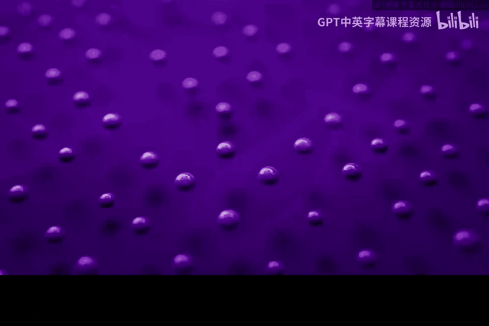
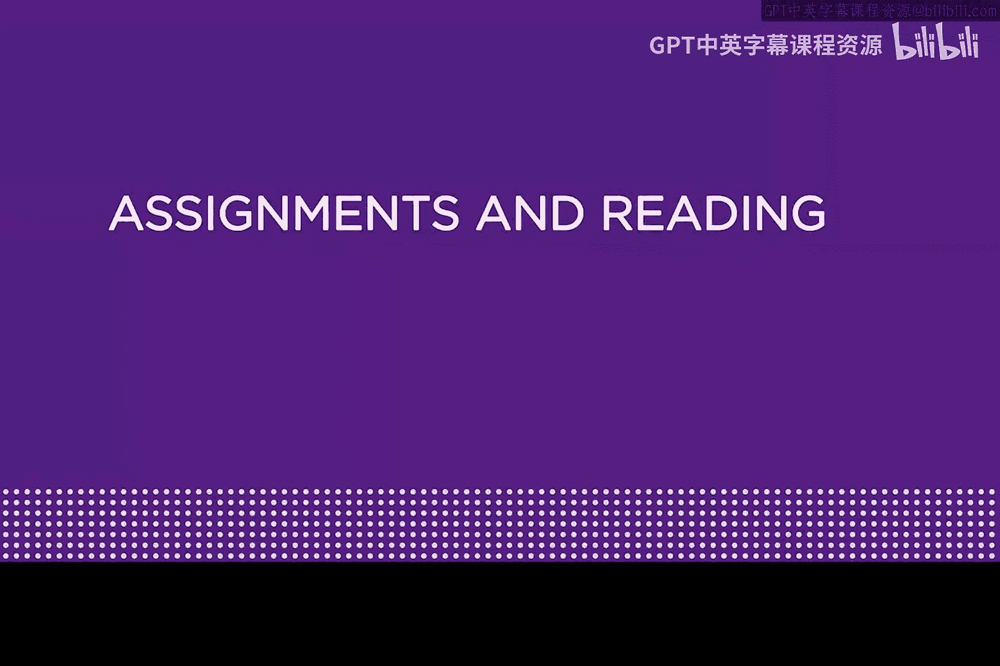
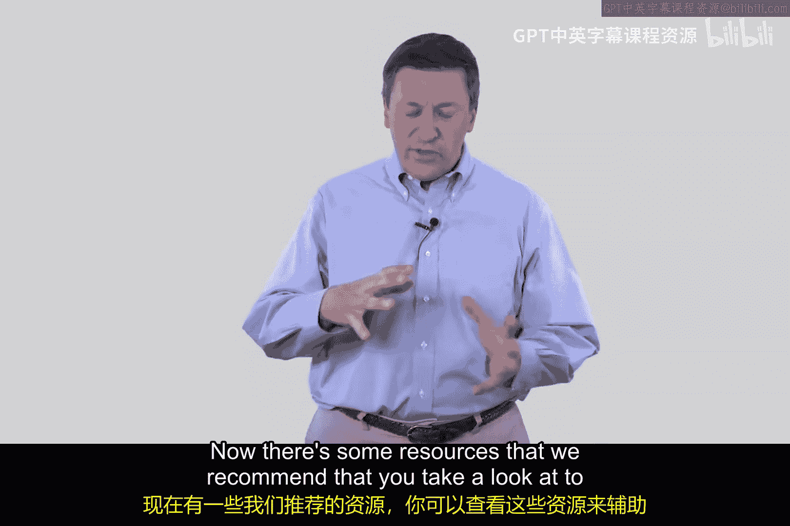
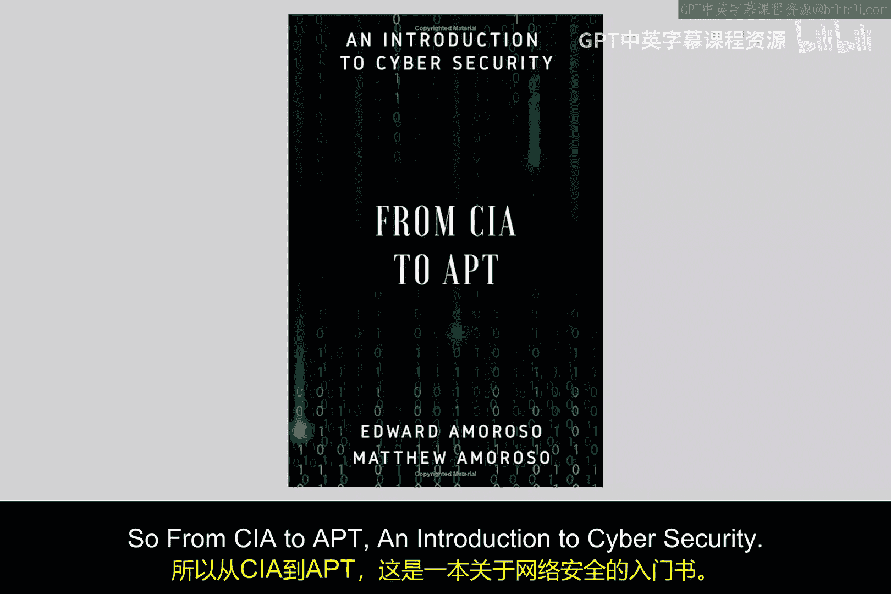
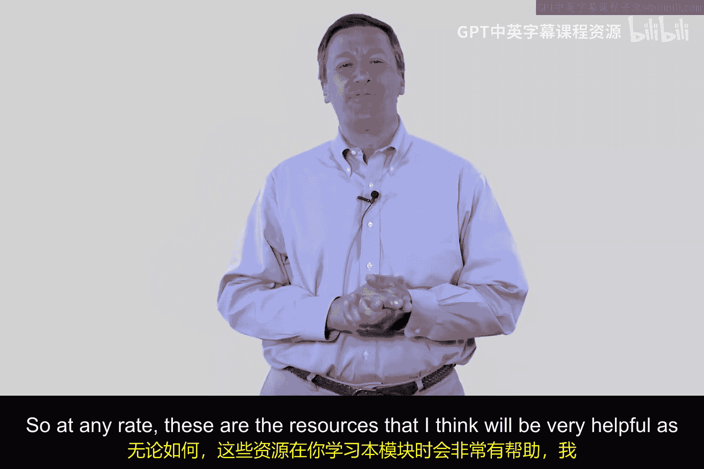
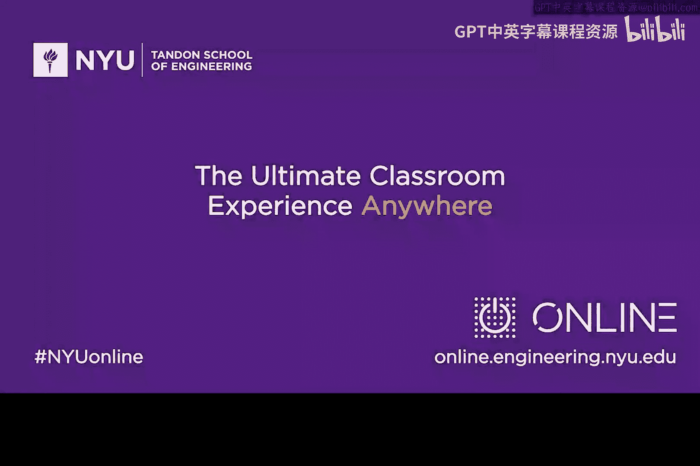

# 纽约大学《网络安全｜Introduction to Cyber Security》中英字幕（deepseek p149 12_作业与阅读.zh_en -BV1TFLZzYE26_p149-

Hi everyone at Emmarosso here and I want to welcome you to this module it' our goal in this module。

 some very cool technology related to cloud security and micro segmentmentation and some of the advanced techniques that are really topical right now in modern cybersecurity for the enterprise and for infrastructure Now there's some resources that we recommend that you take a look at to complement your learning in this module。

 one is an ebook that I've written with my son Matt optional。

 but if you like you download it from Amazon and you should kind be around chapters 2728 in the ebook from CIA to AP and introduction to cybersecurity and then second a paper that I wrote for IAE some number of years ago that just gives a survey of the practical methods that you can use to secure cloud I think it's perfect complement to the material in this module So at any rate。

 these are resources that I think will be very helpful as you go through the module and I hope you enjoy。

All of them， thanks。

