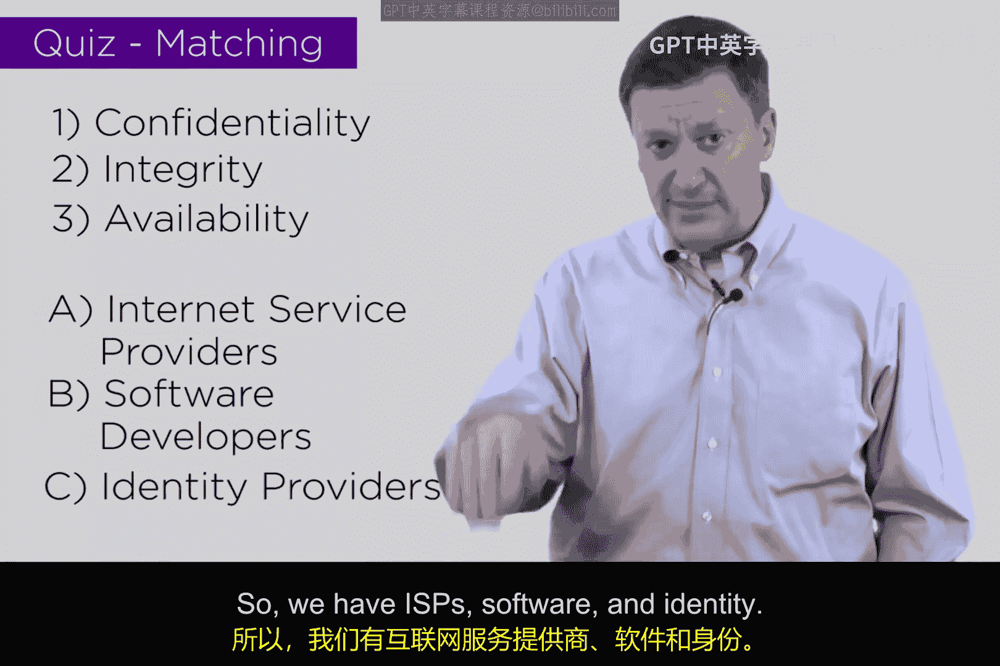
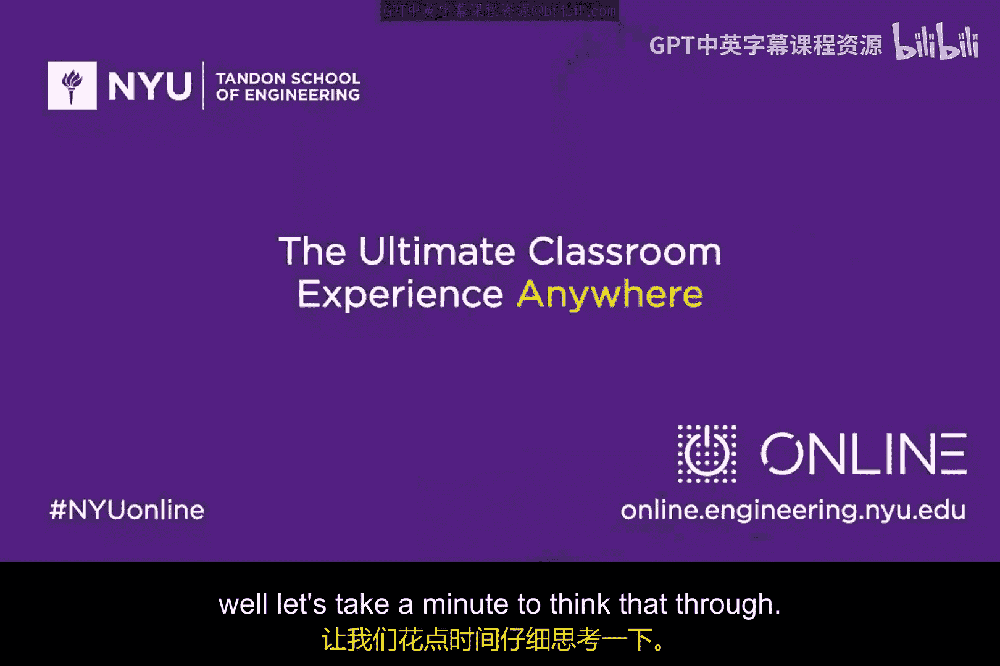

# 纽约大学《网络安全｜Introduction to Cyber Security》中英字幕（deepseek p15 15_匹配测验.zh_en -BV1TFLZzYE26_p15-

I want you to think about different types of industries now。So when we think about industries。

 I mean， you know， broad sectors of business， and I want you to think about what of the first three。

 let's take the three CIA， which of those threat types would match。

The greatest intensity for given sectors。 So let's start with service providers。

 That'll be a Internet service providers。 What would Internet service providers be concerned about as their primary threat。

 Second would be software developers。 What do you think software developers would consider their primary threat。

 And third， identity providers， identity vendors， people are dealing in identity。

 checking your identity checking validity and so on。 So we have ISps， software and identity。

 And those three sectors， which do you think， Well， let's take them think that through。😊。

