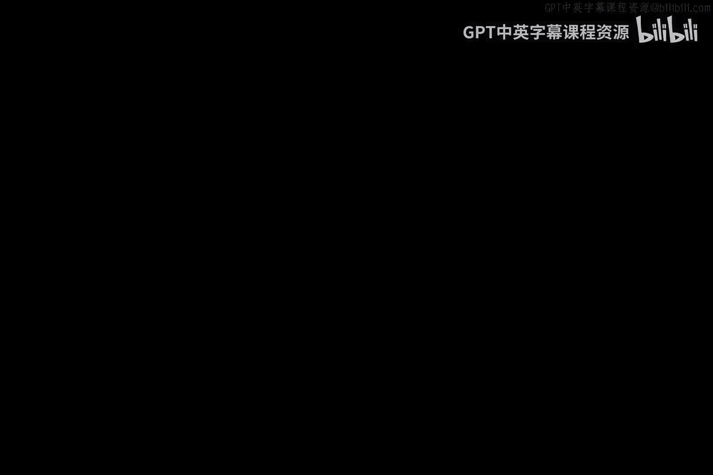
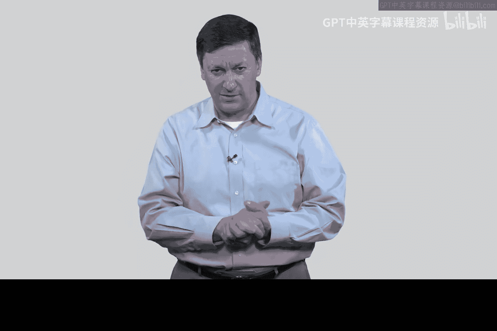
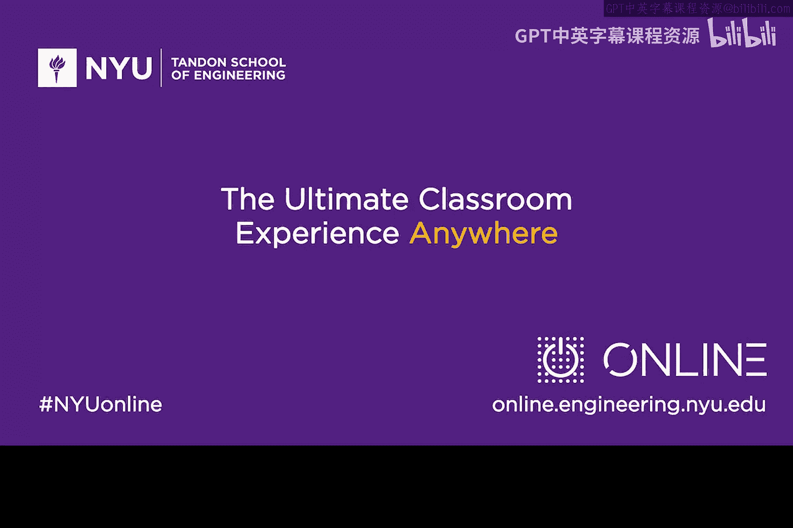

# 纽约大学《网络安全｜Introduction to Cyber Security》中英字幕（deepseek p151 14_工作负载微隔离.zh_en -BV1TFLZzYE26_p151-

Hi everyone， Ed Amarosso here and in this video I want to introduce a cybersecurity technique known as micro segmentmentation here's how this stuff works。

Everyone is comfortable with the idea that users。Try to access apps to get things done。

 right and we used to just call them applications when they lived in the enterprise when they became mobile。

 suddenly applications became apps。 But the idea of a client server。

 Alice and Bob user and app were're so familiar with that cadence that you to get work done。

 you have a user hitting an app。 now， when we had all this inside a perimeter。

 both the user the network medium and the application were all hosted and contained within one firewall based perimeter protection。

 We had it all quote unquote inside the firewall。 And we said the user was trusted to hit the app。

 why isn' it all the network that's inside the firewall。

 we're good Well as we transition to hybrid cloud doesn't work that way anymore。

 It's different right， suddenly the application has found itself hosted into cloud on a virtual。

SystemAnd basically accessible via mobile connection So now we have a new picture where have a user。

Accessing a virtual app that sits on a virtual operating system in subp cloud。 And we go， okay。

 that's great， except。😊，I don't have that big perimeter to wrap around this。 And yeah。

 there's a bunch of different ways that we could go about trying to secure this。

 Some of you immediately might be thinking， well， what about cryptography。

 Why don't we do that or why don't we harden the endpoints or do all these kinds of things and they're all valid。

 but the technique I want to teach you here it's called micro segmentegmentation。

 which is basically a way of creating a little perimeter around the app。 Do you follow。

 So instead of having a big perimeter around all my infrastructure。

 if I can somehow put a little shrink wrapped perimeter around an app。

 then that might be something worth investigating now， if I had to buy hardware to do that。

 I just don't think this would work。 you have 1 thousand0 apps and you're all protecting them with one firewall in the enterprise。

 And then you throw that out， you scatter them around cloud， I'm not going to buy 1000 firewalls。

 if it's hardware。 It's just not going to work。 but the beauty of virtualization is I can deploy。

Software and I can deploy software virtual appliances to that cloud operating system how cool is that so what you might do is in addition to having the virtual app hosted in that virtual operating system on cloud。

 I can take， let's say a virtual firewall and a virtual intrusion prevention system。

 put those appliances quote unquote in front of that app so that the user now accessing the virtual app and cloud has to go through the virtual firewall。

 virtual IPS before it hits that virtual app that's hosted in cloud， how cool is that。

Like the idea here is that I can tailor a microparmeter around an application and think about the rules that would be required here。

 What do I have to put in the firewall， Do I put thousand rules in here。 that sport。

 you know email and HDB。 Well， only if the app requires that if this is a database app where I'm just going in。

 updating a record and leaving， then the only requirement I have at that firewall is that users can come in whatever port is required has to be open。

 I'll have them update records and leave。 That's kind of cool。 The firewall can be very simple。

 The IPS can be looking for some very simple signatures and pattern changes。

 This is an interesting concept。 This is something that I think changes the nature of the way we do cybersecurity and cloud because it requires that we think more about the data。

 the application， the objects and the way cloud designers would refer to this whole thing is。

They would call it a workload， meaning it's not so much the virtual app but the work activity that gets put in cloud gets its own perimeter so for example there might be a human resources or HR function that allows you to add employees and to remove employees so you get hired into the company and I add you to all the different things and then you leave the company and I you know take your name out of all the different database that could be a workload that you can move to cloud you might build a microparmeter around that and it's possible there could be a couple to few apps。

 but the idea is more around workload than app this is an advanced concept this brand new this is something that you know as you're listening to me the most senior。

 the most experienced cybersecurity teams are beginning to investigate how to do this sort of thing as a means for supporting the transition from private perimeter-based security。

To hybrid security to eventually full public security。

 we need ways of wrapping and protecting our applications and workloads。 So keep that in mind。

 this idea that virtualization enables the use of software。

 software enables the use of potentially a very light and easily deployed perimeter that can be tailored to the specific needs of an application or workload can become embedded in cloud。

 and in a sense， becomes a shrink wrap perimeter for applications and workloads。

 very powerful concepts， microsegmentation， something that I hope you'll keep in mind。

 as you advance in your understanding of cybersecurity。 I'll see in the next video。

