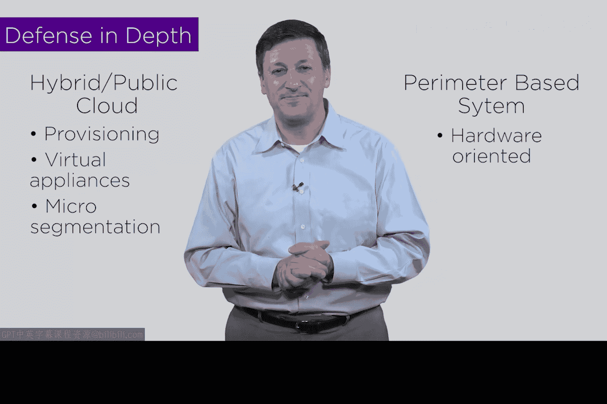

# 纽约大学《网络安全｜Introduction to Cyber Security》中英字幕（deepseek p152 15_通过微隔离实现深度防御.zh_en -BV1TFLZzYE26_p152-

Hi， folks at Emmarosso here。 And in this short video， I want to introduce you to a basic topic。

 a basic concept in cybersecurity known as defense in depth。 And in particular。

 I want to show how it applies to the use of microsegmentation in cloud。

 Let's start with defense and depth。 the term itself is pretty indicative of what it means。

 that if I want to protect an asset from hackers。 if I put one protection between the hackers in the asset。

 I don't have a very deep solution。 They breach my one protection boom。

 they have access to the asset。 But let's say I build two or three or n of them。 Well。

 now the idea would be that if there's a failure at any particular layer that as long as I have some degree of diversity between the other layers that maybe something else will stop the attack。

 if I don't have diversity。 If's all it's the same protection。 And I invent or discover the。

To that door or that wall like go through all of them。 But if they're all different， one's a door。

 one's a wall， one's a code， one's something else。 then at each step。

 I have a different puzzle or challenge that I need to solve to get through if I'm the hacker。

 So this idea of depth is rooted in good cybersecurity architectural design。

 So we have an example let's say a connection across your ISP to some set of PC and server assets that you're trying to get access to first layer might be a firewall。

 I can say that's a first depth layer that we would have to get through for attackers。

 then there might be an intrusion detection system Is that I have to get through because presumably it might detect what I'm doing in ding some alarm bells somewhere。

 Third might be a password layer It's going ask me for a password and maybe I can guess it maybe I can't The next might be checking for any virus like that would be a fourth layer in our depth model and fifth the whole stuff assets might be encrypted。

So you can see that to go from hacker to PC or server assets。

 if I've got a good layered defense in depth model may not be so easy for someone to gain access to our systems。

 So now I want to show how this defense in depth model kind of plays in the context of micro segmentegmentations。

 So let's look at the next charter。 you can see a picture of a user。

 you can see a first defensive layer basically being a physical firewall。

 Why not a physical firewall for the cloud service provider and then embedded in that cloud is a micro segmentegment that might be tailored to or shrink wrapped to every workloader app in the cloud。

 do you follow it doesn't have to be the case that just a micro segmentegment is the only protection。

 you can have other things。 I can put physical firewalls。 I can put other protections。

 And even within the micro segmentegment itself， we can see that there may be multiple virtual appliances。

Fiwall， the IPS， you could probably put 10 other things in there if you want。

 This is a powerful concept， this idea that using virtualization to build additional defensive layers。

😊，Additional defense and depth can be done without hardware， done lightly done through provisioning。

 it suggests dare I say。That perhaps public cloud will be significantly more secure than the kinds of things that we saw with the original conventional perimeter based security。

 That's a big deal。 Let me say that again。 That's so， so profound that it begs repeating。😊。

The original concept of a perimeterbased system， even with some defense in depth。

 was probably very hardware oriented as we move to hybrid and eventually to public cloud。

 what we end up with is the possibility that through provisioning through the use of virtual appliances through the use of microsegmentation with its own layers。

 and through the use of other types of protections combined with micro segmentegmentation。

 we really produce a very high security result， with lots of layers， most of them virtual。

 So we have lower cost， more flexibility。 But in the end。

 I think it supports the contention that the move to public cloud is actually more secure rather than less secure than staying in the enterprise。

 Hope this has been useful。 I'll see you in the next video。

