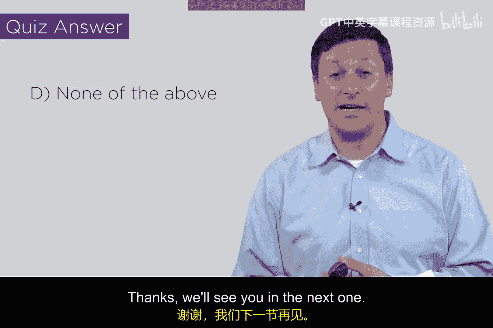

# 纽约大学《网络安全｜Introduction to Cyber Security》中英字幕（deepseek p153 16_云访问安全代理.zh_en -BV1TFLZzYE26_p153-

Hi， folks Ed Ammarosso here。 And in this video， I want to introduce a security component for cloud that's referred to as a cloud access security broker CAB。

 and what we do is we just call it CASB。 It's a term that actually was invented by the Gartner company。

 I always liked that。 I thought it was a good way of describing the concept。

 and let me see if I could motivate。 So you've got users that are normally just hitting applications and workloads on a land inside an enterprise。

 There's really no need for doing security arbitration in the midst of that path inside the firewall。

 this is what it is。 we've had that model for 25 years。

 As those applications move to public clouds suddenly have the obligation to fix them and in other videos we've talked about the possibility of maybe introducing something called a microsment which is essentially a container that we build around an app or workload and we can introduce virtual appliances into that container。

environmentronment to protect natively and to shrink wrap some sort of protection than but what if I've got lots of different clouds scattered all over the place and I'm using workload you know hosting on five or six or1 different clouds and I want to impose one type of protection let's say I want to do common intrusion prevention for all of them Well I do that and I have the micro segmenteged model。

Then I'm obliged to put the security in each of those microsegs。

 right if I have an I and 25 different micro segmentsegs。

 I have to orchestrate rule changes for all of those。 that may not be your favorite thing to do。

 What a caSby does is it potentially sits in the middle serving is a broker。

 a security broker potentially for multiple clouds。

 There's some nice man in the middle security functions。

 You can see a diagram here where we have a user hitting a cloud that does have microsegmented protections。

 virtual firewall virtual I we show physical firewall sitting there in front of the cloud service provider to stop stray garbage from maybe coming into the cloud land。

 now we've introduced another layer。 The Casby sits between the user and the cloud and multiple clouds。

 providing access control monitoring， logging， auditing。

 all sorts of nice capabilities can go right into that very common function that supports。😊。

Multiple clouds， multiplele heterogeneous clouds， in fact， it could be from different vendors。

 different service providers。 So extremely powerful concept。

 one of the things I particularly like about CASB is that it provides ones stop shopping for auditors and for compliance managers。

 So for example， if I wanted to have a pretty good understanding of who's accessing cloud like which of my enterprise users are hitting cloud when under which conditions what are they doing a CAsby can sit there and develop that kind of telemetry that gives me a good understanding of who's using the hybrid environment and for what purpose so definitely a tool that I think has not only taken root in most cybersecurity architectures。

 but I think it's going to be an important component moving forward as users try to hit containerized environments in cloud。

 So I've got a little quiz here the answer is none of the above I mean these are not the kinds of things that drive a CASB。

 the kinds of things that do drive a CASB。BeA multiple cloud environment， heterogeneous， you know。

 some requirements that that you would like to be able to impose in a common way across multiple containers without without having to touch each micro segmentment individually。

 So CaSBs are very useful for that。 And yeah， they do support compliance。

 but certainly none of these different components in the quiz I think justify the answer。

 So it would be none of the above。 I hope that's helped your understanding of CaSB。

 And as you continue in your learning， you'll see how vital a CaSB is to a security architecture。

 Thanks， we'll see in the next one。

