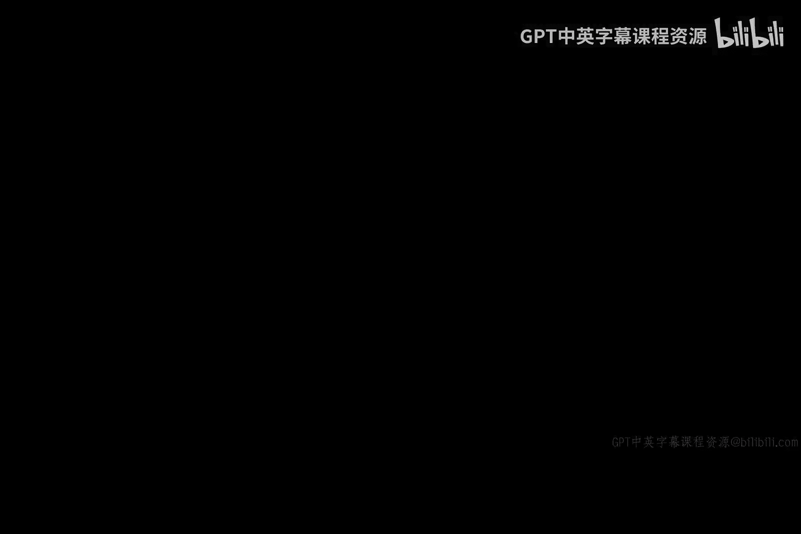
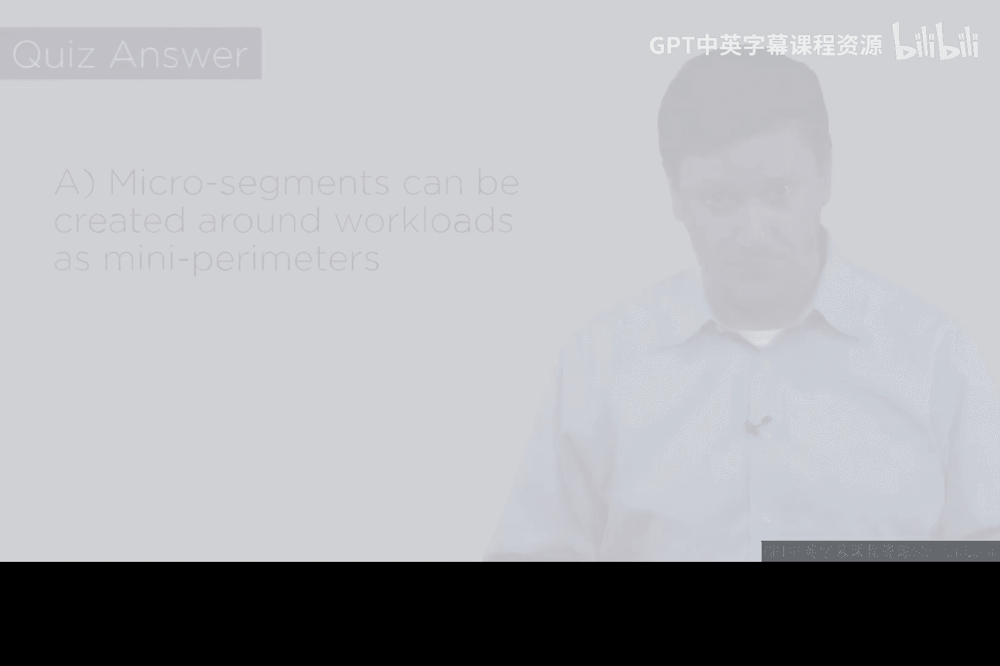

# 纽约大学《网络安全｜Introduction to Cyber Security》中英字幕（deepseek p154 17_高级混合云安全架构第1部分.zh_en -BV1TFLZzYE26_p154-

Hi， folks at Amarosso here。 and in this video， I'm going to call this part one of learning to do an advanced hybrid security cloud architecture。

 So this is pretty advanced stuff。 you're going to like it。 Now， let's start with。😊。

The basic premise that you have for virtual internal workloads that sit inside your perimeter。

 And when I say virtual， I mean that there's its software， these are applications that are running。

 They sit in your data center。 They sit on your servers， but they can more or less be moved。

 are these are capabilities like email and remote access and so on。

 So let's start with the premise that they sit in your enterprise and that your perimeter is leaky right。

 It has the ability for hackers to get in and we don't like that。

 we want to kind of move from this to an environment where each of these quote unquote workloads or assets。

Are their own sort of self-protected entity in some cloud。

 So we want to go from this diagram that you see on the chart here where I've got an oval showing the perimeter with the breaks in it and for internal assets to something that we think will be more cloudlike。

 So let's start by we just sort of redraw it to the left of the picture here showing the same thing。

 And I'm going to start by selecting one of the workloads here called outsourcing。

 So maybe you have a gateway that all your outsourcing vendors come in and hit and they put information and whatever they do you know as outsourcing providers and normally they come into your enterprise to do that。

 But what do we want to do we're going move that thing into some cloudbased virtual data center。

 that's VDC in the diagram you can move the outsourcing workload out there。

 and notice we were able to actually clean up the enterprise perimeter rule set a little bit。

 So used to be a rule that we need。To support outsourcing。 Gu what？

 I don't need that rule in the legacy enterprise。 Hence my firewall for the legacy enterprise actually improves because I've moved something now。

 how am I going to protect that thing out in the virtual cloud。 Well。

 let's build a micro segment around that and the micro segmenteg again is a shrink wrapped sort of virtualized container that we use for the outsourcing workload that includes whatever security functions you think are necessary for that。

 So we've now moved one workload out to the cloud。 let's pick a second one， How about email。

 We're going to take the email and you can see in the diagram。

 a little arrow that says email gateway to an opening in that perimeter。

 as we moved the email workload to cloud， Watch what happens to that little opening， It closes。

 You see the perimeter actually becomes simpler。 as we move the workload out to cloud And now we're going to protect the email workload and cloud boom。

 build。Containerized micro segmentegment around that。

 And notice that could be the same cloud as we used for outsourcing， or it could be different。

 In fact， be better from a resilience perspective if these things are in fact different。

 Let's take a third workload， a partner gateway。 This is maybe a lot of business partners that are coming in and hitting some server that authenticates them and provides them with financial data。

 maybe they get paid through this gateway。 Who knows， but I'm going to do the same thing。 And again。

 notice the arrow points to an opening in that perimeter。 boom， I moved that thing up into cloud。

 I can simplify the legacy enterprise firewall perimeter。 I've moved it up into a third cloud。

 build a containerized microsegment around it。 And now look what I've done here。

 I've got basically for workloads。 Look， I'm going to leave internal asset alone because we all know that they're going to be applications and systems that you're not going to be able to move to cloud。

 So by doing all of these operations。My enterprise， the legacy enterprise， in a sense。

 becomes its own hosted cloud。 Your enterprise then takes on the characteristics of a public hub。

 because let's face it to anybody that you're working with。 you look like a cloud。

 if they're hitting you， then your cloud。 So let's just sort of reorganized the diagram here a little bit。

 Let's， you know， move that thing over。 Let's refer to the legacy enterprise Now。

 as hosting a workload。 we can kind of simplify it once more and look what we've done。

 We've gone from four workloads that SAT inside a perimeter。

 And we've now built micro segmented protections or in the case of our legacy。

 We've simplified the perimeter that had existed before。 We've left it in place。

 but we've made it better because each time we move a workload out。

 We can simplify the rule set that supported that workload that has now exited。

 And if I do that enough。😊，Enterprise perimeter actually gets better and I end up here with four workloads。

 three newly hosted capabilities in containers， one legacy workload that stays behind with an improved enterprise perimeter and this is the base on which we can continue doing some design work Now we call this part one because I wanted to get to the stage and just make sure that you sort of understand how we go from perimeter to a bunch of workloads with micro segmentsegments clearly it's a right because the other three just on the right and certainly moving legacy apps。

 some legacy apps may not move， but microsegments certainly can be created around workloads as many perimeter。

 that's the answer to that one so we'll use this as a base in some sense on which to do subsequent design work in part two of our investigation of how we build highly secure architectures in hybrid cloud we'll see in the next video。

