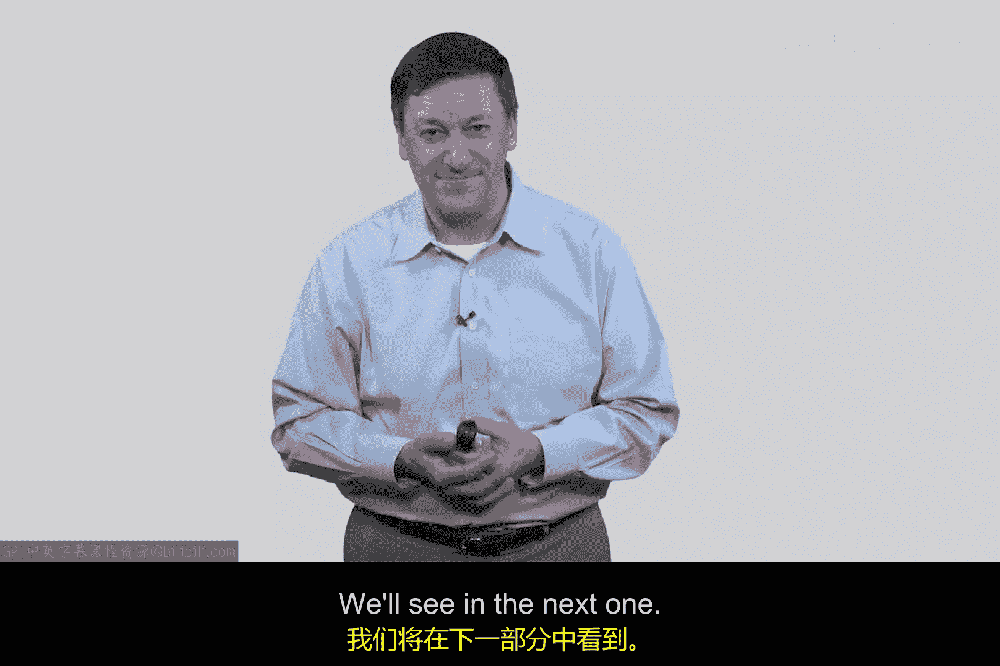

# 纽约大学《网络安全｜Introduction to Cyber Security》中英字幕（deepseek p155 18_高级混合云安全架构第2部分.zh_en -BV1TFLZzYE26_p155-

Hi folks at Amarosso here and this is part two of our advanced hybrid security cloud architecture and what we're going to be doing here is looking at a way of doing hyperresilience in a cloud orchestrated model。

 Very cool。 Here's the idea。 We're going to start with this diagram that shows CNC that's command and control node that in some sense is orchestrating the policies for assets A B。

 C and D， and each of them are shown in their own container So we've got CNC with these lines connecting to the assets that shows its ability to kind of manage the firewall。

 microparmeter and the rules in the ids and sort of orchestras to make sure they all have the same thing you need that for sure here's the problem。

 We said we didn't like perimeter because of one big blob that you can attack well if I draw this diagram and I told you how you're going to take this system out。

 you would say， my gosh， the first thing。I would do is just go after that CNC I justn it out so that's not going to be acceptable and then look the obvious first step here that anybody could do is you put two CNncCs in In fact you could put 10 of them in and a lot of vendors do that multiple CNCs could CNC again being command and control thatll provide policy orchestration for all these different assets so we know that that's a possibility but kind of an interesting approach that we've seen in some attack tools involves a more clever mechanism and let's back up a botnet has a similar kind of setup here where if CNC is kind of connecting to a bunch of different assets。

And if I knock the CNC out in a botnet， what happens Well the control transfers to one of the other nodes。

 really cool concept， right， we use the terminology called Fast flux domain name system。

 fast flux DNS where the individual bots are programmed if they can't phone home to their mom。

 mom's not there， they'll phone to a different mom and one of those moms could in fact originate as one of the other bots in the botnets。

 really。Clever concept for hyperresilience。 So we could do something sort of similar here in advanced cloud security architecture。

 Let's redraw this just as like little dots here where we've got the CN is a dot and each of the nodes as dots。

 And now what we're going to do is assume that a hacker comes along and bang goes after the CN taking it out。

 Well， if we were designing this correctly and using a fast flux type model。

 then suddenly one of the nodes becomes the CN again， clearly if you have lots of different CNs。

 then you just move to it。 but there's no reason why one of those CNs couldn't have originated as one of the nodes so that you have almost like a round Robin scheme and let's say the original CNC comes back。

 I can return control back。 So the idea here is that we're going to use advanced distributed system techniques to try to ensure hyperresilience across these advanced cloud。

architectures these are the kinds of things that cybersecurity is going to have to start attending to。

 Look， we began our discipline trying to protect data from being lost from being stolen data breaches。

 I think we're moving into an era now where attackers。

 particularly nation-state military attackers are going to be more interested in knocking out systems in taking a strategic or tactical view of something that's important and making it incapable to operate along the lines of what we're describing here。

 I look at a system， you've moved away from your perimeter。 how are you controlling it， wow。

 you're controlling with this node， bangang I'm going to try and take that note out。

 if by taking that node out， the whole system adjusts and continues to operate。

 continues to orchestrate you have a hyperresilient system and that's what we need in cybersecurity now this idea is we go to hybrid cloud it's not enough to just build microseg。

To know containers around our workloads or apps。 we need a way to orchestrate and the orchestration can't be something that can be targeted by an attacker。

 It has to be able to survive and be hyperresilient。

 So I hope this little part2 in our architecture is useful for you。

 you'll see in our next video in part 3， we're going to put some of these pieces together into something that I think will resemble。

 I hope what all of us will be running in the next several years as a normal enterprise architecture。

 So we'll see in the next one。

