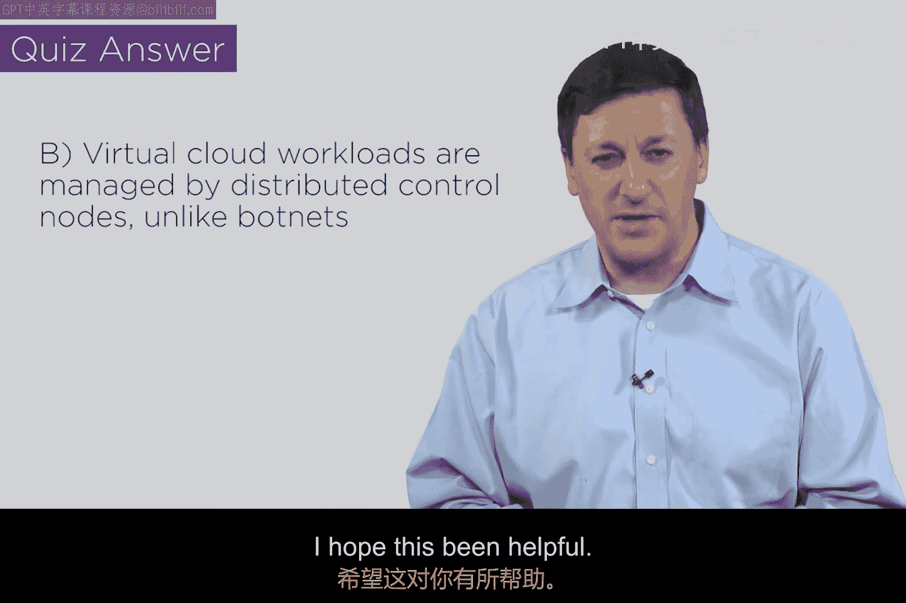

# 纽约大学《网络安全｜Introduction to Cyber Security》中英字幕（deepseek p156 19_高级混合云安全架构第3部分.zh_en -BV1TFLZzYE26_p156-

Hi， folks Ed Iorosso here， and I want to give you part three now of our advanced cloud security architecture。

 hybrid cloud。 and what we want to do is kind of put the pieces together into what I think should be your enterprise security architecture of the future。

 Now let's start with kind of where we left off。 We've got。😊，5 dots here on the screen。

 a red dots showing CNC four dots showing our nodes。

 It's kind of where we left off and we investigated the hyperresilience property in the last video and you saw how each of these nodes really emerged from workloads that sat in our perimeter to microsegmentss that we popped that into cloud and we're just simplifying things I'm not showing the cloud infrastructure。

 we don't need to。 you got you understand that that's there So what we're going to do now is I'm going to just assume that there's a geographic behind all of this。

 let's put a geographic map right over where our dots are doesn't make a lot of sense where I' put the dots now the PowerPoint chart just drop some dots in the middle of the ocean and one in Africa somewhere and they's so kind of all over the goal here would be for us to make sure that we've created workloads that can be hosted in places that make sense。

 So let's now put them in place as that make sense。

Like we had a chart out that shows a lot of red dots and blue dots， the red dots or CNCs。

 the blue dots are your workloads， they're all individual micro segmentegmented components in containers in their own cloud infrastructure possibly with CASby sitting between the user and that workload that whole concept I'm going to tie together link it all up into a bunch of different components where they logically interact where they've got network connections and again they're all isolated segments and guess what my friends this is the enterprise architecture of the future This is the way it should be set up remember the first couple of videos back in part one we started by saying we had a big oval and we put our workloads in it。

 we had a big round you know sort of protection around it but we had to cut a bunch of holes in it because we said the perimeter requires access So it's not really。

A perimeter protection。 It's just something else with all these holes。

 and then we move them all out to cloud。 We microsmented。 we put Casbys in。

 we made it hyper resilient。 Now we've hosted them in logical places around the world。

 and maybe it's just in one country。 Maybe it's global Connect them all up。 This is awesome。

 This is really tracking the way a bot networks。 This is an architecture that has all the resilience characteristics of a botnet。

 This is not a botnet， clearly， not like we're stealing compute resources from people's PCcs。

 that's not what this is。 but each of the dots here exhibits some of the characteristics。

 the autonomous behavior， the distribution， the virtualization。

 hyperresilient secure communication honing back and control from a CNC intermediary from a CaSby。

 These are all the characteristics that will be working from over the next few years。

In building security architectures， I think this gives you a glimpse into where this is all headed。

And the answer is B， you know， both are sort of managed by control nodes。

 I think that gives you an understanding of how there's some differences here between botnets and the architecture。

 but the same framework exists distributed， hyper resilient。

 and I think this is a glimpse into the way things will be in the future。

 I hope this has been helpful。 I'll see you in the next video。

