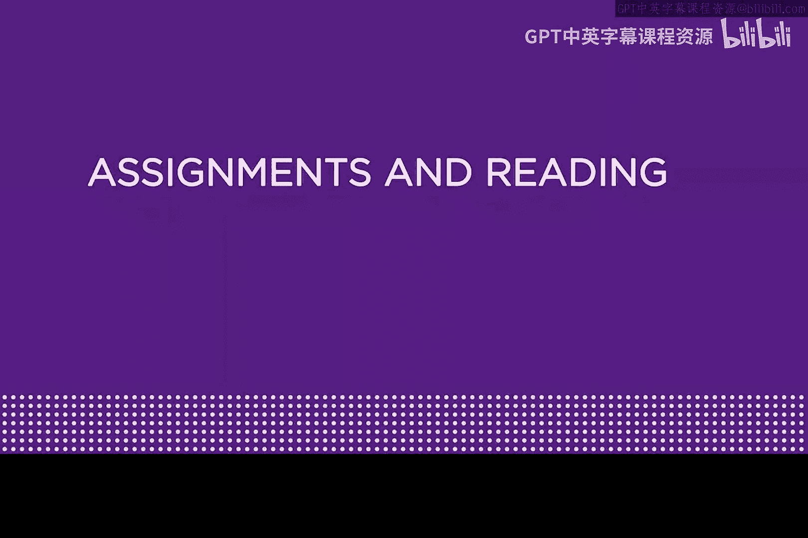
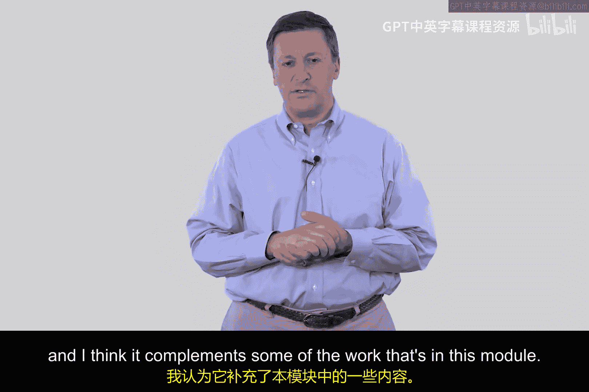
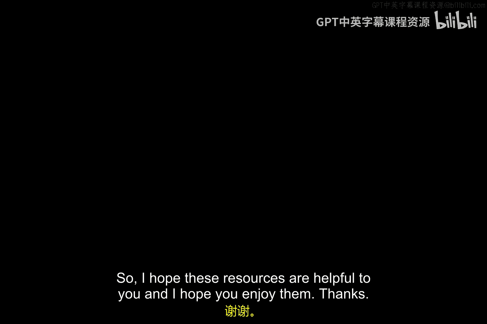

# 纽约大学《网络安全｜Introduction to Cyber Security》中英字幕（deepseek p159 22_作业与阅读.zh_en -BV1TFLZzYE26_p159-

Hi， everyone at Emmarosso here and I want to welcome you to this module Now the goals in this module is the kind of intro the basic underpinnings of e-commerce cybersecurity and you can't do that without getting into blockchain and some of the anonymity protocols that we have on the internet it's really fun material。

 I think you're going enjoy it。 Now there's some resources that we recommend that you use to compliment your learning as you go through the module。

 first couple of papers I recommend one is you have to read the Bitcoinin paper written by Nakamoto It's called from Bitcoin of peertopeer electronic cash system。

 everybody who does what we do for a living and cybersecurity is familiar with that paper。

 it's just a landmark and it lays out the basic essence of how Bitcoin and in some sense。

 its use of blockchain were put together。 So you'll enjoy that。

 And then there's a nice paper that kind of outlines critical infrastructure protection and some of the vulnerability。

These called common threats and vulnerabilities to critical infrastructure by a handful of wonderful authors take a look at that and I think you'll find it useful and there's a couple of optional books that we recommend that you use as you go through the module one is an ebook that I wrote with my son Matt it's called from CIA to AP an introduction to cybersecurity kind of chapters 29 and 30 would be useful for you to be kind of following along with as you go through the material here you can get on Amazon again it's optional and then I think you need to have a TCPI book we all do and I'd recommend that Richard Stevens book he calls it TCPIP illustratetd volume1 that'd be good thing for you to have and maybe chapters 29 and 30 would be good to be looking at as you go through the material Now there's a video that I really like it's from Benjamin Rideella at the Arizona State It's called HDDIAC Critical Infrastructure Protection webinar I'll let you watch the video to see how to。

Expand that acronym but you're going to enjoy it。 I thought it was a really good talk and I think it compliment some of the work that's in this module so I hope these resources are helpful to you and I hope you enjoy them。

 thanks。

