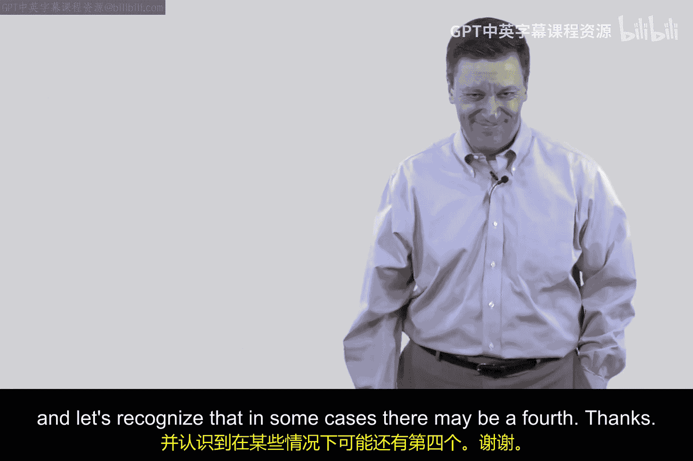

# 纽约大学《网络安全｜Introduction to Cyber Security》中英字幕（deepseek p16 16_匹配测验解答.zh_en -BV1TFLZzYE26_p16-

ISSPs provide service， right， they have to be up。Like the worst thing that can happen to a mobility or Internet service providers to be down。

 So the availability threat turns out to be the most intense for that group。 Now let's take software。

 So Im providing you a piece of code。 I want it to work。So as you'd guess。

 integrity is an enormous consideration in software development sector， right。

 You don't want infected code。 And then for identity where I'm trafficking and information。

 confidentiality is a big issue， right， if I'm checking validity。

 I'd probably have all kinds of customer records and want to be very careful about exposing information about your identity。

 So you can see those are three industry sectors with somewhat different concerns。

 but notice all three of them would be concerned with every threat， right。

 I'm more asking you what's the primary concern。 And in the three cases。

 I think it should be somewhat clear。 So I hope that's helpful， Let's keep that CIA model in mind。

 and let's recognize that in some cases， there may be a fourth， thanks。

