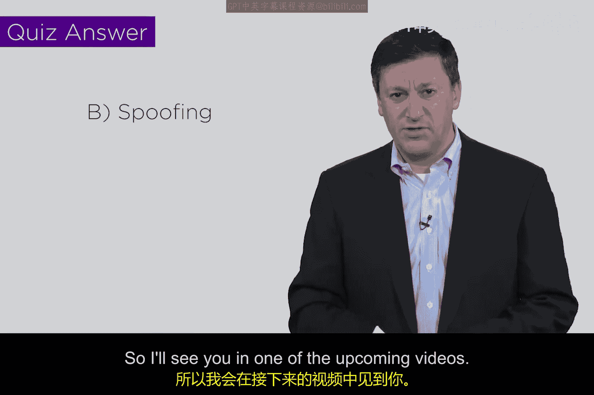

# 纽约大学《网络安全｜Introduction to Cyber Security》中英字幕（deepseek p160 23_哈希算法.zh_en -BV1TFLZzYE26_p160-

Hi， everybody at Ammarosso here。 And in this video。

 I want to tell you a little bit about a very special function that we use in computer science and certainly cybersecurity called a hash function。

 Now， if you're a student of computer science or mathematics and you know that a function is like so central to just about everything we do functions associate elements of a set we call domain with elements of a set we call a codoma。

 a mathematicians come up all these different properties of functions and different types of characteristics of how the domain code domain or map。

 none of that's all that important for the concept I want to cover in this video which is known as a hash。

 Now what a hash does， the defining characteristics from the perspective of the cybersecurity analyst is it it takes basically variable length input。

 think about your email or something you write or a paper or a database the size of。

is going to vary depending on what type of data you're putting into the database or what type of sentences you're typing or what you've included in your email。

 clearly variable， unpredictable， but it produces the hash produces a fixed length output and what you try and do is make sure that the codedomain is large enough that you're not going to have collisions。

 it's not going to be the case that two different things will produce the same hash。

 obviously metaphysically that's possible but for the most part it's not practical to consider that as a possibility so you're going from variable length input to fixed length output。

 really useful thing if you've ever used for example like a checkum that's kind of a trivial example of a hash。

 albeit be at a very small code domainoma where you're saying the parity of something adding up the variable length input and saying whether it's odd or even in some sense it's a hash but not a very secure one so with hashing we try and use that as a mean。

For doing something we refer to as a digital signature。 Now。

 the beauty of digital signature is it allows us to sign， electronically sign or authenticate。😊。

The know a document or content or a message， whatever it is you want to do so let's think it through there's a number of different steps that we often see in the context of digital signature let's imagine again。

 usually Alice and Bob right we always like to start with Alice and Bob and let's assume that they've gone through the process of generating a public and secret key pair Fair enough and Alice wants to generate some sort of message。

 send it to Bob and sign it。Maybe she's signing a contract， buying something from Bob。

 can be a million different reasons why she might want to sign it。

 and it doesn't even matter whether it's a secret message。 We can do that sort of separately。

 we would encrypt with the public key of the recipient if we wanted to make it secret。

 But for digital signature， we're going to do something different。 Now we want to do in some sense。

 is come up with sort of a fingerprint of the message and that's where the hash comes in。

 It allows us to take the message that Alice has created。

 run a hash function on it and produce output， something that sort of by convention。

 we usually refer to the output of digital signature abstractly as Lambda。

 So I run the hash function on a message M and I produce Lambda now。

 I assume that both Alice and Bob have access to the same hash function or hash algorithm。

 If they were using keys cryptographic keys with the hash。

 we'd refer to that as a message digest algorithm。The so hash plus key message digester for now。

 we just assume we're using a hash so Alice。Writes her message M， whatever it is。

 She runs a hash function on it to produce lambmbda。

 And then what she will do typically is encrypt lambmbda using her secret key， which only Alice has。

 So， yes， you can maybe create an envelope there。 Maybe she has her name。

 the time the lambmbda a bunch of stuff or just trivially usually will just say her name in the lambda。

 You know， we encrypt that， with the secret key of Alice， send it off to Bob。 right。

 So in some sense， it's like a signed message now。 So when it gets over to Bob。

 what happens is we realize that， you know， Bob is going to want to somehow。Figure out， you know。

 where did this come from， What's the authenticity。

 So how the heck is he going to decrypt something that's signed by Alice。 Well。

 it's easy because the presumption is that everybody has everyone else's public key， right？

 So if I send something signed with my secret key。 I send it to Bob。

 Bob just takes my public key decrypts it And what happens then is he gets lambmbda。 and he gets。

 you know， whatever else is in there。 The name， the message definitely the message would be sent。

 It can either be encrypted or sent separately in our diagram here we show it is being encrypted in the digital signature doesn't have to be。

 But what Bob will then do。 is take the message and apply a local hash to it。

 to provide some local lambda， a lambmbda prime。 He'll take the lambmbda that Alice sent the lambmbda prime generated locally。

 compareare them if they match。 Ho， Alice it's you。 There's some sense proof。

That it was Alice who signed the thing because Alice used her secret key to encrypt。

 I used the public key to decrypt， compared the digital signatures， boom we're in pretty good shape。

 Does that make sense it seems to me to be very clever way to produce digital signatures because when when I first started learning about this as a student I thought what do you put in a digital signature。

 do you put your name， do assign it， and then encrypt it that seems dumb。

 like what would I put in there， what kind of content， Hi， amhmed Ammarosso， send it off encrypted。

 That's kind of a hokey content for digital signature。

 So the idea that you would use a hash function provides a good reasonable piece of content to embed in the signature。

 but it gives you one more thing if the message M should happen to be garbled on transmission from Alice to Bob across the network。

The hash test won't work， right？So it gives you a little bit of integrity protection on top So it's kind of nice right Hahing enables different types of applications the two most obvious being digital signature。

 which provides authenticity and also some integrity management because the hash functions wouldn't match if the message got garble so as we often do a little quiz here to test your understanding of hashing digital signature and the answer is be right spoofing I mean that's the whole point so we're trying to make sure that we have some authenticity that we can authenticate that we can sign something。

 send it to a recipient and that recipient would have confidence that in fact it came from the originator Alice claiming to be Alice so it really does reduce that spoofing risk I hope this has been useful and you'll see in subsequent videos that hashing is going to be the basis or one of the base components for something that we refer to as blockchain so I'll see。

😊。

One of the upcoming videos。

