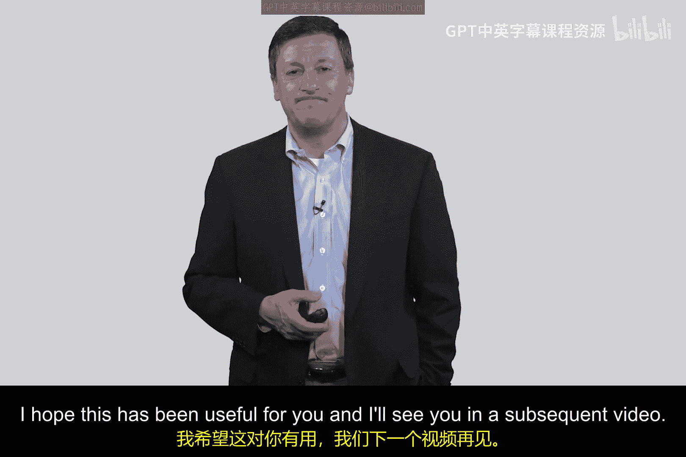

# 纽约大学《网络安全｜Introduction to Cyber Security》中英字幕（deepseek p164 27_洋葱路由与Tor.zh_en -BV1TFLZzYE26_p164-

Hi， everyone Ed Iorroso here， and I want to talk to you a little bit about a topic known as onion routing。

 something that enables anonymous communication。 Now， if you're here in the US。

 kind of an interesting place to visit if you like to do cybersecurity is the naval research lab down near Washington I've been there many。

 many times it's a wonderful group of researchers there that have just made fundamental contributions to cybersecurity for so many years。

 and there's a small group kind of led by a guy named Paul Cyson。

 he and I started our careers about the same time。 Paul and some of his colleagues。

 but Paul kind of being the lead， we're working on this idea that as you're visiting resources on a network。

 that doesn't have to be the Internet but for the most part， it's browsing the Internet。

 that's kind of the concept that immediately springs to mind， but again。

 there's nothing about onion routing that necessarily makes it just browsers in Internet。

 but we'll talk about it in that context。idea was is it possible to go off and visit resources on a network and not have it attributed to you and do it anonymously you can think of folks who may be in a situation like of domestic abuse who would like to ask for help or if you live in a region where there may be some injustices and you want to make those injustices known and on and on and on on you think of a lot of different reasons valid reasonable societyf reasons for doing anonymity in network communication so that was kind of the original concept what they came up with was the idea that let's assume it's a client and a server that fair enough so client server they said in between in the client server I'm going to put a network of nodes there they kind of think of these nodes in three different categories like there would be sort of entry nodes。

 intermediate nodes and exit nodes and the idea。Being that I'm going to weave some pattern through those nodes from client to server and make it really。

 really hard for the server to kind of know who the client was。

 client will see you know where this is exiting， but apart from that。

 you're not going to be able to know that it's you Billy。

 you know buying baseball cards on this site。 You just won't know if you do this properly。

 So the way the thing works is you can think of the anonymous communications is consisting of a bunch of routers like these intermediates basically routers。

 I don't mean router in the sense that you bought it from juniper。

 I mean router in the sense that these are routeable nodes that are supporting this protocol。

 And the idea is that it's kind of quasi at random because it's not totally random because you have these different categories。

 but you're picking a routing path and then enabling it by creating a bunch of envelopes。

 So what'll happen is in the envelope selection。The way this works。

 and I keep wanting to say the word tour that I think I'll just bring up the concept here。

 that there is a browser that sort of you know lives and breathes this onion routing concept in the context of an area of the internet that we refer to as darkNe that really does support the anonymity and the way the thing works is that the server will be sort of paired up with an exit node in a quote unquote envelope。

So the exit node paired up with the whereverver it is you're trying to browse and then that in some sense becomes embedded into an envelope that pairs up the exit node with an intermediate node and then that becomes embedded in an envelope that pairs up the entry node with intermediate and then finally there's an envelope that pairs up the sender。

 the client with the entry node that makes sense， so it's like putting envelopes inside of envelopes in a sense it's a wonderfully marvelous scheme because it works you know and it provides some sufficient anonymity that I think has kind of changed our world right if I'm sure you've heard of To and you've probably heard of the dark web or the dark net sometimes。

But I bet you heard of it in the context of kind of， you know。

 maybe not all that societally friendly stuff。 Let's look。

 thiss a picture of kind of the tour browser here。sort of the image that we have of somebody using ToOR is that they're buying drugs or doing something nefarious or illegal。

 the kind of stuff that we would say don't do that。Or maybe you would say do it。

 I would say don't do it。 But the point is it's kind of interesting。

 when you go back and you look at Paul and his team's kind of invention。

 a beautiful contribution to not just computer science。

 but communications in general has been realized by an infrastructure that I think does have a lot of sort of nefarious characteristic to it。

 again， it's by no means reflective of anything in the protocol or the way this was designed。

 but it's kind of interesting to sort of lament that you have kind of this bifurcated use。 Now， yes。

 there are legitimate and and excellent implications of using to in order to， like I said。

 if you live in a affected region where there may be some serious injustices。

 and this is a way for you to be part of a community and to be heard and to make your make your voice known。

😊，But again， darknet is usually where say stolen credit cards would be posted for sale。

 So what's happened is a lot of cybersecurity experts。

 hunters and analysts and certainly law enforcement folks go dive into that sort of nefarious portion of the Internet。

 you know， not in some sense， indexed by Google and they use their to browser to go sort of hunt around and find whether or not。

 for example， bank X Yz， you know， has had their credit cards stolen and now up for sale。 know。

 on this dark web。 Sos these threat intelligence services have emerged that go and tunnel through and look around and pull data from this portion of the Internet that was set up for some sense。

 these nefarious purposes。 So in the context of cybersecurity， there's two dimensions to all of this。

 One， is that clearly there's an anonymity component here。 that's interesting as computer scientists。

 It's interesting。To look at how that works。 But the second angle is that when attacks are made on businesses。

 the effects are usually held in some sort of commerce。

 illegal commerce that's on the dark web that's accessible via To using anonymity So it goes around comes around doesn't it It's a really interesting stuff If you are interested in this。

 I hope you go dig a little bit deeper， I hope you read kind of the original seminal paper on kind of bitcoin to learn a little bit about how the commerce is supported here because when you're buying something on the dark web。

 you're probably using Bitcoincoin that's blockchain supported。

 go back and look at some of the work that Paul and his team have done and you subject to your own local considerations and laws and policies and so on。

 If it makes sense and it's appropriate for you to download To you may want to try and do that and see how the thing works。

 but again that's certainly subject to your local situation， local consideration。

It may not be appropriate， maybe in your school， your business。

 your country for you to be doing this， but if it is and you're comfortable with that and you have appropriate legal cover。

 then go ahead and do it and you may learn something through your use of Tour and again it's very reflective of the fine contributions not just of everyone at the Naval Research labb and other places here in the US but if Paul Cyverson and his colleagues as well I hope this has been useful for you and I'll see in a subsequent video。

