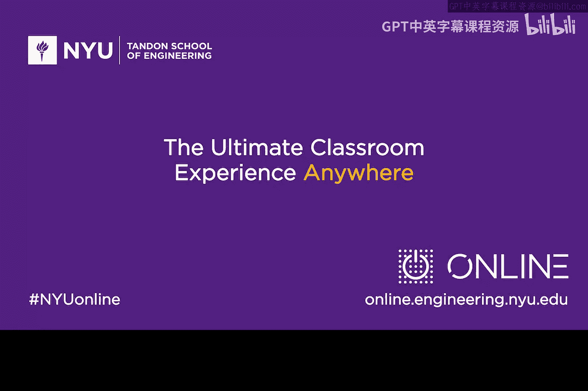

# 纽约大学《网络安全｜Introduction to Cyber Security》中英字幕（deepseek p165 28_Chaum绑定算法.zh_en -BV1TFLZzYE26_p165-

Hello， Ed here， and I want to take you through in this video。

An interesting protocol and concept that was introduced in the 1980s by a guy named David Chaum。

 And it's called Blinding and the blinding。Purpose is to introduce some degree of anonymity。

In interaction between client and server。 And let me tell you what the the idea here is。

 and this is David Chm's work， wonderful mathematician spent quite a bit of time at University of California。

 Berkeley and founded a company called Diitcash on the basis of what we're going to be talking about here。

 So I think it's a marvelous algorithm and something I like to show students because it's so easy to conceptualize。

 So here's the idea。The client would like to provide to the server， now think customer in bank。

 maybe or you know buyer and seller， whatever I'd like to provide to the server an envelope that's sealed。

🤢，And inside the envelope is the equivalent of a paper check where I've written out an amount。

 It has a number。 all checks are numbered paper checks。 It's signed， It's valid。

 And let's say I put the amount at $25 US okay so I want to send the envelope to you。

 Have you not open it or read inside it。But trust me that I said， hey， there's $25 in there。

 and it's got a valid serial number。But don't look inside because I don't want you to see the serial number。

And just。Here's the check， deposit $25 and send it back， or or debit my account。

 give me 25 or whatever I'm trying to do。What do you think about that。So you might say。

The bank or the recipient or the authorizer of this。 The signer of the envelope is going to say。

 what are you crazy， maybe you say it's $25， but maybe you put $2500 in there。

 I'm not going to sign it without reading what's inside that。 That's crazy。

 So Chm said about coming up with a way to solve this。

And it turns out there's actually a trivial way to solve it。

 You could say that all interactions are always say$10。

 then okay now maybe you put multiple of them inside。

 there's still ways you might cheat that but but setting that aside if I want something that's the equivalent of anonymous say cash where I can make the number whatever I want the number to be like on the outside of the envelope I write a number and you trust that that number is reasonable came up with a scheme that's kind of cool。

 and again， sort of there's these multiple steps。 it sort of involves Bob like sending an encrypted to the encrypted server or an encrypted secret number to the server。

 the server then does something it's going to attest to that and send something back encrypted。

 that's sort of the idea it would be done through a network and let's go through kind of the Alice network and Bob steps or at least the purpose and then I'll explain how the protocol work So there's sort of a create send sign respond and then assign certificate。

Aspect to this where I'm creating kind of an encrypted， you could think of it。

 I guess in some sense as a certificate。 It's got a serial number has an amount。 and it has some key。

 say key K1 that I then send across to Bob the server。 I'm asking Bob then without key K1。

 I don't want Bob to have the key。 I want him to then quote unquote， sign it with his secret key。

 So without reading， it doesn't have key K1。 I want him to sign it with S sub B。Respond back。

 And now I now have a signed certificate from Bob。 You know， that has my original amount in there。

 It has $2 US with a serial number， and it was encrypted with K K1， which I still have。

 And now I have it signed by SB。 Now， if I want to spend that， say with a merchant。

 I just provide the merchant with K K1， and this whole certificate because the merchant will have the public key of Bob can validate with public key of Bob。

 Oh， good， this is real。 I've given youki K1， They take K K1， they decrypt the message。

 And now they see the $2， and I can spend this。 But as you can see， how do I solve the problem。

Of having you trust that it's really $2 and not $2 million in there。

 So here's what Cham came up with。 Now as you look at this。

 this is the blinding protocol implementation。 on your first glance you may not get this。

 I'll describe it a couple of times because it's a really crazy scheme when I'm doing this with graduate students say in know classroom about half of them get it in the first try and then second try more get it。

 you may have to stare at this a few times， but here's the idea。In step one。

 according to the Ch blindding protocol， Alice creates， say 1000 essentially duplicate notes。

 could be 10，000， could be 100，00 could be 100， but let's just say it's 1000 for now。

The only place they're different is that the serial numbers are different and the keys are different。

 The amount is the same。 that's still a valid a sort of set up the way the message is constructed。

 the way the note is constructed is the same serial number the amount which in this case is $2 and a key。

 serial number different one amount， same amount， different key， serial number。

 amount key all the way down from one to 1000。 So they're all the same in structure， They all say $2。

 but they have different serial number different keys。 I send that whole blob over to Bob。

 I send all 1000 to Bob。 He's got the whole group of them。

 Now what Bob does is at random picks a number between  one and 1000。

 So Alice couldn't possibly have known in advance。 what that number is going to be。

 and she guesses it。 That's why it could be $10000 could be a million。 but let's say it's a000。

 He picks some number whatever， you know， 53 or。127 or some number。

 we'll just sort call it some caseaN。And says to Alice。Give me all。Of the keys。

 except let's say it's the number 317。 Give me from 1 to 316。 Don't give me 317。

 That's the random number I picked。 But then give me 3，18 to 1000。 So I'm asking you for every key。

 except one random key for one random number that I picked that you couldn't have possibly known about in advance。

 So you get this request now for 999 keys， which you then provide to Bob， but you hold back。

The one that Bob said to hold back， hold back 317， don't give that to me。

So now Bob takes all these keys and starts reading all the notes to see if you cheated on any of them。

 And if they all look reasonable serial number $2， serial number2 all the way down。

 then he concludes， well， I asked for 999， I picked one at random。

 if these $999 look good and the chances are pretty good。 that the one I didn't look at。

 looks like the others， he signs the notes and sends it back to you。 what do you think of that。

 follow It's like I give you a batch of envelopes， you like those big batch of them。

 there's  a thousand they're sitting at a big bucket somewhere。

 and I'm asking you to sign one of them。 I don't care which one， they're all $2 notes。

 I'm telling you all $2 notes。 and you go well， All right， So you open all of them， but one。

 Now the way you open them is you ask me for the keys。 But the one that you don't open。

 you don't get the key for。 you rip them all open， they all look exactly the same。

 throwing them all out until there's。One envelope sitting there in the basket that you haven't opened。

 every other one looks the same and you go。All right。 I'll sign that。

 I'm pretty confident that you did that right。 Bo， you sign it。

 send it back and you have anonymous signing。 Is that interesting。

 It's kind of a form of anonymous cash on the Internet。

Always thought that was one of the most clever schemes I've ever seen different than onion routing。

 right， Onion routing is weaving a routing path。 This is a different kind of anonymity。

 This is using applied cryptography in a sense to produce a very similar effect。

 You can use blinding for a lot of different things always surprises me that a protocol that。

 you know， was introduced， I think， is 1983 or something that this came out。Hasn't seen a bigger run。

 So hopefully this will inspire you to take your understanding now of how blinding works applied to something auctions。

 elections， banking， all kinds of different things could benefit from David Cham's fine work。

 which we refer to as blinding or blinding signatures now as sort of an additional consideration。

 I would like you to sit and think about what are some applications in your own mind besides banking auction and so on。

 What are some things you may be involved in。 where some anonymity would be useful。

 where would he sort of signing something blindly be useful。 Try to think it through。 You know。

 I gave you a few of the obvious ones。 See if you can come up with some that are a little less obvious。

 I will see you in a subsequent video。

