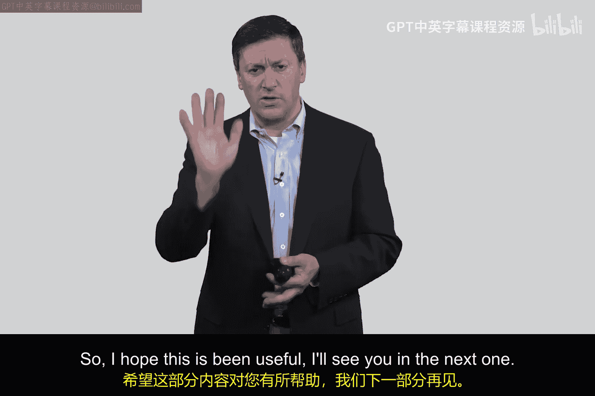

# 纽约大学《网络安全｜Introduction to Cyber Security》中英字幕（deepseek p166 29_关键基础设施第1部分：需求.zh_en -BV1TFLZzYE26_p166-

Hi， everyone Ed Ammarroso here。 And in this sort of part one video I want to spend some time talking to you about critical infrastructure in a subsequent video。

 sort of part two， I'll talk to you about kind of how we protect it。

 But in this one I kind of introduced the idea of how something becomes in some sense designated as critical now a good definition of criticality for any type of asset would be that if removed that asset then makes the mission。

 the attendant mission impossible to accomplish like in your car you'd say。

 what are critical asset in your car。 Well， you'd say what's the mission of my car's to get me from point A to point B safely and reasonably comfortably So you'd say。

 well， would the four wheels be considered critical assets and the car go you bet they are cars not going anywhere with four wheels。

 but you could say well what about the stickers that I put on the outside。

My car is that critical Probably not if somebody of you live of a magnetic sticker and somebody peels it off the car still works just fine。

 you're not happy， maybe you like that sticker and maybe somebody stole it。

 but it's certainly not critical or essential to the proper mission or operation of that car now when we apply that concept that criticality measure infrastructure here's what we come up with。

 come up with the idea that we're going to say okay critical infrastructure sectors or components would be those sectors or components which if removed。

Have a pretty negative influence or negative impact on society。

 Okay so we'll go through 16 examples just briefly to give the idea。

 So first is agriculture and food，  clearly if somebody affects that。

 then there's going to be an impact on a population might be starvation potentially。

 So to the degree that that's connected to the Internet。

 that there are systems that control that crop output， monitoring things。

 that could be pretty dangerous if somebody's tampering with that banking and financial services。

 I shouldn't even have to explain。 that's obvious that if people tamper with that， that's a mess。

 chemical， certainly a big industry and in many countries countries manufacturing and using chemicals for certain types of things。

 The reason that's consequential is because if people get their hands on that stuff。

 they can cause certain types of attacks and you know all sorts of bad consequences occur。

 if if chemical， you know， very dangerous chemicals are made available to people who。

you'responible or who want to bring some harm so that's an important one commercial facilities like your stores and the ability to go into a grocery store and buy things。

 you certainly want commerce to be proceeding if commerce is impeded or interrupted。

 you potentially have some problems and they're all connected to internet now like the supply chain for a typical grocery store here in the United States is so efficient that the amount of material the stuff that's put on our shelves turns over very quickly so that if there was a problem if the supply chain were impeded through cyberattack then the shelves could become very barren very。

 very quickly， it's surprising how quickly that could occur so certainly that's important communicationations telecommunications。

 are mobile phones， our ability to connected to internets is essential to the proper operation of a society Dams。

 you know keeping certain regions safe， those are all controlled electronically。Hackers。

 many cases might target that to cause some very negative consequences to people who will certainly live in the path of a dam Defense obvious right military is all based on cyber to some degree。

 I don't care what you're talking about。 There's a computing component。

 There is a networking component。 almost all aspects of the way we do defenseense and military。

 Em services， people， you know 911 here in the United States wherever it is where you are if you're calling for an ambulance or calling for emergency service。

 You want that service to be coming very quickly， you don't want that to be impeded by hackers。

 Energy might be the most obvious of all。The power goes out。

 You've got a problem here in our studio at NYu in New York City。 The power goes out here。

 We got a big problem doing this video。 We'd have to find a way to do it at another time。

 things just can't proceed without power， may be one of the most fundamental things to life nowadays。

 beyond， say water and air rent food power in some sense， maybe be just as important。

 government facilities， we'd all need to be governed crazy chaos。

 if we didn't have some way of organizing ourselves。

 So to the degree that hackers try to impede government activity causes a problem。

 health care certainly the case。 I mean， hospital it's in the midst of some operation。

 some complex operation where if the operation were interrupted in the middle， the patient would die。

 you need continuity of power， continuity of safety and the ability to continue to work through something like that。

 and certainly just with a lot of。who are recovering or who are ill who need the quiet and the respite and the safety of a hospital。

 you don't want that to be interrupted by cyber attacks。 IT is the backbone for all business。

 so if IT systems are impeded and interrupted， it affects commerce affects our ability to do all sorts of things。

 nuclear materials and waste， the nuclear energy and anything having to do with nuclear reactors。

 certainly a big target， you know if somebody were to create a destructive attack to something like that it have consequences for people who live in that region。

 transportation system， pretty obvious that you know the way the flow of transportation。

 whether air or ground is essential to a society certainly needs to be free of cyberat water and wastewater again absolutely essential for life and sometimes you forget how important it is for waste to be properly managed。

handandled it in a society。 And these things are generally the flow of wastewater and other things is all done in and around computing and networking。

 And finally， critical manufacturing， the ability to build and to create things that we need in our society。

 You don't want that sort of thing impeded。 So these are the good example。

 these are 16 sectors that for the most part， I think correspond to the kinds of things that a typical society would not want to have attacked by cyber。

 So this sort of been part one to introduce to you。

 the kinds of requirements that we have in and around critical infrastructure。

 and part two of our video， I'll introduce you to some of the types of things that we do to protect critical infrastructure。

 So I hope this has been useful。 I'll see in the next one。

