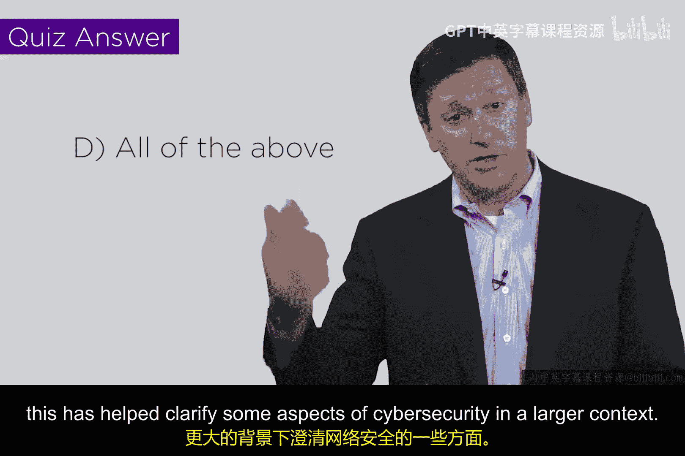

# 纽约大学《网络安全｜Introduction to Cyber Security》中英字幕（deepseek p167 30_关键基础设施第2部分：保护方法.zh_en -BV1TFLZzYE26_p167-

Hi， everyone Ed Amarosso here。 and this is kind of part two of our discussion of critical infrastructure in the context of cybersecurity。

 Now you'll recall in our last video， we said that critical infrastructure kind of corresponds to this property that if removed。

 it makes it impossible for a mission， the attendant mission to be supported。

 if that sector component transportation， water， energy， defense。

 if those things are missing then it's hard for society to achieve its mission that fair enough。

 So the question is how do we stop these types of things from cybertex。 Now for many years。

 the presumption was critical infrastructure， your PC， what's the difference。

 Like if I asked you how do you protect your PC at home， you'd probably go well。Passwords。

 some system administration。I do some scanning， I run a little firewall on it。

Little encryption of some stuff， that's it， say firewalls， encryption， password scanning。

And then I say， hey。Big critical infrastructure， you know， the transportation systems。

 control systems in your country。 How do you protect that？ Sadly， too often， the answer has been。

 you know， passwords。😔，Firewalls， we scan it。Do a little encryption。

 they do some system administrators， the same stuff。

your PC compared to a massive critical infrastructure component。

 is about as different as a tricycle in a big jumbo jet。 These are totally different。

 these are fundamentally different components。 They're both means of transportation。

 They both have wheels， they both take human beings from here to there。

 but that's kind of where the similarity ends。 So it turns out that there's some techniques for protecting critical infrastructure that transcend you know。

 normal everyday cybersecurity。 I want to use， want to mention one example and then kind of dig into a second。

 So one example is called situational awareness。 And that's where your hyper aware at all times of the threat level and threat condition and amount of potential vulnerabilities。

 exploitable holes and other things that might exist in an infrastructure。

 You're keeping track of that situationally aware at all times。Does that have any meaning on your PC？

Really not like you don't have to be kind of a weird person to be constantly hovering around your PC being situationally aware having it all wired to the telemetry pouring out。

 you're constantly monitoring the safety and security of your PC very unlikely that you're going to do that on an individual basis but if you're dealing with the transportation sector or you're dealing with the military or power。

 then you are absolutely doing that， and I think it's a good kind of first view of how different protection methods might be for something small。

 something large， small things can be manual， large things can't be manual you have to have some way of scaling small things can be in some sense they don't have the need to scale you don't need to be able to measure how quickly something can be deployed when you scan your PC at home if it takes an hour or two in a problem you want to deal。

With scale where you've got thousands or tens of thousands or even millions of components。

 suddenly scale matters like if you want to run scans on all these things and each take two hours。

 you got may have a problem。 So you actually have to attend to fundamentally different sets of concerns。

 So this idea of situational awareness is one that I think is pretty useful。

 but a more interesting one， frankly。That illustrates the difference is something known as diversity now。

Diversity means intentionally introducing。Differences in an ecosystem。 So for example。

 I'll give you a contra example， there's some companies like here in the US。

 there's an airline called Southwest Airlines。 I show a picture here of all the airplanes lined up。

 you know， at an airport Southwest in order to keep their costs low in order to keep sort of the training and the operations kind of uniform through their whole fleet。

 They fly one kind of airplane。7，37。 good good idea。 You know， these are all wonderful jets。

And it allows the training and the operation to be the same， they're all the same。

 they don't have 10 different kinds of airplanes but。Suppose。

The aviation administration here in the United States decided to ground that jet。

 Well that would cause a big problem because they don't a great diversity Now again this is not cyber issue。

 I'm just trying to illustrate you know the strengths and weaknesses of diversity in contrast if you looked at it sort of a biodiverse ecosystem beautiful picture here of an ecosystem where you've got lots of different you know foliage and plant life and animal life and other types of things。

 bacteria and soil and everything's different and they all work together in a very symbiotic and diverse manner。

 it'd be different to take something like this out with say one crop disease might take one segment of the very diverse population out but it wouldn't take everything out So the idea。

 say for your PC to have diversity doesn't make sense because you're going to pick an operating system you're going pick applications is going to just be what it is but in a large。

Ecosystem around some critical infrastructure component。

 you might decide specifically to introduce diversity into that populace。

 meaning lots of different operating systems， lots of different applications。

 diverse network technologies， diverse geographic regions and on and on and on the reason being that if somebody attacks one component of that infrastructure sector。

 it will not easily cascade across to other sectors。

 this idea of cascading is a weakness in a non-diverse ecosystem， when you have everything the same。

 a bazillion windows computers are vulnerable if they're all connected together。

 if somebody's got a killer virus for windows， it's going to cascade but if I introduce five other operating systems and sprinkle them around。

 suddenly my Windows virus that comes in will only cascade to other vulnerable systems when it hits a diverse interface hits something that's not willing to。

Acept that virus。 It stops and you can see how that's a good way to stop cascading no meaning in the context of a small system。

 Fundal consideration in the context of critical infrastructure And the reason I think it's such an interesting one is that I and system managers generally hate it。

 a problem we have in cybers once in a while We hit on something that cybersecur experts want。

 but I folks don't like too much and diversity is the posterchil for that。

 a contra example would be virtualization where data center managers and cios and I managers love virtualization reduces cost improves flexibility and security people should love it as well。

 because it allows us to micro segmentegment and to shrink wrap perimeter without hardware and on and on and on。

 So it's not always the case that wherere at odds but for critical infrastructure。

 I think you want to keep in mind that there's going to be a fundamentally different。

Of protection measures that we use。 then for small。

 and occasionally we may find that they're somewhat at odds with our I partners。

 Now I got a little quiz here。 and the answer is all the above。

 Those are all true statements with respect to critical infrastructure。

 So I hope this has been a helpful introduction to something that I really do think anyone who considers themselves a cybersecurity expert。

 has to have some facility with。 And if you're a decision maker， particularly in government。

 then I hope this has helped clarify some aspects of cybersecurity in a larger context。

 I'll see in the next video。

