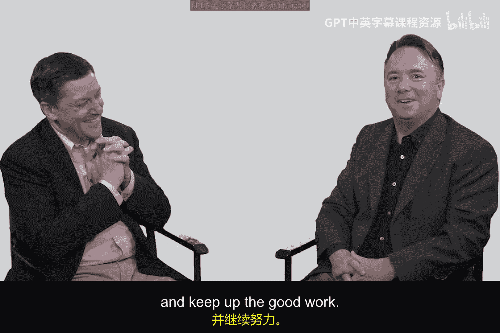

# 纽约大学《网络安全｜Introduction to Cyber Security》中英字幕（deepseek p168 31_欢迎Roger Thornton第2部分：AlienVault首席技术官.zh_en -BV1TFLZzYE26_p168-

Hi folks at Amarosso again， we're back for part two of my discussion with my friend Roger Thornton。

 the CTO of alienen Vault， so Roger let me ask you about cyber threat。

So what are the things that people running businesses or governments or countries should be fearful of now in terms of assets and infrastructure that sit on the internet that use software。

 what are the threats that you see kind of brewing that are of concern， big question right。

 and a lot of attention to this on just about every？Facet of TV right turn。

I think the first thing we could probably do here is group these into some various buckets and the one I we'll dive down on is the one as a practitioner trying to protect a business you should be concerned about。

Broadly speaking and you know I've got to say you definitely understand this topic better than I。

 so here's my attempt to make sure I got it right okay broadly speaking as a corporate entity。

 you've got to consider a range of threats from insiders， employees that have some malicious intent。

嗯。啊。Somewhat amateur external groups that are involved in crime。

 professional external groups that are involved in crime。

And then depending on the company you're in and what you do for a living。

 you may very well have to deal with the nationstate trying to break in military attacks。

 basically maybe even from your own country that you on your customers and you don't want that to happen the one thing has to be said especially you know since a lot of these are college as an individual your privacy is something you should be concerned about and you know if you're young and in school protecting your privacy from your peers。

 protecting what you want to keep secret from your parents or your。Loved ones。

 your employer is really hard to do if you're going to be laying it all out there in a computer so if you use social network and all that stuff you want to think about probability that this stuff is going to be seen by everybody now is about 100%。

Gotta throw that out there wouldnt。や great。So and then for governments， I mean。

 you have that same threats that companies do accept the。

The degree to which the countries are antagonizing each other using computer security is at an epic level。

 Maybe it was like that in the past。 and we didn't have the visibility， but it's profound。

 So if you're a company and you're trying to protect yourself against those threats。

 first thing you got to do is。Consider each of the various threats both from motivation and a capabilities point of view and let me give you a good example。

Most of your employees are not terribly motivated to harm the company they work for。

But a few of them might be， and they might be terribly motivated。

 they might be people that you had to let go or lay off or someone you hired who wasn't a good person would seek retribution。

 so a small percentage of people who have enormous motivation。

 maybe not the greatest capability from computer hacking point of view。

 but access the threats that I think are some of the easiest to deal with are the criminal threats in that they're really just trying to make money so their motivations are fairly rational。

 they don't want to get caught and go to jail and you can predict that behavior。The threats， I think。

 that are the most troubling for a business are groups that are attacking your business out of some kind of zealous。

desiresire to change the world， philosophical philosophical， you know。

 harder to predict what they're going to do， harder to know that they're there and just about any company that operates today is going to have somebody that doesn't like them。

And so if you're going to defend yourself， one of the best exercises to start off with is doing a real careful assessment of the kind of company you are。

 where those threats may reside and what their opportunity may consist of。When you do that。

 you've got a general blueprint of how you're going to manage things。

 but the next thing that you need and it's partly what I do in my day job。

Is you need to know maybe it's a little bit like somebody who trade stock。

 you need to know what's going on in the market today， know what are the active campaigns。

 what are the Maware toolkits that people are utilizing。

 what are the things that people in my sector are seeing， what have I seen last week。

 what things are kind of going out on the horizon， and this unfortunately is a fairly complicated。

And expensive endeavor， very， very large companies will invest in teams that can do this if you're in a。

A section of the economy that's deemed critical infrastructure。

 you may very well get some help from the federal government in understanding the threats down the tactical level。

 but for most companies around the world。Youre going to have to figure out how to do it yourself and so that's that's what I'm dedicated to right now is trying to figure out a way that you can make that。

Day in and day out threat information available ideally for free。

 if not through products that are reasonably priced。

 I think a lot of the a lot of the very big companies。Very capable to take care of themselves。

 but the average size company is really not。 And so one of the things that my company runs is we call it the open threat Exchange。

And the open threat Exchange is a free crowdsourced system that。

Anybody who's running a threat detection system， we have a commercial one and we have an open source one and all of our open source users and big percentage of our commercial users upload to the open threat exchange。

 what we call indicators of compromise， and these are any measurable thing on a computer system that goes along with a particular threat campaign or attack。

And these all get uploaded into a central computing environment and cloud。

Then people can log into that and collaborate with one another and say， hey you saw this， I saw this。

 but here I saw these 15 other things too， you should know about them because now I've got 16 indicators and tell me about this guy you might upload another10 and so on and so forth。

 you bundle these things together in an entity we call a pulse and then through the system people can publish pulses and send them out to each other that's all entirely free that that that sharing system is a way for us to allow the customer base who everybody once you're a victim you have the ability to see even if you don't have a fantastic security research organization。

 you're gonna to see some indicators at some point after they've crashed the door and if if you're generous enough and smart enough。

 you're going to share those with your peers because sharing it with their peers allow your peers to now be aware of that of that actor。

But。Its smart to share with the peers because of course you right now a big body of you。

 you only need victim number one and that guys found out。

 and this is going back to the whole thing of cybersecurity is not an engineering problem solved。

 It's a crime to be managed This a never ending game it always going to be the next attack that's based on some new piece of software that has a vulnerability that slips through the cracks and our ability to detect it once globally。

And not over and over and over and over again is a big shift。 saves time。

 It's so nice to see your passion and your interest in this technology and in this field。

 It's just very， very inspiring。 So on behalf of our whole community。

 I want to thank you for taking some time to stop by our studio and share with us and I hope you'll come back。

 Thanks Id really appreciate it。 great and everybody out there。

 Good luck with the rest of the course and keep up the good work。 That's great。

 We'll see on an excellent， thanks。😊。

