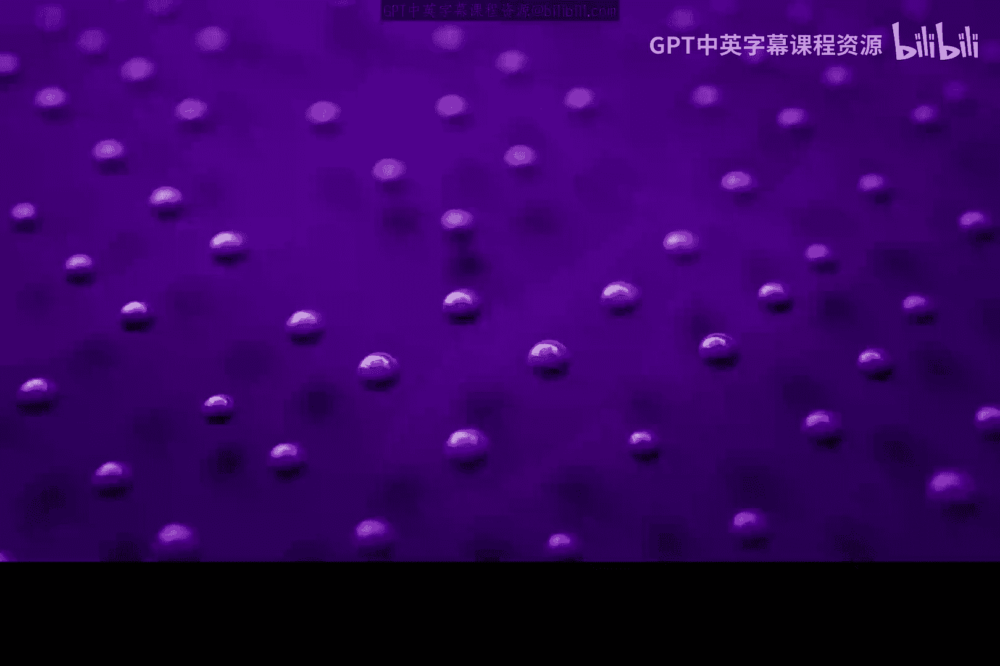
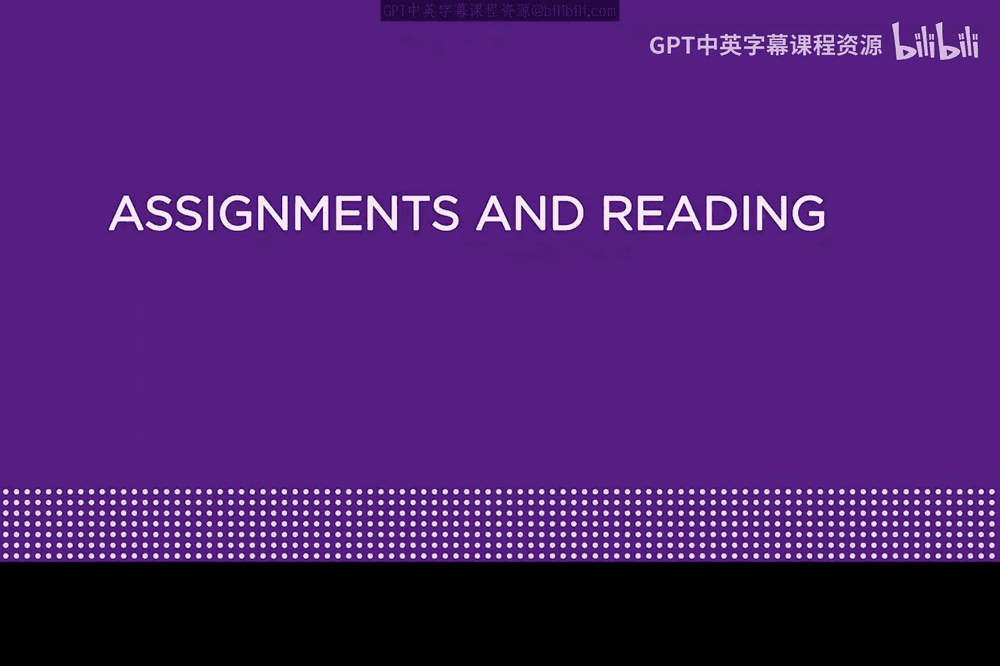
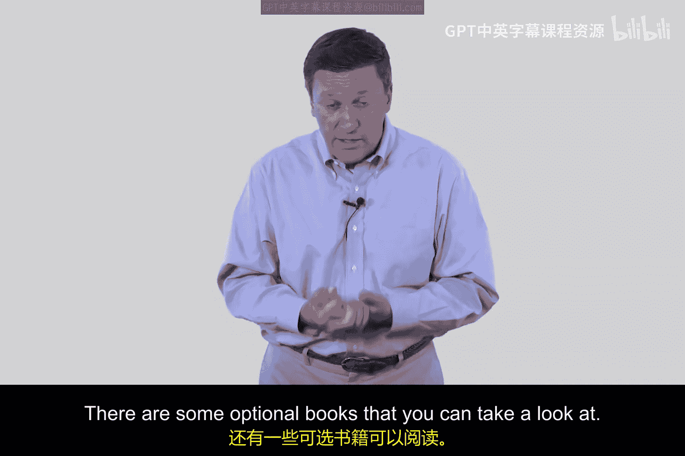
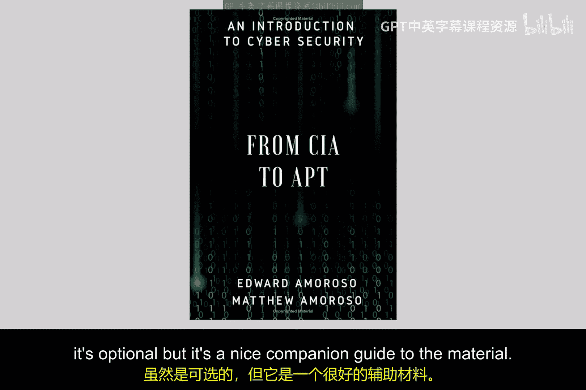
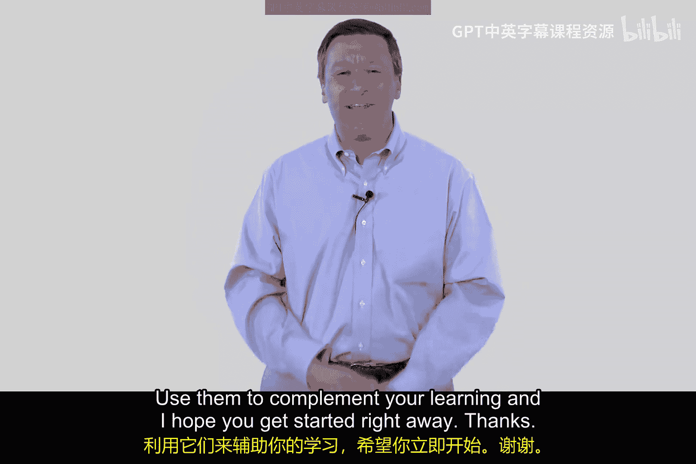
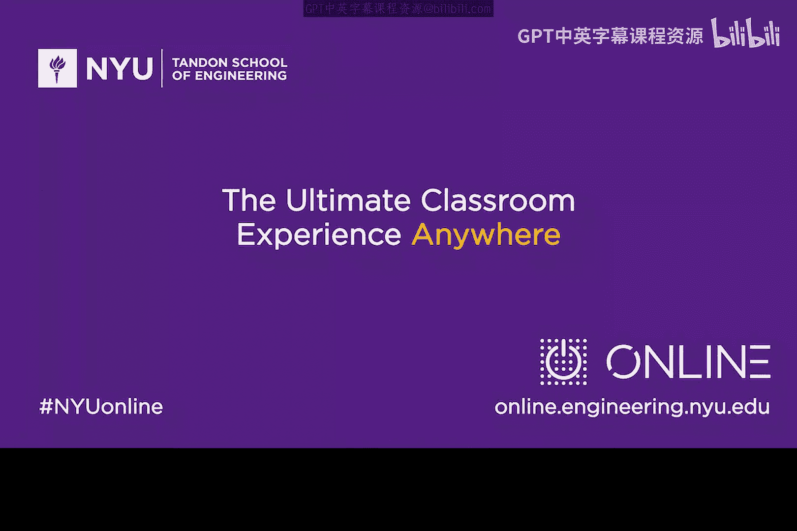

# 纽约大学《网络安全｜Introduction to Cyber Security》中英字幕（deepseek p169 32_作业与阅读.zh_en -BV1TFLZzYE26_p169-

Hei everyone Ed Amarosso here， and I want to welcome you to this module。

 Now our goal in this module is kind of a collage of different things that we'd like to do。

 I want to introduce mobile security a little bit about internet of things security Io and also want to spend some time giving you some advice on careers and cybersecur。

 So kind of an interesting mix of things that we' do in this module。

 Now there's some resources that we recommend you use to compliment your learning as you go through module papers。

 some optional books and a video on terms of papers there's really classic paper on something called onion routing if you've ever use the tourr browser。

 then you don't realize it， but you're using onion routing to get out anonymously to the Internet and and the founders basically inventors of onion routing and tour I wrote this nice paper。

 Paul Cyson is somebody that I've been very familiar with for many years。 He's one of the authors。

 and there's a nice paper also on cyber。Security deception by a couple of authors。

 one of whom is our good friend Eugene Spford， I think that'll also be a good paper for you to take a look at now there are some optional books that you can take a look at。

 one is an ebook that my son Matt and I wrote it's called from CIA AP an introduction to cybersecurity you can get on Amazon and again it's optional but it's a nice companion guide to the material Now a video that I think will compliment your learning in this module's read by essentially a guy at a company called Lookout It's a wonderful Mo security company and and KevinHaffy from lookout gives a talk on mobile security make sure you have the link there to the video I think you should take a look at it and I think you'll enjoy it。

 So take a look at these resources use them to compliment your learning and I hope you get started right away thanks。

