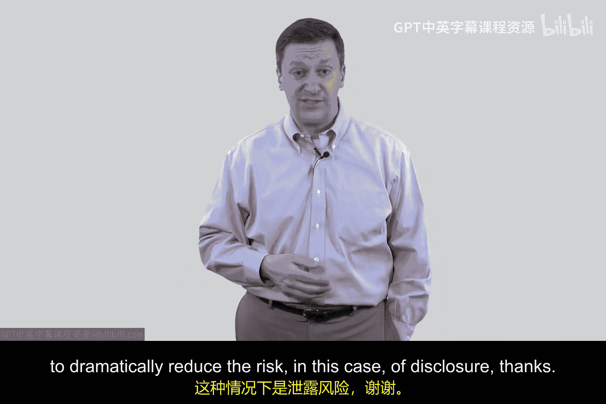

# 纽约大学《网络安全｜Introduction to Cyber Security》中英字幕（deepseek p17 17_保密性威胁.zh_en -BV1TFLZzYE26_p17-

You I want to talk to you about the disclosure threat Now you'll recall that disclosure is about confidentiality and usually the best way to get some deep insight into these types of things is through story。

 So this is I think you'll enjoy this kind of fun little different story here in the United States we've had problems with political parties protecting data and as I speak to you now。

 roughly 20 years ago back in the mid-90s， the Democratic national Committee。

 So here in the United States， we have Democrats and Republicans。

 but the Democrats actually called me concern that email security might be something that would cause them to lose an election and they wanted to know if they could have some help producing more privacy in their email。

 how funny is that it was 20 years later， you could argue that had they had better privacy in their email might have had you know some differences in the way elections and so on。

but anyway， let me tell you about story， said two buildings that were connected in Washington D by a telecommunications line。

 the way worked in those days， it would be a private line connection out to the ISP like a phone line in a sense。

 and what they were interested in was putting encryption at either end of the line。

 Now here's the idea a lot of disclosure and confidentiality problems are fixed by a technique known as encryption。

 We're going to talk about that at length in these lectures。

 but the idea is that you garble or scramble。What's going on between two buildings。

 between two people， between two entities， two computers， whatever， or a groove。You garble it。

 the idea that if somebody comes along in the middle and listens， you know。

 puts a tap on your communication。Then they won't be able to understand what's there。

 Does that make sense， Like if you and I were together in a room and we're talking the way we're talking now。

If somebody's sitting next to us。And they're listening。

Then they understand we're saying there's no secrecy at all。 In fact， here in the United States。

 we have laws that say， if you and I are sitting saying a Starbucks together talking。

And we're gibber jabbering back and forth。 And somebodys sitting next to us。

 They have every right to listen。 Now， you may be in a country where that's different。

 but I think that's pretty universally the case that if you're in a public square。

Then you can listen。 You're there。 If you don't want anybody to listen， go somewhere else。

 If I want to go hide somewhere in the corner and have a private whisperhied conversation。

 then again， here in the United States， we have laws that say， you and I as friends。

 if we want to have a private conversation。 the government's not going to come put a big boom microphone over our head and listen。

 again， you may be in a country where that'd be different。 But you get the idea。

 the confidentiality and disclosure are about this idea of communication。

 I back to sort of the Democratic story， they were concerned about， you know。

 the communications between the two buildings and putting some sort of encryption between the two。

 which I think makes perfect sense。 Now， putting that encryption as you'll see， is not so easy。

 Like you have to figure out where you want to do it， Do you do it on everybody's handset。

 Do you do it on all their computers。 or you go into the basement of the two buildings and do it on the wire that goes out。

The building now in the first case where you do it all over the place。

 that's called end to end encryption or end to end secrecy。

 that's a way of enforcing confidentiality properties。Between individuals。

 regardless of the systems that they're using， that's one approach。

 And the advantage is it works better。 the disadvantages way more work。If I did it at the basement。

 you know， where the wires coming out of these two buildings to connect to each other。

 that's called link encryption or link secrecy， where between the buildings， I garble stuff。

 So you know， within the building or within some network or some enclave。 A。

 I hope there's all good people there。 we can say that that's very closely related to something we call a perimeter model。

 But as long as it leaves the building that I make sure I have secrecy。 So as you can see。

 this disclosure property is certainly more involved in just other other things leaking the way that we solve this is going to be a combination of different architectural concerns and certainly of using functionality such as encryption now。

😊，What I'd like you to think about is maybe from an organizational perspective。

 if somebody's giving you advice， as I did 20 years ago on this encryption。

What would be the circumstances under which you may either do it or not do it， Like， for example。

 if you're running a business and I came along and I said， hey。

 why don't you put encryption on all your stuff， You should be worried about disclosure。

But what would you do would you just immediately take the advice that I provide。

 put the encryption in place， put link and end an encryption， do all the stuff。

 or would there be other considerations that would come to mind， for example。

 costs it' cost a lot of money to do this a lot of time does it affect our communication when we're talking over the phone if I put encryption。

 does it suddenly sound like we're both talking to each other through a tunnel？These are basic ideas。

 And as we go through the threat types， you're going to see that if I want to counter the disclosure threat。

 it doesn't come for free。 There's going to be things I have to do to counter that。

 And that's what I'd like you to ponder as part of our sort of as you think through this session。

 Think about the conditions under which you might actually take the time to dramatically reduce the risk in this case of disclosure。

 Thanks。

