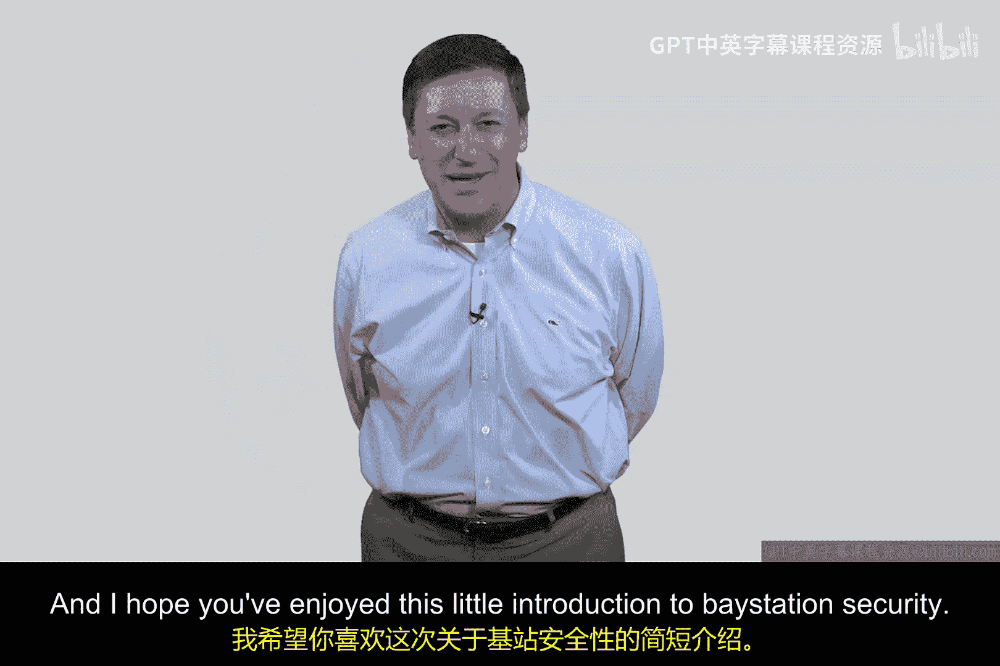
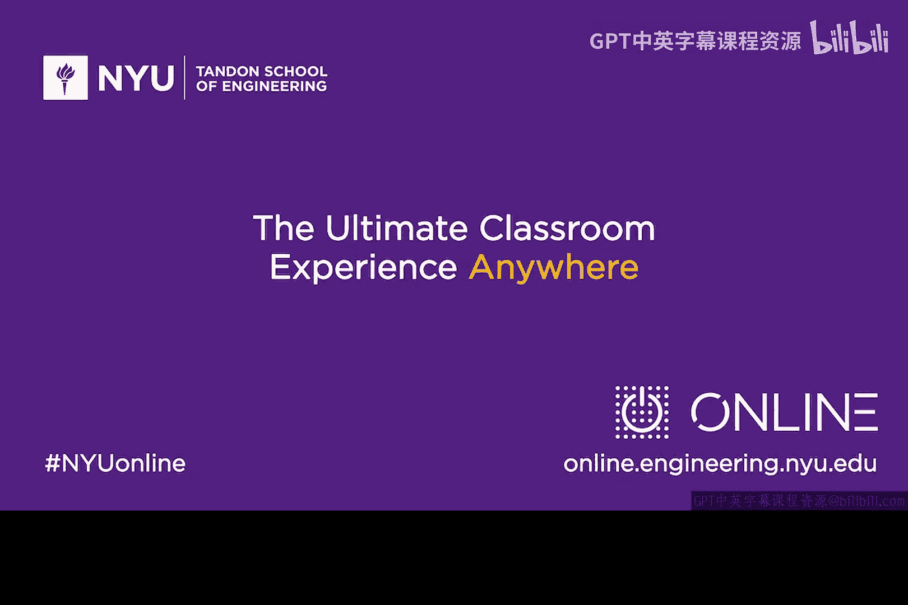

# 纽约大学《网络安全｜Introduction to Cyber Security》中英字幕（deepseek p171 34_IMSI捕获.zh_en -BV1TFLZzYE26_p171-

Hi， folks at Amarosso here。 And in this video， I want to talk to you a little bit about base station spoofing and mobility。

 And another way it's sometimes referred to is called Mccaching。

 where IMsI stands for individual mobile subscriber I。

 Let me tell you a little bit about how this whole thing works。 So in early generations of mobility。

 The original concept was that your handset would connect to tower and who cared about authentication。

 You know， was it's amazing that you could actually make the thing work Now。

 in second generation networking。 We did come to the conclusion that we need some little better。

 we came up with some algorithms that would actually， in some sense， connect the handset。

 like make certain that the handset is authenticated by the tower。😊，But we didn't do the reverse。

 Like the idea that the handset should authenticate the tower seemed dumb because there wasn't that much infrastructure out there。

 And you were lucky to find a tower， much less have to worry about authenticating to it。 Now。

 there was also a principle that was rigid first generation has lasted forever。

 and it's always been that a handset will try to attach to the strongest signal。 whatever's closest。

 So we knew kind of in the context of 2G mobile networking that we might have a little bit of a problem if the handset is really not bothering to authenticate the tower that if there was another smaller。

 littleer tower nearby。 that somebody put there。That maybe you would attach to it。

And you started to see people building not nefarious or malicious things around this。

 but very friendly things like for a festival， you could set up a base station tower that would give people better connectivity in the area and their phones would just attach naturally to this 2G tower but people figured out quickly that that base station could also be used for nefarious purposes for hacking for listening。

 So in 3G the idea。 and again this sort of follows a progression I'm assuming for the most part。

 the global standards， the GSM standards， GSM to UMTs to LT。

 there are other standards here in the United States Verizon follows a slightly different path。

 but all eventually getting to LT and beyond everybody sort of converges on the same standards。

 but I'm talking mostly about the more popular global protocols here。 but 3G networking UMTs。

 The idea was well let's。Let's make sure that the handset is doing authentication to the tower， okay。

 so that made sense， so if you had a fake tower， then the handset would wouldn't want to connect to it even if the signal was stronger。

But here's the problem。The problem is that as you roll out mobility infrastructure。

 focused for the most part on coverage， making sure people have good coverage。

You have to have a capability and you certainly had to have a capability between 2G and 3G called fallback。

 and what that means is。My handset is able to。Do 3G to a 3G tower， that's great。

 but if there's no 3G tower because I just haven't built one in that region yet。

 I only have 2G towers。Then I want the handset to be able to do that as well。

So wherever I get the best coverage， I connect to it。

 So even in the context of improved authentication in 3G。

 you had to support the fallback to the less secure case， Is't that interesting。

 So even though you fixed it in one generation， you had the problem in the previous generation。

 simply because you couldn't just walk away from that。

 It's a good example of how successive generations inherit the sins of previous designers。 Now， look。

 4G nice tight， strong bidirectional authentication。 certainly the case in 5G。

 And as 2G sort of retires off。 This is less of an issue。 but I love this as a case study。

 and how one generation of security inherits the problems that may have been introduced in a previous case Now。

 as sort of an additional consideration here to test。 Can you think of cases， where it would be。😊。

Oable to set up a small tower say an office environment。Where it's okay。

 you want people to be connecting to the small town and they shouldn't even know about it。 I mean。

 obviously， in your mind， you're going to jump to well， provides better coverage。

 But does it also violate privacy。 Like when would that be acceptable。

 is it acceptable in a business。 Would it be acceptable in a shopping mall。

 Would be acceptable at Starbucks。 Wifi， in some sense， plays that role to some degree。

 you're on a 5G， you're talking， you walk in to get a cup of coffee next thing， you know。

 you're on wfi， Is that acceptable， Do you want that to be seamless。

 Do you worry about security or privacy in that consideration， There are no answers to that。

 It's your opinion And it's the kinds of things that societies have to decide。

 are considered acceptable or unacceptable。 So I hope you'll take that into mind。

 I hope you enjoyed this little introduction to base station security。 I'll see you in the next one。

