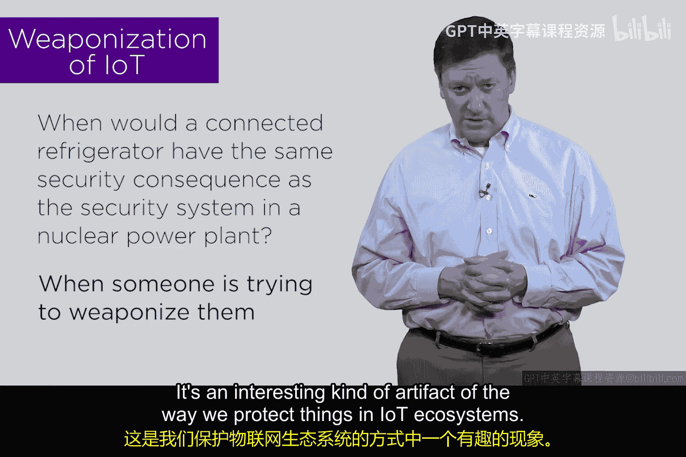

# 纽约大学《网络安全｜Introduction to Cyber Security》中英字幕（deepseek p173 36_物联网僵尸网络.zh_en -BV1TFLZzYE26_p173-

Hi everyone， this is Ed Emmarosso， and I've got a little short video here where I want to pose kind of a fun question to you。

 and the question is this。When would a connected refrigerator potentially have the same security consequence as a security system in a nuclear power plant so on surface。

 you would say that's utterly ridiculous， you know you attack a cyber attack on a nuclear power plant is always going to be worse。

 then you know a refrigerator connected to the Internet but what I want to have you think about here for a minute is something called weaponization of IoT that's where IoT systems are harvested together into a big bo。

 if there's been a lot of articles that are out on the internet and things that pop up in the popular press of talking to weaponization of IoT and the implications of the bottom line is if you've got IoT or industrial control devices。

 whether refrigerator or safety system in a power plant that have computers on them。

 they have operating systems with memory and CPU and IO。Network connections， if you have that。

 and I'm building myself a botnet to try to scale up to attack something。

Do I care if I'm stealing that compute cycle from a refrigerator or a power plant， The answer is。

 you don't。 In fact， my argument might be that the power plant probably is less valuable for the security thing gives probably a lot of security around that。

 Where your connected refrigerators probably wide open。 If you've been watching。

 there have been a lot of different cases， there's a famous one called the Muai botnet from I there's that graduate student。

 you know， in New Jersey where I actually live in the US who had created and harnessed a botnet of Iot devices。

 You always hear about in these kinds of cases， the devices that are attacked tend to be very innocuous things like digital video recorders or or cameras。

 home cameras， things like that。 Why is that， It's because there's no security there。 Now。

 if they wanted to go after the safety systems in a nuclear power plant。 Well。

 if they were easy to grab and get。TPU， memory， IO network connection， then they'll do that。

 You're going to go to the place where there's the least resistance So the answer to the question。

 when is a connected refrigerator potentially you have the same security consequences as the safety system in a nuclear power plant the answer is when somebody's trying to weaponize them And in terms of that weaponization it may be that the consequences are even more severe for the consumer device keep that in mind it's an interesting kind of artifact of the way we protect things in IoT ecosystems thanks I'll see in the next one。

