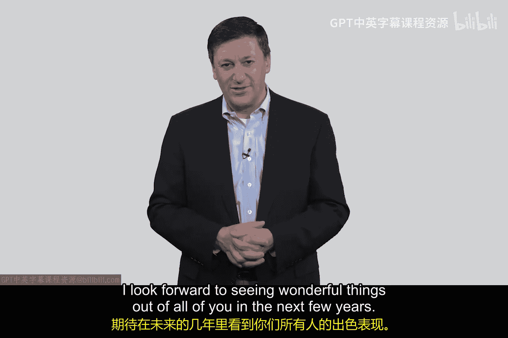

# 纽约大学《网络安全｜Introduction to Cyber Security》中英字幕（deepseek p176 39_网络安全职业建议.zh_en -BV1TFLZzYE26_p176-

Hi， everyone， Ed Ammarroso here and at this point in our video progression I'm assuming you've been with me for a bunch of videos。

 you know perhaps through multiple courses and so on。

 and I want to give you some advice now as might be one of the first questions the most popular question that I get as an instructor as an educator as a professor as a practitioner in cybersecurity is how do I forge a career in this area if you're a young person you might be sitting there saying wow。

 I like this I like cybersecurity， how do I get into it， what are the different areas。

 let me give you kind of the the categories of career places where you can make money doing this and kind of the path to it。

 we can talk a little bit about that in a minute but let me give you the different sort of end states So first is you might try and make a career as sort of a hacker and attacker in cyber Now there are a lot of bug bounty programs out there that will pay individual research。

To break into systems under ethical circumstances。 It can be a nice way to make money。

 You could be a penetration tester。 You could work for a military breaking into things or you could even work for a company that wants to be doing some very active testing。

 So if if you like that。 you like breaking into things。 and you feel like that's your skill。

 your skills， finding weaknesses and something and exploiting it。 You can make money at that。

 Now you don't want to make money doing something illegal。 That's not a good idea。

 That's absolutely the wrong use of that skill that God given skill that you might have。

 but you really can make a living in hacking， you know through ethical penetration testing and perhaps working for military。

 Second， the most obvious is move to the defense right if youre you enjoy cryptography。

 like setting up firewalls， you like setting up defenses， you like doing architecture。

 like doing operations， you like keeping track of data， doing analysis， hunting。

 that's what defenders。Do and that's what we do in a typical enterprise or government chief information security officer team。

 the chief information security officer or CiISO or Cso is the highest position in cybersecurity in a typical enterprise and you may aspire to that might be part of a team doing that kind of a defense defense of sort of position A third area is more the compliance area。

 that's where you're overseeing cybersecurity， you're doing assessments and audits and you may be pretty good at keeping track of requirements and documenting them and you might be very good in the way you communicate。

 so that can certainly be a career and for anybody who's got say an accounting bent or background or interest。

 audit and assessment might be something you'd be very good at a fourth possibility is to get into the building of tools you work for a vendor。

 work for a cybersecurity company if you have a startup streak in you and you think you'd like to build some new。

Compan build the next greatest you know company like Fireeye and Palo Alto networks in Floridanet。

 all these companies that have gotten very big and done real well because they had visionary founders。

 maybe that could be you or you'd like to work in that sort of environment startup Another possibilities government just bet every government in the world looking for cybersecurity experts to both oversee their industry and their society and also to protect government systems tends to move a little bit more slowly。

 but if you've got great patience and you have a sense of social purpose then working in a government environment can be just absolutely wonderful。

 So you've got to consider that。 and finally academia component of my path。 I mean。

 I spent a lot of time personally in the enterprise environment as a Cso for a large telecommunications firm。

 but I've also been a professor for 29 years teaching cybersecurity to thousands of undergraduate and graduate students。

 if you enjoy research。😊，If you enjoy teaching， if you enjoy that kind of environment。

 then academia makes sense now how do you come to these things， well it's always hard work。

 doesn't matter which of these paths you pick， there is no easy way to get there。

 you stand at the base of a mountain， you look up at the top and you say that's where I want to be don't forget that there is a mountain between you and it you may know exactly where you want to be but hard work is the way to get there。

 you want to focus on having a good technical background。

 you want to focus on having a good business background and you want to focus on your ability to communicate writing。

Speaking， presenting， understanding， these are the kinds of skills that are going to help you。

 So regardless of the path you take and whatever your endpoint would be。

 I do hope that you decide cybersecurity is a career that makes sense for you and look forward to seeing wonderful things out of all of you in the next few years。

 Thanks。

