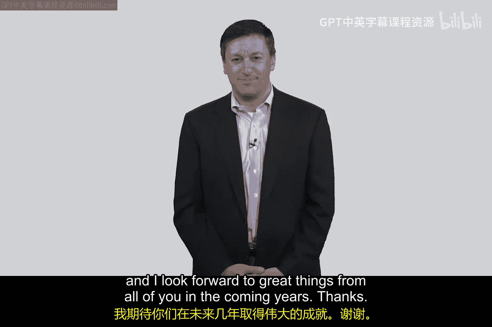
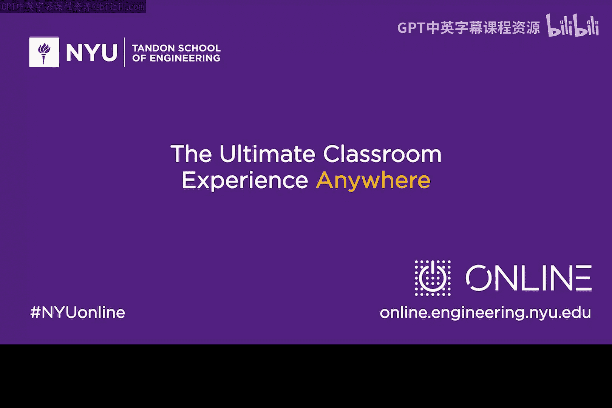

# 纽约大学《网络安全｜Introduction to Cyber Security》中英字幕（deepseek p177 40_如何继续网络安全学习计划.zh_en -BV1TFLZzYE26_p177-

Hi， everyone Ed Ammarosso here。 And in this last of our progression of videos on cybersecurity。

 I want to give you a little roadmap for how you can stay sharp Now you're going to have to continue to read there's always a lot of really good books that pop up around cyber and information security and you can have your pick。

 I've written some I have some ebooks that are coming out that will make sure you all have access to via links and information through the course。

 you want to keep taking courses。 course Sarah is a wonderful portfolio of different topics and courses and things that are both on security and also in the adjacent issues of networking and computing and software。

 you want to spend some time on that media is a little funny like when you if you decide that you want to learn from media。

 be careful because sometimes the media reports can be written from perspectives that may or may not be right questionable back。

ence of why you find some things that are good。 Brian Krebs in particular is a very good media reporter so you may want to take a look at Brian Krebs's website to kind of keep up on different types of things that are going on in and around hacking a published journal articles and things that are peerreviewed are always excellent。

 these are things that you ought to consider staying sharp on and spending some time with conferences are good things to go to anything from the IAEE Association for Comp machinery there's some industry conferences from companies like RSA that are just excellent。

 So there are conferences that may be useful but in general I think the bottom line here is that as you continue in your technology work。

 whether as a manager， practitioner， developer， student teacher。

 cybersecurity increasingly will weave into the mainstream and it won't be so hard to kind of see it as a separate discipline we need to learn because I'm hoping it becomes more。

mbed but in the coming years， I do hope you'll continue to read。

 continue to learn going to conferences， keeping track of articles and so on and so forth。

 to stay sharp。 we need you to be sharp。 we need you to really do a good job protecting systems that you build and keeping our infrastructure and our society safe I hope all of these lectures have been useful for you and I look forward to great things from all of you in the coming years thanks。

