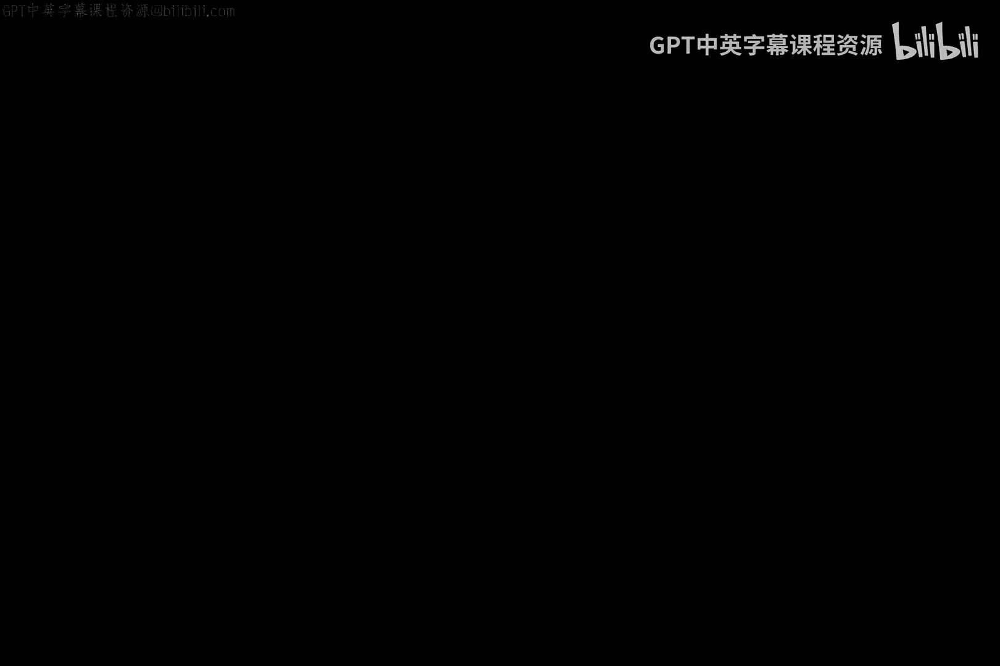
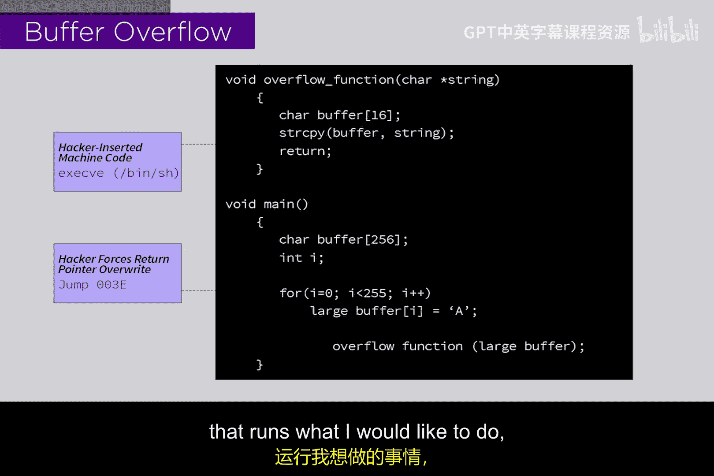
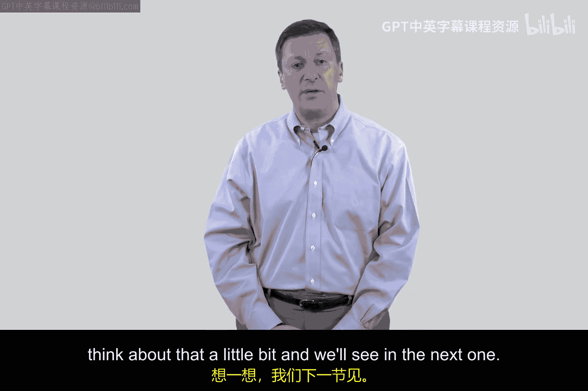

# 纽约大学《网络安全｜Introduction to Cyber Security》中英字幕（deepseek p18 18_完整性威胁.zh_en -BV1TFLZzYE26_p18-

So now I want to talk to you about the integrity threat or modification threat。

 the threat that somebody might be corrupting an asset， a piece of software， a system， whatever。

For malicious purposes， and the obvious example here is malware。

 That's where code that has some presumed correctness or validity。

 has that corrupted by a malicious actor putting malware into your system。Integrity threat。

How in the world would you do something like this， Well， again。

 it's the permissiveness of the CPU memory model that's been in computing since we've had computers。

 This idea that， you know， I can take code and I can manipulate it and make it do other things by just shifting and changing。

 We don't have rigidity in computing， we have the ability to make modifications to software。

 Think about that。 That is absolutely fundamental of this whole thing。

 If you drove up in a car into my driveway And you say， here's my new truck。😊，There it is。

 What do you think， How easy is it or would it be for me to make fundamental modifications to that truck？

Probably not easy， right， And it's hardware。 There's components。 They're all connected up。

 Maybe if I'm a genius mechanic， I can make some changes， but it's certainly not a flexible。

 easy environment for making changes。 software is different， if I show you a piece of code and I say。

 hey， what do you think， and you look at it。 you want to make some minor changes to it。

 we're well set up for that， Now， one of the problems that occurs frequently in programme is the handling of buffers。

 Now， here's something for those of you who are programmers will be very familiar with this idea。

 We use scratch space and memory and a lot of our programs to keep track of things。 So， for example。

 if I'm pushing to a stack。And I want to add things。

 Then what I might do is I might push the first value to a little scratch pad in memory。

 Then I push the second value to that scratch pad in memory。

 and then my program might pop the first one， pop the second。

 add them and then push the answer onto this buffer onto the stack onto this scratchpa in memory。

 So we're constantly using memory to do things。 And one of the things that was invented with computers is if I look at a full list of memory in a computer。

 Then what we typically do is we reserve some portion of that for the programs you run。

 and we reserve some portion of it for the data that your program uses。 That makes sense。

 memory keeps track of programs and data all in the same place。 yeah。

 it's in different place the memory， but it's the same sort of linear progression through memory。

 It's a basic weakness that we've had in computing since the beginning。 Now。

 here's the way programmers might cause an integrity threat through some。

Something we would call a buffer overflow。 The way that works is up here in your program。

 I'm reserving somewhere a little piece of scratch pad to do something。

 and I reserve a little piece of memory where I'm going to put some array of， you know。

10 characters of something。But what I do really， is the program then instead of just putting a variable that's within those bounds。

 I put some gigantic thing into it， some gigantic piece of data that not only fills up the buffer or scratch pace that you put in there。

 but it overruns and starts causing all kinds of problems in memory and what's going to happen to your program。

 it's going to go。It's going to explode or crash。 And again。

 the way computers work is that when your computer crashes。

 the program counter goes to something called an exception handler。 That's the way computer works。

 program runs。 and it goes for whatever reason， and the computer goes， what do I do， Well。

 the designer says， well， what do we do whenever something crashes。

 Let's put the program counter here and run this code to recover。 You got that program crashes。

 program counter recover， Okay， now， what if。And this is going to sound crazy。

 but this is the way it works。 What if instead of overriding the buffer a little bit？

I really overwrite the buffer。 I mean， overwrite it all the way down to the point where I find the recovery procedure and then where the recovery procedure is。

 I put a piece of code that I want to execute。You got that。 so here's the idea。

I overwrite the buffer。And I overwrite it with We would call it No op。

 Put a bunch of things in there that really don't execute。

 But I just start filling up memory with no ops。 I get to or even go past where the recovery procedure is。

 and then I put code at the appended part of that no op bridge。 that runs what I would like to do。

 maybe copying me a shell。 So now here's what happens。 program。 I overflow buffer。

 The buffer overflows with a no op bridge。 It fills up memory， and then has something I want to run。

 The coal computer goes crashes goes， oh my guys everything goes haywi。

 The program counter goes down to the recovery memory address。 But I've overwritten that with no ops。

 It's going to ride the no op bridge。 find my piece of code executed。

 and I probably now own your machine because I' put code there。 that will own the machine。

 Isn't that clever， look。😊。

There are a lot of resources on the Internet。 We'll make sure as part of the support environment here for this lecture that you have some things that we recommend that you take a look at。

 including a great paper called Smashing the Sta for Fund and profit。You can take a look at it。

 and you can dig in and try and understand buffer overflow at a little deeper level。

 But I think you probably get the idea here that integrity threats generally involve problems in memory。

 the fact that data and programs are all sort of interspersed。 And I can have things over right。

 And I know where control will go when things crashes and on and on。

 I can take advantage of these things to cause integrity problems in computer systems。

 So to ponder that， think about that a little bit。 and we'll see on the next one。

