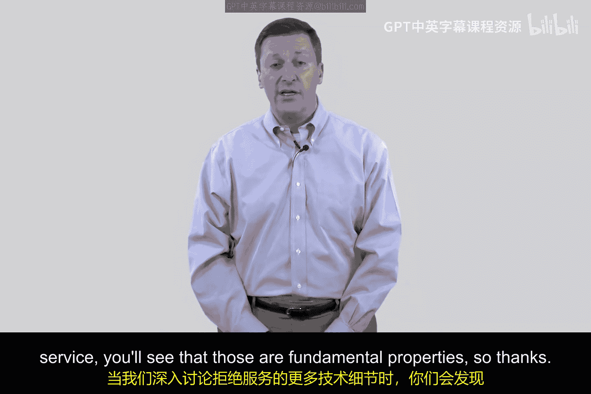

# 纽约大学《网络安全｜Introduction to Cyber Security》中英字幕（deepseek p19 19_可用性威胁.zh_en -BV1TFLZzYE26_p19-

Now I want to talk to you about the availability threat and in particular。

 this denial of service condition that we try and avoid denial of service is when。

Someone clogs up or blocks or maliciously attacks the ability of somebody to gain access to a resource that they're authorized to gain access to。

 Let's take an example。 General， if you're listening。

 Like it's like a non-computing thing as a human being。 and I'm trying to listen。

 I'm trying to pay attention to something。 a way that I can make it difficult for you to listen or pay attention。

 to create a whole bunch of noise， right， Like you've all had that experience。

 If I'm trying to listen to something and there's tons of background noise， then I go。

 turn all that stuff off， I can't hear， there's noise coming in。

 and that's an important concept because much of denial of service is based on this idea of lobbying a whole bunch of noise so that you can't pay attention to or except real service requests。

 Now， one important property here。 involves sort of this idea of amplification。

 So I do something and it amplifies。Think about if I was hitting a tennis ball at a wall， Well。

 we're used to hitting a tennis ball at a wall and one tennis ball comes back。

 What if I could hit a tennis ball at a wall？Thous0 tennis balls come back。 That's amplification。

 And an example would be if I query some system， little simple query， I say， hey， what time is it。

 And you say2 o'clock。 great little question， little answer，'s great， But what if I say。

What time is it everywhere in every language， and I'd like to know what time it's going to be every time for the next three months in one second intervals。

So what's going to come back。 It's crazy stuff。 You're going to get all this time information hitting。

 you go。 all I did was ask what time it was the first time we will little answer。

 Then I hit a tennis ball to walk。 I get all these tennis balls coming back。

 That concept of amplification is absolutely fundamental to denial a surface attacks。

 The ability to have something small become something large。

 turns out the internets chock full of these kinds of examples。 and furthermore。

 there's a second property called reflection where I can have me hit the tennis ball。😊。

But guess what？ The ball hits somebody else instead of me。You get the idea。

 so I had tennis ball at the wall， didn't come back to me， hit you and now how about this？

A tennis ball at the wall， and now a thousand tennis balls hit you。That's a dial service attack。

 That's how works。 So now I say， hey， what time is it， but I ask as you。

 And then you're sitting there and all of a sudden you hear it 2 o'clock。 and you go 2 o'clock。

What I didn't ask anything， but it's no big deal。 one' answer。 But if I ask that other thing。

 all the times and everything。 and all of a sudden， you're being barraged with the time。

Then you're essentially experiencing what we would call denial of service attack Now we're going to get into later how distributed denial of service attacks work and how botnets accomplish these kinds of things。

 but I wanted you to have the basic idea here of denial of service and how it plays out now it's kind of a little quiz to test our learning。

 I don't you think about a few little properties here。That affect the availability of a system。

 And I want you to think in your mind which of these based on what you've learned so far。

 kind of constitute an attack， a cyber attack， a denial a service cyber attack。

 First would be a would be if lightning hit a data center。 Suppose a data center gets hit light。

And you could imagine probably would be。Taking out the data center's ability to process data。

 so that's a B would be some software that's intentionally taking out access points， Wi-fi， 4G， LT。

 whatever， but intentionally blocking or taking out access points and the third would be coding errors and unintenentional coding errors that cause a system to crash。

 so we have lightning in a data center we have software on endpoints that are taking out access。

And we have unintentional coding error。 Let's take the three in turn。 Lightning。

 we've said earlier is not a security issue。 So I want to make sure you have that your mind。

When there's something that's non malicious， non intentional。And takes out a data center。A problem。

 But we don't consider that denial of service。 The third one。 that we said we unintentional software。

 again， if it's unintentional， it's not a security issue。 Security implies intentional， deliberate。

 malicious。 It's obviously， the middle case is the one that we would consider to be a denial of service attack。

 That's where endpoints are taking out an access point， taking out wfi， flooding it。

 making it unavailable for authorized users。 So you can see in those three cases。

 whenever you see something that looks unintentional， unavoidable， nothing malicious。Not security。

 but in the case where it's malicious， there is。 So keep in mind also。

 that idea of amplification and reflection， because we're going to come back to that。

 And as we get into some of the more technical discussions around denial of service。

 you'll see that those are fundamental properties。 So thanks。

