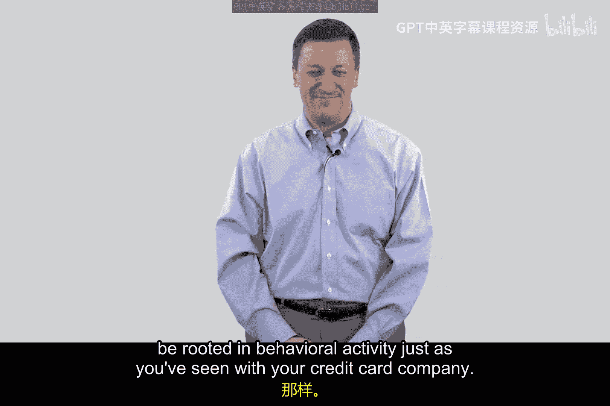

# 纽约大学《网络安全｜Introduction to Cyber Security》中英字幕（deepseek p20 20_欺诈威胁.zh_en -BV1TFLZzYE26_p20-

Now， I want to talk to you about that special case threat type that we alluded to earlier。

 namely fraud。 and and you can also call it theft。 And just a review， that's we steal something。

 paying money， but you just basically taking an asset。

 And this is an important kind of consideration in cybersecurity。

 because increasingly with things online and with so much e-commerce going on。

 this idea of preventing people from stealing is a really big piece in cybersecurity。

 So we do want to take a minute to think about the the threat and how it normally plays out。

 And as we said earlier， when somebody is committing theft。They're not paying for a service。

 And the first sort of place that we can take inventory where this might happen is any place where there's something of value。

 So if you're doing an inventory about whether there's a fraud risk， then it's simply。

 is there any financial value in something that's being protected。

 Financial value is what attracts fraudsters。 Okay， there's no financial value。

 then as the security engineers， a security analyst as a security expert。

You know that fraud is probably not going to be the big issue。 but when there is financial value。

 then what we need to do then to prevent this。 And we'll get into it later。

 But I want to give you some motivation now for the cybersecur concept I we need to look for hints that fraudster would typically follow。

 Does that makes sense。 Like we're going to do something that would be called behavioral analysis。

 That's where I'm watching the behavior of something。

 And I'm trying to determine whether fraud is being committed。 I'll give you a simple example。

 Let's say we're keeping track of passwords that are coming into a system。 Okay， so red program。

 and I watch， and I see user I D password。 And I check， and I see， oh， wait， not valid。

 And I send the response back and go。Not valid， sorry。And I sit and I wait now。

 the same user I D comes in again。 Another password comes in。 It doesn't match。 And I go。Sorry。

 not valid， too。Then you see another user I D come in。 see another password。 And it's not valid。

 And I go back and I go， hey， not valid。 Now， the question is from a behavioral perspective。

 Can I make some conclusion about those three guesses or fat fingers or whatever。

 whatever is going on， Some's having a little bit of trouble here， They tried three times。

 And they didn't know the password， So here's the question for you。

 Are they committing fraud or they just forget their password。Its a big deal in cybersecurity。

 it is absolutely fundamental to almost every control we have in cybersecurity。That an attack。

 in many cases， may not be an attack。 And we call that a false positive， if we call it an attack。

 but it not。 We'll get into that later。 But for now， this theft fraud issue is something。

 It's a little tough to know when something's committing fraud。

 Look a lot of you have probably had experiences with your banks where you get a phone call and they say Mr。

 Jones， Missus Smith。OhWe see， you're using this credit card in Singapore。Are you in Singapore。

 Is this O， Are you really buying a suit in Singapore， It seems like you don't live there。

 Is this okay， You're doing behavioral analysis to determine if something doesn't make sense。

 You've all had that experience。And a lot of times it is a false positive where you say， well， yeah。

 I am in Singapore。 and yes， I am， you know， buying this suit。Thank you for checking。

 But everything's just fine。 You get the point。 It turns out that fraud is something little difficult from a foundational perspective to really assign good solid safeguards to generally。

 what we do is we watch the behavior， we look for things that are odd patterns。 One。

 one other example that we see often in fraud activity is when somebody's going through a website that might have a wizard。

 for example， where I'm stepping through the wizard doing each of the steps。 I go to this screen。

 and it says continue。 I go to that screen。 I do continue fraudsters usually don't have a lot of patience and they can usually find a way to skip through a wizard and a lot of antifrud systems online。

 will watch to see if you've skipped a wizard and say。

 that's probably fraud and it may or may not be。😊，So I think the learning here is that where there's money。

 you have to be suspicious that there may be fraud or theft that can go on。 And for the most part。

 the types of technology and the types of safeguards that will'll use to reduce the risk of fraud are going to be rooted in behavioral activity。

 just as you've seen with your credit card company， said thanks。

