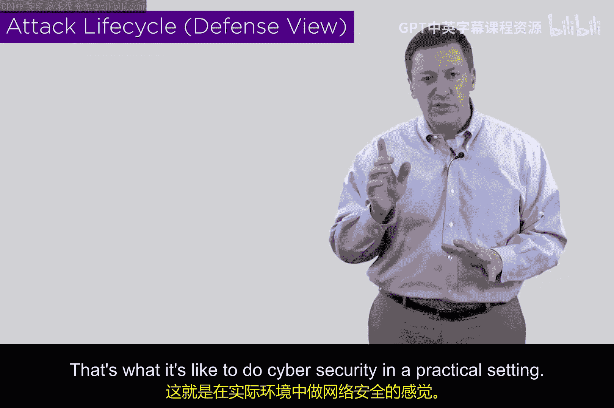
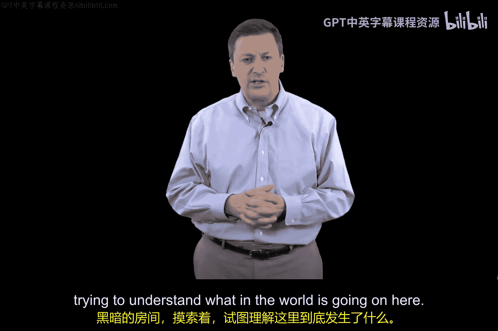
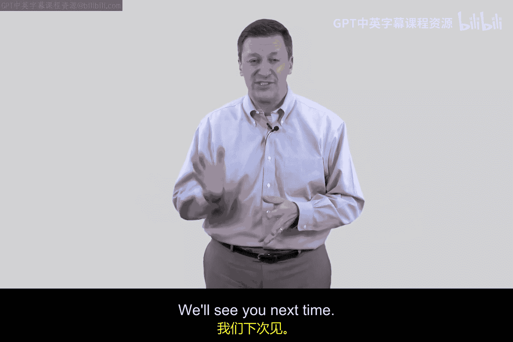

# 纽约大学《网络安全｜Introduction to Cyber Security》中英字幕（deepseek p22 22_攻击.zh_en -BV1TFLZzYE26_p22-

Now we're going to talk about cyber attacks。 We're getting towards some material that's getting a little bit more technical。

 What you're going to find is that a lot of the upfront material here is we do taxonomies and so on and my stories。

 my incessant stories will'll lead to or build a base so that we can start doing some computer science。

 But for now it's I want to help you understand how a cyber attack is organized。

 we're going to take the view of the defender。 Okay so when a defender is watching a cyber attack。

What we see are something called indicators。 That means we see some hint or some idea that there may be something going on。

 For example， if you're sitting at home and you see a car drive by and you go， car drive by。

 I wonder if that's a problem， What questions would you call the police then I don't know。

 It's an indicator you might have a little bit of weird discussion with the police have you said you saw a car drive by。

 let's say a few minutes later， you see a car drive by again。

 now you get the idea you're going to see these indicators that may or may not lead you to believe that you're under attack。

 And what happens is these indicators build up to some threshold where really an attack has occurred after which the indicators you see might actually have some real damage。

 Like you might be noticing that assets are really being damaged There' real problems with something So we tend to break attacks。

to two phases， there is the early indication warning phase。

 and then it's kind of a post attack phase， we say there's early and there's latter stages to an attack。

Now， keep in mind， anybody would say you're better off。Stopping an attack in the early stages， right？

 I mean， that makes perfect sense that you'd want to stop it before it gets to the point where there's an issue。

 Like if I call the police because the car drove by a couple of times。 And they really are criminals。

 And that's fantastic。 I've stopped it。 I didn't wait until they came up to my house and broke in and stole all my stuff。

 Well， if you called the police then then yeah， I understand， they broke into the house。

 broke all my stuff， They're stealing things， I call the police would have been better。

 if I'd called when they drove by。 Well， what's the problem with calling in those early stages。

 And what's the problem if you're cyber defender with initiating incident response based on early indicators。

😊，It's called false positives。 That's where most of the fuss that I'd be making about a cyber attack。

Would be not really a cyber attack。I'd be making a fuss about a lot of nothing。

So in our minds as cyber defenders， we try to organize cyber attacks in a way that helps us be preventive but also balance the amount of time that we want to spend。

 with all these indications of warnings that may be popping up and with issues thatll pop up。

 you know， in the different phases。 and and make sure that we're not wasting all of our time。 Now。

 the way an offense will think about cyber attack is they're going to do things like reconnaissance in the first stage。

 then they're going to do scanning to try and see what's going on on your system。

 Then they're going to gain access to your system in some way。

 Then there's going to be a real exploit， and then they probably cover their tracks and leave。

 That's the compendium that an offenses。 The defense just sees a bunch of indicators。

 the offense is not going to mail you a map of what they're doing。 It's much different。

 So I want you to think。That as a defender， you do not have a map of what the offense is doing。

 They're not laying it out for you。It's like being in a dark room and feeling around。

 That's what it's like to do cyber securitycurity in a practical setting。

 That imagery is an important one。 Dark room feeling around and trying to understand what in the world is going on here。

 What sorts of things are happening。 You know， and， and really， that。

 in essence is the core problem in cyber securityity。 If we knew what the offense was doing。

 then we'd be fine， But it turns out that we don't。 We'll see you next time。

