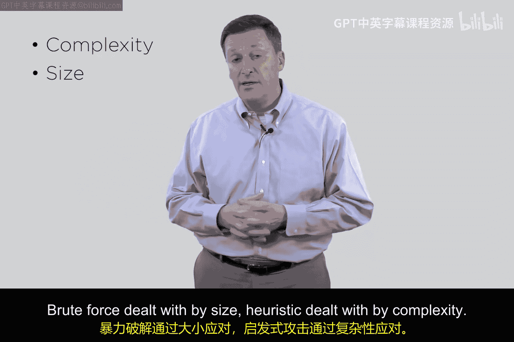

# 纽约大学《网络安全｜Introduction to Cyber Security》中英字幕（deepseek p23 23_暴力破解与启发式攻击.zh_en -BV1TFLZzYE26_p23-

You know， there's two different types of attacks。That we see in cybersecurity。

 The first is called brute force。 That's where an attacker creates software creates a system。

 creates some sort of an attack strategy that's literally going to try every possibility in some input set to try and break into your system。

 the obvious example here is passwords， right， So one possible way to break your password。

 try every password。 I that's crazy。 but that's why we try and lengthen the password that you're using。

 make sure that it's a sufficient length and complexity that it's not easy for you to just try every possibility。

 If you have a three character password that in my sleep。

 I can write a program that will try all possibilities of three characters。

 So brute force attacks it turns out are things that are thwarted in cybersecurity by making size to domain Now keep。

That in mind， sizeize becomes a means for dealing with brute force attacks when someone asks you。

 hey， you know， what's the strength of this cryptographic algorithm。

 Sometimes what they mean is what's the size of the key。 What's the domain。

 The number of keys that are possible。 and it's considered strong， if the domain size， is's very big。

 Okay， so that's first thing。 brute force。 Second type of attack that we often see in cyber is called a heuristic attack。

 Now， Heuristic attacks a little different。 That's where you're using your intelligence。

 you're using knowledge。 you're using something called a shortcut。 So we brute force。

 I write a programmer I do something that runs through every possibility。Euristic attacks， you say。

I don't have time for that。 I can't do it that way。 I need a shortcut。

 I need some way of making the amount of time to attack your system reduced that the way we deal with heuristic attacks on the offensive side。

 not with size， but with complexity， I try and make whatever my scheme is that you're trying to break so complicated that you can't use your intelligence。

 Let's put those together。Brte force is about size。

So if I see something that has a weakness in terms of， say。

 number of keys in crypto or the number of possibilities in terms of guessing。

 then that brute force nature would lead me to follow that approach。

 But if I see that you've accounted for that。 then I'm going use my intelligence and see， wow。

 let's see if we can find a way to break this system without having you try all the possibilities。

 So， for example， let's take a dumb crypto example， if I said， you know you know。

 your's three characters， you know， to the keys then use brute force。

 But if I try and you know make the key length real big， then the question is。

 can I figure out the algorithm。 Are you doing something really dumb。 if it's a function is F of 2，4。

 F of 3，6， F of 4，8， I don't need to go through all the possibilities to see that you're doubling the domain input。

 So complexity and size， are the two ways that we deal with these main two types of cyber。

Tax brute force dealt with by size。

Heuristic dealt with by complexity， keep that in mind， thanks。

