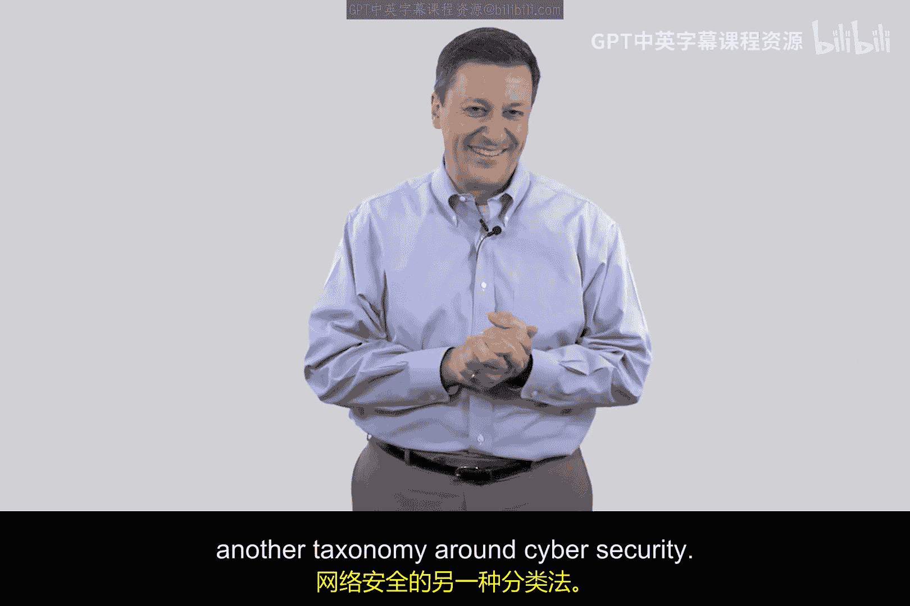

# 纽约大学《网络安全｜Introduction to Cyber Security》中英字幕（deepseek p24 24_密码分析.zh_en -BV1TFLZzYE26_p24-

So the art and science of creating codes is called cryptography。

 We're going to have a lot of fun learning basic cryptography。 in this course。

 You're going to come out with an understanding of how it all works。 but the corresponding。😊。

Art and science of breaking codes is called crypt analysis。 So if you're making codes。

 you're doing cryptography， if you're breaking codes。

 you're doing crypt analysis and it's a good case study as we learn more about cyber attacks and think about them in the context of different taxonomies。

 Now， it turns out there's three strategies that we can follow for crypt analysis。

 we'll take them in order。The first is called Cyphertext only。 That's where you， the attacker。

 are looking at a stream of encrypted data。 And you have absolutely no hints as to what's in there。

 You just see the encryption。 and you have to come up with some means for breaking the encryption。

 And in a previous video， we said one possibility is you do brute force attacks。

 you try and decrypt using every key you can think of。 Another is to look at the encryptciphermin。

 We call that ciphertext， encrypted text。 See if there's something in there that we could figure out to somehow do the reverse of the encryption。

 which we would call decryption or crypt analytic processing。

 So that's the hardest ciphertext only is the hardest case ofpher encryptpt analysis。 No hints。 Now。

 there's a second possibility。 And that's where you do have a few hints。

 I some crazy can imagine having a piece of paper。That has some English text on it。

 and having next to it， the encrypted version of that。 And you get hints， you look。 and you go， oh。

 so that encrypts to that。 I get it。 And in computing。

 we think of that more as the challenge response between Alice and Bob。 So a lot of times。

 encryption is implemented as a function。 So that one entity。 Alice。

 lobbing over a challenge to Bob and getting back a response is like sending plain text and getting the encrypted cipher text back。

 We follow。 If Eve is watching this。 She sees the plain text， she sees the cipher text to hint。

 It may not give you the whole function。 It certainly not， but it's a hint。 It's not nothing。

 And we call that case， known plain text。 So ciphert only no hints。 known plain text， hints。

 follow Now there's a third case。And that's where I actually have the encryption function。

 go break into your building and I take your encryptor and boom I drop it down。 obviously。

 encryptors are not big pieces of equipment。 But you get the idea if I have the encryption algorithm。

 then I create something known as a code book。 That's where I can literally feed input to the encryption function。

 look at the output， the corresponding encrypted function， the ciphertext， write it down。

 and then I feed another input encrypt it， write that down。

 And I do that successively over and over and over and over again and build up a code book。 Now。

 you would think my gosh， if I can build a code book。😊，I have you。

 I'd have the whole I just sit there and build the codebook and I'm done。

How do we deal with something like that？ Now what did we say earlier was the type of attack that involves doing things over and over again。

 brute force， and how do we deal with brute force size， right？

The complexity of the algorithm is irrelevant if I'm building a code book。

 I don't care how clever your scrambling and transposition and other types of mathematical functions are。

 If I can just feed things in and read what comes out。

But the one thing I can't deal with is if you've made the domain so enormously large that it would take from now until the end of the universe to build the code book。

 Let me say that again。😊，If I can build。A domain size big enough。

That for you to build a code book would take from now until the end of the universe。

 How motivated are you even begin， It makes no sense。 Size is the way we deal with brute force text。

 So let's keep those three things in mind。 We have cpher text only known plain text and chosen plain text。

 that third case where we're building code book。Obviously codebook is the easiest of the three。

 but if I make the domain size big enough， then you're going to have trouble。

 it's a good case study in thinking through another taxonomy。

 yet another taxonomy around cybersecurity we'll be back in a little bit with another session。

