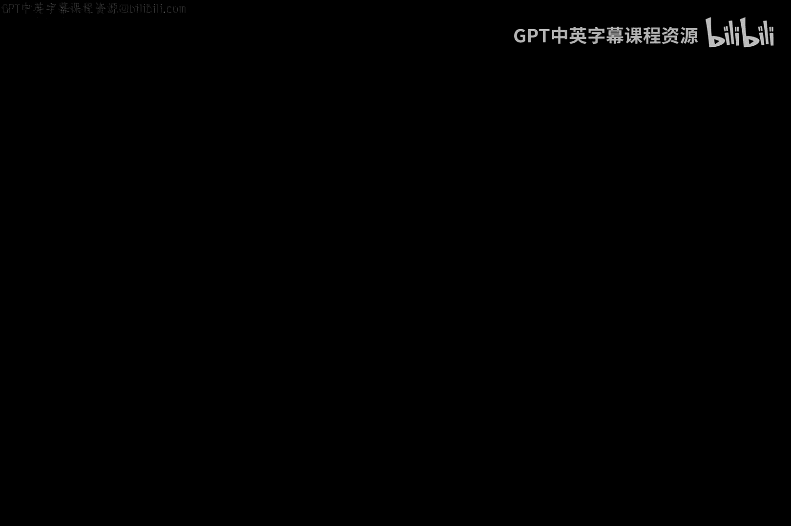
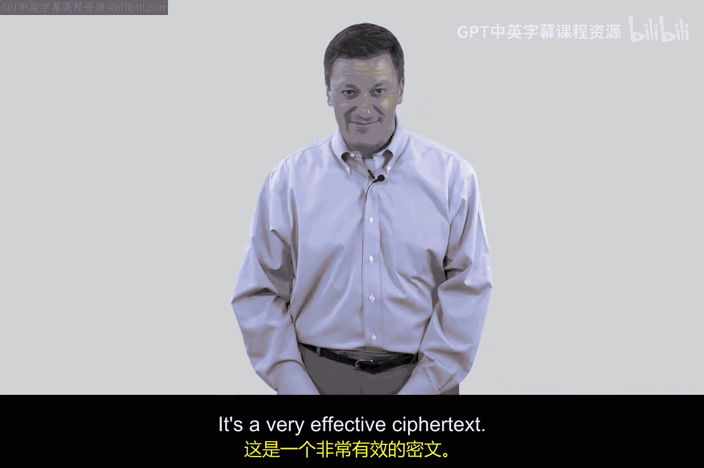

# 纽约大学《网络安全｜Introduction to Cyber Security》中英字幕（deepseek p25 25_破解凯撒密码.zh_en -BV1TFLZzYE26_p25-

So I want to do an example now， a real example of crypt analytic attack。

 okay so now let's start with the idea that we're going to have an encryption function and cryptographers would call it a cipher。

 that's what they like to use。😊，So we're gonna to have an encryption plug it's not to be a very good one。

 It's going to be a replacement or substitution cipher where I take one character。

 replace it with another one， Okay， think letters， take one letter， replace with another， Okay。

 and we're going to use。😊，Probably the simplest of all substitution ciphers。

 the so called Caesar cipher， where I'm just shifting letters in the alphabet。

 Let's say I'm shifting each English alphabetic letter。 You know， two slots forward。 So A becomes C。

 B becomes D and so on。I get that that's not a very good encryption function。

 but it'll illustrate the type of attack that I want to show you because there are clever ways to sort of combine brute force with heuristic into a program that allows you to decrypt almost like magic based on ingesting data。

 Let me show you how this would work。 Now， you know， all of you know。😊。

That if I look at a frequency distribution for an alphabet。And we'll use English as the example。

 and there's going to be great predictive aspects of that frequency， for example， in English。

The letter Z or Z is certainly not going to be seen as frequently in English sentences or talk as the letter A or the letter E or the letter R。

 And we can be very mathematical about it， We can lay out the exact frequency distribution of the English language。

 We can lay that out。 Okay， so we know that。 and we know that if I start with a little sentence and start counting up letters。

You know that it's not going to uncover the frequency distribution immediately， right， It takes time。

 So as I ingest a sentence， paragraph， as page，10 pages， a entire book。

 By the time I get through the entire book， just counting letters and building the histogram。

I'm pretty sure we've turned over the frequency distribution， we created it， the more data。

 the more exact match we have to the frequency distribution that makes sense now。

If I'm doing a cipher text only， crypt analytic attack。

On a substitution cipher that shifts the alphabet forward a couple， then here's what that means。

Where you had intended to say Apple， and it would have been AP P， P， L E。 Well。

 when you encrypt that， A becomes C， right， and P becomes R and the second P becomes R and so on。

 shifts forward。Now， if I take that stream of encrypted output。

And I start building a histogram of that。 Here's what happens。The letters will magically create。

The histogram， the frequency distribution of the English language。

 But for the letters that they were intended to be， like the idea would be that now a。If if it's a C。

 then where I see Cs， it becomes A in the frequency distribution， you follow or P becomes R。So。

Whatever I typed as my book， my English book， A， B C。

 the frequency distribution is going to be the way it was intended by the writer。

 But when I encrypt it， when I shift the letters。That frequency distribution is preserved。

 and as I ingest the ciphertext， I can write a Python program or I can write a C program or whatever that just indents the data。

 builds the histogram， matches it up against the frequency distribution andvoila。

A ciphertext only cryptnalytic attack using brute force ingest。 That's a lot to say。

 But I think you understood what I said， that's kind of cool。 right。

 We at a program that does the crypt analysis in an automated way。 Keep that in mind。

 It's kind of fun。 It gives you an essence of how we might use computers and systems to combine brute force。

 heuristic and other types of things into very effective cyber attacks。 So we'll see you next time。😊。

