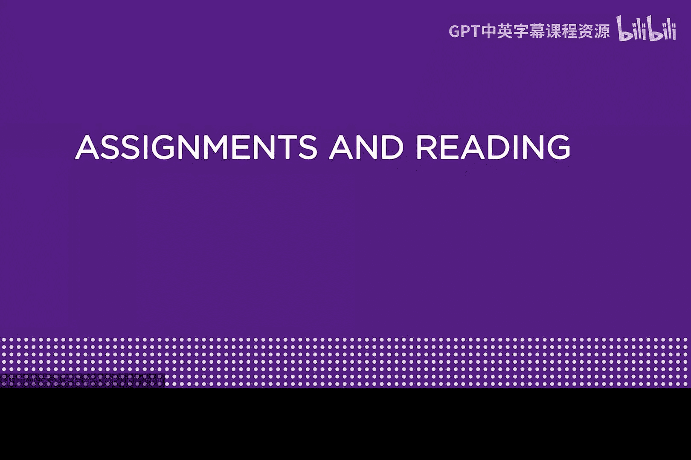
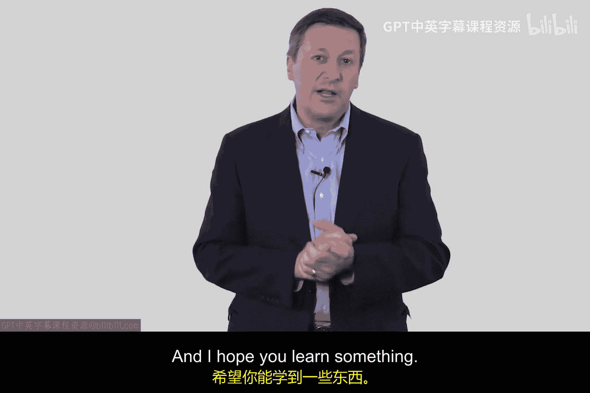
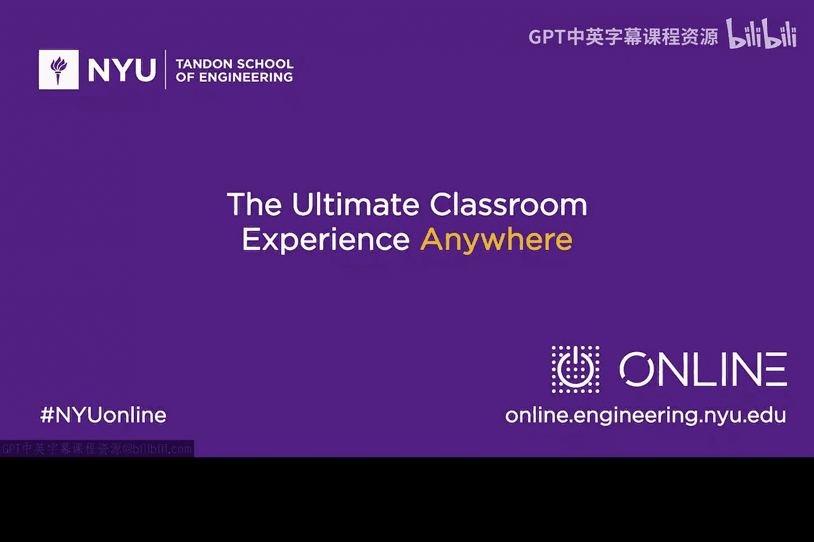

# 纽约大学《网络安全｜Introduction to Cyber Security》中英字幕（deepseek p27 27_作业与阅读.zh_en -BV1TFLZzYE26_p27-

Hi， everyone， Ed Ammarosso here， and I want to welcome you to this module Now。

 our goals in this module to kind of go through some more advanced attacks。

 I want to look at worms and Dids attacks and kind of dig into them a little bit and and get some perspective on where the offense。

 you seems to be headed。 certainly more intense attacks then existed the beginning of cybersecurity。

 has a couple of cool papers that I'd like you to take a look at to complement the learnings here in the module。

 One is a wired magazine article。 It's all about Andy Greenberg， who's a reporter at wireless。

 at wired magazine。 he writes about his experiences being in a Jeeep as hackers you know。

 essentially live， take over the Jeeepaw on a highway。

 question whether it was a good idea to actually do that on a live highway。

 but I do think you should read Andy's article。 And then second there's sort of a biographical piece about one of the one。

Real pioneers in building attack and offensive weapons HD more and I say weapons。

 he probably would say， gosh， they're not weapons。 They're tools that help you demonstrate the security of your system。

 HD Moore is one of the best and meta traces It's lineage back to HD as being the real founder there I get a little paper that we found that kind of takes you through a little bit of his of his Jo in the cybersecurity industry So I think you'll like that paper and' a couple of optional books that we recommend that you make use of during during this module One is an ebook that I wrote with my son Matt it's called from CIA to AP and introduction to cybersecurity you can get in on Amazon again optional but if you decide to read along chapters 5 and6 would be good ones for you to take a look at and then I do think it makes sense for you to have a good solid TCPIP textbook on your Pro bookshelf It's optional for the module。

But recommended。 And if you need one of Richard Stevens。

 I think has one of the best books ever written on TCPIP TCPIP Illustrated volume1。

 And if you look at chapters 5 and 6， I think they'll help you a little bit with this module。

 That's a couple of Ted talks that I think you should watch along with your study in this module。

 ones by Ps Holman。 and it's about you know basically a top hacker talking about how he does things。

 I think it's really quite good。 And the second is an old friend of mine Avi Rebin's a professor Johns Hopkins。

 And he wrote up gave a nice TEed talk about called all your devices can be hacked。

 And I think it's just delightful。 frightening。 but really quite a good talk。

 So I hope you'll take advantage of these resources as you're learning through this module。

 And I hope you learn something I hope you enjoy the material we put together for you。 Thanks a lot。

😊。

