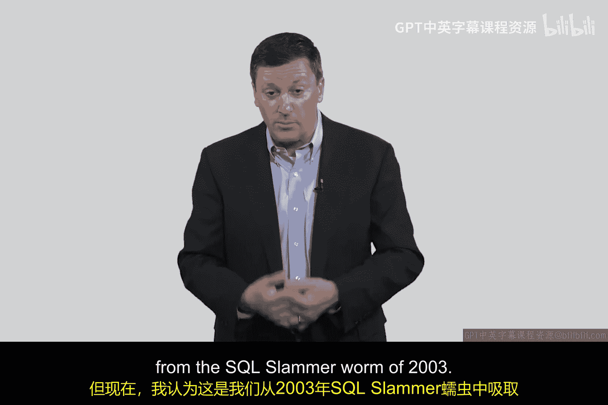

# 纽约大学《网络安全｜Introduction to Cyber Security》中英字幕（deepseek p28 28_2003年SQL Slammer蠕虫.zh_en -BV1TFLZzYE26_p28-

Hi， folks at Amarosso， I want to tell you a little bit about some issues that came up on the public internet in 2003。

 and let me start with a story。 right around January 2003。

 a lot of us were woken up on a Saturday morning a bunch of texts and calls and notices that the Internet was going nuts and in particular。

 it was the packets on a UDP port that were building up like crazy， just completely exploding。

 hitting gateways， taking out networks， taking out systems。 Now you recall in an earlier lesson。

 we talked about the way a worm program works。 And this issue in 2003 was called the Slammer worm was really one of the first。

Instaniations of a worm that would affect the whole Internet。 And you remember。

 there were three ways that a worm worked。 We find a system， copy the worm program to the system。

 and then remotely execute。 And a cascades， So what was happening in January 2003 is we were seeing the effects of this cascade across the Internet on UDp。

 So a lot of questions emerge number one， what do you do about it。 I mean。

 when there's UDp packets hitting a gateway。 The first question that any security administrator would have is' what's attracting this in。

 why are these UDp packets coming in。 Are they good， Are they errant is this denial of service。

 It's that kind of chaos that typically characterizes what happens during the defensive work when a worm is ongoing。

 Second thing that people noticed， I that a lot of the intrusion detection systems and defenses that you have for smallscale problems don't work for a worm。

 I mean， think about it on a small system when you have intrusion detection firewalls。

of things that are probably very familiar to you， particularly if you have them on your PC。

 they just don't work when there's a barrage of UDP packets coming at you。

 So it was one of the first times we all noticed back in 2003 that we had to come up with ways of doing intrusion detection and intrusion mitigation on a larger scale。

 meaning across the entire internet and this worm of 2003。

 this slammer worm really woke a lot of us up。 I mean， it just went nuts。

 Now a couple of interesting things about this worm one is that when we went back and looked when we looked at the metadata associated with this worm with UDP traffic on the internet。

 what we noticed is that the worm actually launched。

 you can see on the chart at the end of January the worm kind of spiked was gigantic increase in UDP traffic but thered been attempts earlier through the month of January presumably on the part of whoever was writing this worm to try to launch it sooner it was very interesting observation。

Because it gave us quite a bit of hope that perhaps by observing metadata in large scale on the internet。

 that might be the secret to intrusion detection， intrusion prevention a large scale So think about that。

 So instead of indicators on a system or an audit log on a PC or on a server question emerges。

 can you collect that kind of data on the internet。

 can you collect metadata at Internet gateways appearing points at places where service providers potentially are looking at public traffic and use that as an indicator that maybe be something's brewing way back in 2003 and I'm laughing because I'm guessing there may be some of you watching this weren't even born then but the 14 years ago we had that issue with this thing just exploding we learned a lot of lessons I'm just sort of to summarize here the slammerworm was one of the first times we saw broadcast cascade of a worm affect。

Internet infrastructure， second， it demonstrated that a lot of the techniques that we use in the small don't work in the large。

 are' just not going to be the same kind of effect。 And third。

 that maybe there's some hints in the early metadata collected across networks that something might be brewing。

 so this gave us a lot of hope in 2003 and led to a lot of companies and organizations and universities and researchers investing more time effort and money into something that we would now call large scale intrusion detection。

 intrusion prevention。 It's one of the ways that we stop other kinds of attacks service and so on we'll get to that in some later discussions。

 But for now I want you to understand that this Sql slammerorm was kind of the beginning of the modern era in large scale Internet service and Internet infrastructure attacks。

 so we'll get more into this in some additional videos but for now。

I think that's a key lesson that we take back from the SQL slammerorm of 2003。

 we'll see in the next video。

